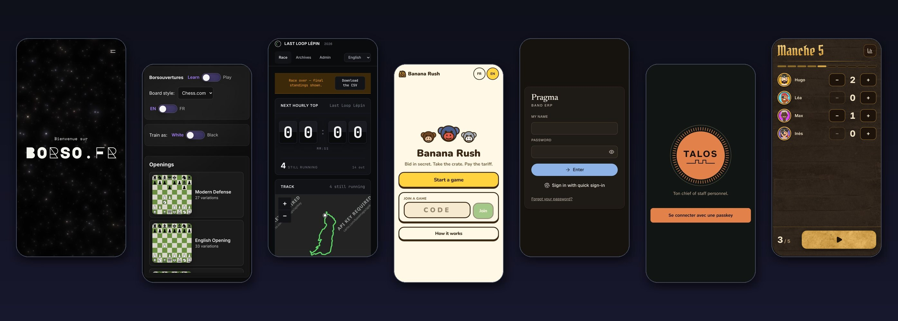
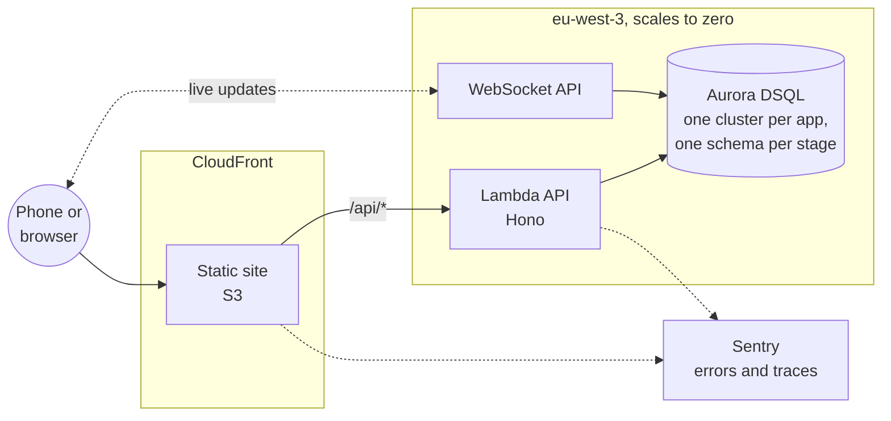
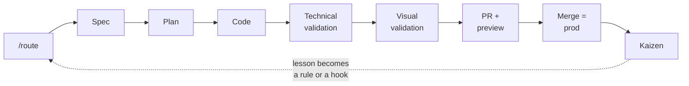

<div align="center">

# borso.fr

**Several apps, one operator, a team of AI agents.**

A personal monorepo where Claude Code agents ship features in parallel, each in its own sandbox,<br/>
onto serverless AWS that costs about a coffee a month while idle.

[](https://github.com/hugoleborso/borso.fr/actions/workflows/ci.yml)
[](https://github.com/hugoleborso/borso.fr/actions/workflows/deploy.yml)


[**Wiki**](https://github.com/hugoleborso/borso.fr/wiki) ·
[Docs](docs/README.md)

<br/>



</div>

## The apps

Each folder under `apps/` holds one app, and `ls apps` lists them. An app runs at `https://<slug>.borso.fr`, except `borso-fr`, which is the apex `https://borso.fr`. The first lines of an app's `README.md`, or of its `VOCABULARY.md` when it has no README, say what the app is.

Every page is built mobile first and works at 375 px wide. Every visible string exists in English and French.

## Architecture at a glance



- **Serverless only.** Lambda, DSQL, S3 and CloudFront all scale to zero. No VPC, no NAT, no containers. The idle bill targets €0.50 to €2 a month ([cost targets](docs/architecture.md#cost-targets)).
- **Shared constructs.** [`infra/cdk`](infra/cdk) (`@borso/infra`) holds the CDK constructs every app composes, held at 100% test coverage.
- **A preview per pull request.** Each PR deploys the apps it touches to `<app>-pr-<n>.preview.borso.fr`, with its own database schema cloned from prod. Closing the PR tears it down.
- **Keyless deploys.** GitHub Actions assumes one AWS role per trigger through OIDC. No long-lived AWS key exists.

Read more in [Architecture](docs/architecture.md) and [Deploy flows](docs/flows.md).

## How it is built

The operator says what to build. Agents do the rest, through a pipeline written as plain files in [`.claude/`](.claude).



Every lesson is turned into structure, so the next agent cannot repeat the mistake.

The lesson lands in one of these places. `eslint-rules/` holds the custom lint rules and `.claude/hooks/` the agent hooks. `docs/adr/` holds the architecture decisions, `docs/dantotsus/` the root-cause analyses and `docs/knowledge/` the knowledge entries. Run `ls` on a folder to see what it holds today.

The full story is in [How it is built](docs/how-it-is-built.md).

## Quick start

You need Node 24 (see [`.nvmrc`](.nvmrc)) and pnpm 10. With [corepack](https://nodejs.org/api/corepack.html) on, the `packageManager` field picks pnpm for you.

```bash
corepack enable
```

```bash
pnpm install
```

Run one app, with everything it needs:

```bash
pnpm --filter @borso-app/pragma dev
```

A full-stack app starts its site, its API and a seeded local Postgres together. The `[dev:db]` line prints the seeded sign-in when the app has one.

Common checks:

```bash
pnpm lint
```

```bash
pnpm typecheck
```

```bash
pnpm --filter @borso-app/pragma test:core
```

More in [Local development](docs/local-dev.md).

## Repository layout

`apps/<slug>/` holds one app. A static app has only `site/`. A full-stack app adds `api/`, `domain/` and `cdk/`. `infra/cdk/` holds `@borso/infra`, the shared CDK constructs, and `infra/shared/` the account singletons. Run `ls` at the root and in any folder to see what it holds. `CLAUDE.md` describes the layout for agents.

Each app opens on its own with `pnpm dev`. No app imports another.

## Ship a change

1. Branch, commit with [Conventional Commits](https://www.conventionalcommits.org) (scopes are the app slugs plus `infra`, `ci`, `docs`, `deps` and `meta`).
2. Open a pull request. CI runs the checks of what changed, and the preview deploys.
3. Check the preview, then merge. The merge deploys every changed app to production.

New app? Follow [Adding an app](docs/adding-an-app.md) or [Adding a full-stack app](docs/adding-a-fullstack-app.md).

## Documentation

The [wiki](https://github.com/hugoleborso/borso.fr/wiki) is the easiest way to read the docs. It is generated from this repository on every merge to `main` by [`scripts/wiki/build-wiki.ts`](scripts/wiki/build-wiki.ts), so edit the markdown here, never in the wiki. Its [Reports](https://github.com/hugoleborso/borso.fr/wiki/Reports) page holds the reports built from the code at that merge (hotspots, temporal coupling, convention drift, rule provenance, the blueprint index) and links the interactive [architecture maps](https://hugoleborso.github.io/borso.fr/), which the `architecture` workflow rebuilds on demand.

Every document lives under `docs/`, and [docs/README.md](docs/README.md) says how to find the one you need.
