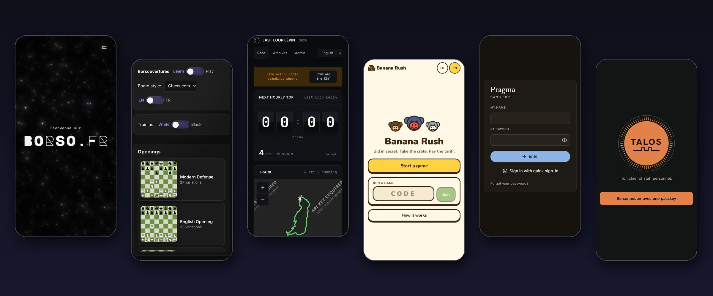
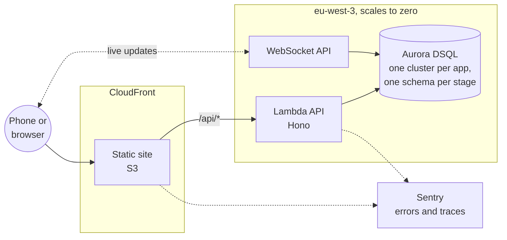
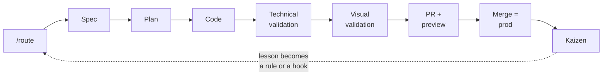

<div align="center">

# borso.fr

**Six apps, one operator, a team of AI agents.**

A personal monorepo where Claude Code agents ship features in parallel, each in its own sandbox,<br/>
onto serverless AWS that costs about a coffee a month while idle.

[](https://github.com/hugoleborso/borso.fr/actions/workflows/ci.yml)
[](https://github.com/hugoleborso/borso.fr/actions/workflows/deploy.yml)


[**Wiki**](https://github.com/hugoleborso/borso.fr/wiki) ·
[Architecture](docs/architecture.md) ·
[How it is built](docs/how-it-is-built.md) ·
[Decisions](docs/adr/README.md) ·
[Local development](docs/local-dev.md)

<br/>



</div>

## The apps

| | App | What it is | Stack |
| --- | --- | --- | --- |
| 🌌 | [**borso.fr**](https://borso.fr) | The landing site: a starfield, a Mondrian generator, a family corner. | Static site |
| ♟️ | [**Borsouvertures**](https://borsouvertures.borso.fr) | Learn and play chess openings. Works offline. | Static PWA |
| 🏃 | [**Last Loop Lépin**](https://last-loop-lepin.borso.fr) | Live race-day dashboard for a backyard ultra: hourly countdown, standings, course map, runners punching their own laps. | Full stack |
| 🍌 | [**Banana Rush**](https://banana-rush.borso.fr) | A party game of secret bids, played from phones in the same room, live over WebSocket. | Full stack, real time |
| 🎸 | [**Pragma**](https://pragma.borso.fr) | The band's private app: songs, setlists, practice sessions, takes, audience voting, and an MCP server so assistants can act on it. | Full stack, real time, PWA |
| 🏛️ | [**Talos**](https://talos.borso.fr) | A personal chief of staff: focus, todos, daily brief, a notes graph, push notifications, and a button that starts a Claude Code session. | Full stack, PWA, passkeys |

Every page is built mobile first and works at 375 px wide. Every visible string exists in English and French.

## Architecture at a glance



- **Serverless only.** Lambda, DSQL, S3 and CloudFront all scale to zero. No VPC, no NAT, no containers. The idle bill targets €0.50 to €2 a month ([cost targets](docs/architecture.md#cost-targets)).
- **Shared constructs.** [`infra/cdk`](infra/cdk) (`@borso/infra`) holds the CDK constructs every app composes, held at 100% test coverage.
- **A preview per pull request.** Each PR deploys the apps it touches to `<app>-pr-<n>.preview.borso.fr`, with its own database schema cloned from prod. Closing the PR tears it down.
- **Keyless deploys.** GitHub Actions assumes one AWS role per trigger through OIDC. No long-lived AWS key exists.

Read more in [Architecture](docs/architecture.md) and [Deploy flows](docs/flows.md).

## How it is built

The operator says what to build. Agents do the rest, through a pipeline written as plain files in [`.claude/`](.claude).



Every lesson is turned into structure, so the next agent cannot repeat the mistake.

| | |
| --- | --- |
| **50** custom lint rules | such as no `useEffect`, no type assertion, no SQL outside a repository |
| **25** agent hooks | that stop a known mistake before it runs |
| **61** architecture decisions | each with its options and criteria |
| **296** root-cause analyses | one per real defect, with its countermeasure |
| **146** knowledge entries | printed to an agent the moment a command matches one |

Counts measured on 2026-11-12. The full story is in [How it is built](docs/how-it-is-built.md).

## Quick start

You need Node 22 (see [`.nvmrc`](.nvmrc)) and pnpm 10. With [corepack](https://nodejs.org/api/corepack.html) on, the `packageManager` field picks pnpm for you.

```bash
corepack enable
```

```bash
pnpm install
```

Run one app, with everything it needs:

```bash
pnpm --filter @borso-app/pragma dev
```

A full-stack app starts its site, its API and a seeded local Postgres together. The `[dev:db]` line prints the seeded sign-in when the app has one.

Common checks:

```bash
pnpm lint
```

```bash
pnpm typecheck
```

```bash
pnpm --filter @borso-app/pragma test:core
```

More in [Local development](docs/local-dev.md).

## Repository layout

```text
apps/
  borso-fr/          static site
  borsouvertures/    static PWA
  last-loop-lepin/   site/ + api/ + domain/ + cdk/
  banana-rush/       site/ + api/ + domain/ + cdk/
  pragma/            site/ + api/ + domain/ + cdk/
  talos/             site/ + api/ + domain/ + cdk/
infra/
  cdk/               @borso/infra, the shared CDK constructs
  shared/            account singletons: OIDC, deploy roles, previews CDN, budgets
docs/                architecture, flows, standards, ADRs, root-cause analyses, knowledge
eslint-rules/        the project's own lint rules
scripts/             repository gates, reports, the wiki builder
.claude/             skills, agents, commands and hooks for Claude Code
```

Each app opens on its own with `pnpm dev`. No app imports another.

## Ship a change

1. Branch, commit with [Conventional Commits](https://www.conventionalcommits.org) (scopes are the app slugs plus `infra`, `ci`, `docs`, `deps` and `meta`).
2. Open a pull request. CI runs the checks of what changed, and the preview deploys.
3. Check the preview, then merge. The merge deploys every changed app to production.

New app? Follow [Adding an app](docs/adding-an-app.md) or [Adding a full-stack app](docs/adding-a-fullstack-app.md).

## Documentation

The [wiki](https://github.com/hugoleborso/borso.fr/wiki) is the easiest way to read the docs. It is generated from this repository on every merge to `main` by [`scripts/wiki/build-wiki.ts`](scripts/wiki/build-wiki.ts), so edit the markdown here, never in the wiki.

| Start here | Then |
| --- | --- |
| [Architecture](docs/architecture.md) | [Code standards](docs/standards/README.md) |
| [Deploy flows](docs/flows.md) | [Architecture decisions](docs/adr/README.md) |
| [How it is built](docs/how-it-is-built.md) | [Root-cause analyses](docs/dantotsus) |
| [Local development](docs/local-dev.md) | [Knowledge](docs/knowledge/README.md) |
| [AWS setup](docs/aws-setup.md) | [Agent instructions](CLAUDE.md) |
