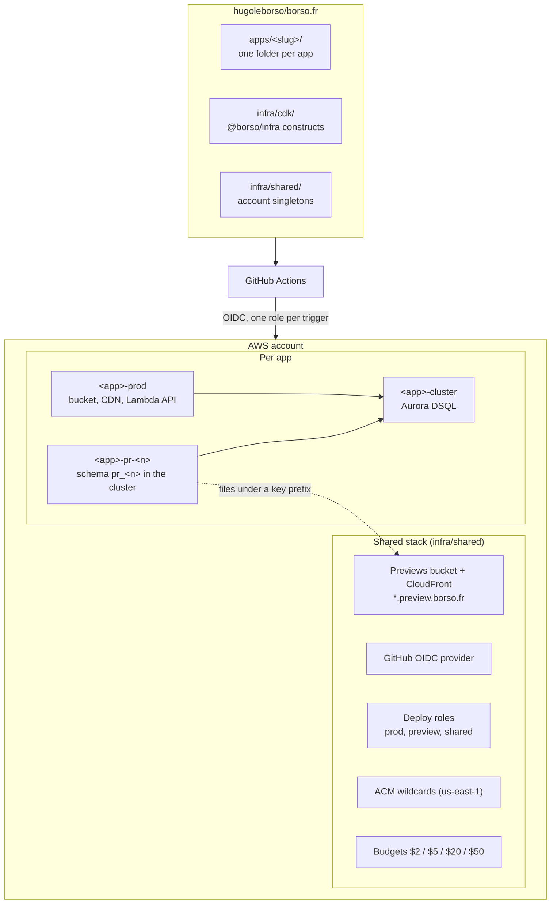

# Architecture

## Topology

One AWS account. Two regions:

- **`eu-west-3` (Paris)** is the primary region. Everything runs here: Lambda, DSQL, S3, CloudFront, Route 53.
- **`us-east-1` (N. Virginia)** holds only the ACM wildcard certificates, because CloudFront reads its certificates from this region.

A static app (`borso-fr`, `borsouvertures`) is one `<app>-prod` stack with its own bucket and distribution. A full-stack app adds a Lambda API and a schema in its own DSQL cluster, which a separate `<app>-cluster` stack owns so a preview never depends on the prod stack's lifecycle.

## Constructs (`@borso/infra`)

| Construct | What it makes | Used by |
| --- | --- | --- |
| `StaticSite` | Prod: a dedicated S3 bucket, a CloudFront distribution and a Route 53 alias. The bucket is named `<app>-prod`, or `<app>-prod-<account id>` with `bucketNameSuffix: 'account'` when the short name is taken in S3's global namespace. Preview: uploads to the shared previews bucket under a key prefix, which the host-routing function serves. | Every app. |
| `LambdaApi` | One ARM64 Lambda behind one HTTP API, served under `/api/` on the site's own host. CORS preflight, error alarm, single-handler routing (Hono). | Full-stack apps. |
| `WebSocketChannel` | An API Gateway WebSocket API whose handler records connections in the app's database, so the API can push to open clients. | `banana-rush`, `pragma`. |
| `DsqlCluster`, `DsqlClusterStack` | One Aurora DSQL cluster per app, deletion-protected, in its own `<app>-cluster` stack. Publishes its ARN and endpoint to `/borso/<app>/dsql-cluster-{arn,endpoint}`. | Full-stack apps. |
| `DsqlClusterBackup` | A daily AWS Backup plan for the cluster, when the cluster stack asks for one. | `talos`, whose restore drill runs on demand (`talos-restore-drill.yml`). |
| `DsqlSchema` | One Postgres schema per stage in the app's cluster. Forward-only migrations, advisory-locked, `DROP ... CASCADE` when the stack is deleted. | Full-stack apps. |
| `DsqlAgentReader` | A Lambda reachable only through `lambda:InvokeFunction`, which runs one `SELECT` as a read-only role. This is how an agent reads production (`scripts/db-read.sh`). | `pragma`, `last-loop-lepin`, `banana-rush`. `talos` answers its own `POST /api/agent/sql`. |
| `PhotosCdn` | A bucket and distribution for user photos at `photos-cdn.borso.fr`. | `last-loop-lepin`. |
| `PreviewableApp` | Composes the site, the API and the schema for one stage. | Full-stack apps. |

## Stages

`Stage = 'dev' | 'preview' | 'integ' | 'prod'`. The `'dev'` marker is for app code only (it chooses the local Postgres connection); the constructs and naming helpers reject it through `assertDeployStage`.

All stages of an app share that app's DSQL cluster, isolated as separate Postgres schemas:

| Stage | Where | Stack name | DSQL schema (in the app's cluster) |
| --- | --- | --- | --- |
| `dev` | local | never deployed | local Postgres, started by `pnpm dev` |
| `preview` | AWS, per PR | `<app>-pr-<n>` | `pr_<n>` |
| `integ` | reserved, unused here | `bp-integ-pr-<n>-<app>` | `integ_<n>` |
| `prod` | AWS | `<app>-prod` | `prod` |

`talos` deploys to prod only and gets no preview ([ADR-2026-10-06T2302](./adr/2026-10-06T2302-talos-deploys-to-prod-only.md)).

## Cost targets

The idle bill targets **€0.50 to €2 a month**, dominated by the Route 53 hosted zone (€0.50 fixed). It holds because:

- **Lambda, DSQL, S3 and CloudFront all scale to zero.** No idle compute.
- **No NAT, no VPC, no Fargate, no ALB, no ECS, no EC2, no RDS.**
- **CloudFront PriceClass 100** (North America and Europe only).
- **Lambda is capped** at `reservedConcurrentExecutions: 10`, ARM64, 512 MB, 7-day log retention.
- **The previews bucket** expires objects after 60 days, a safety net for orphaned PR uploads.

AWS Budgets alerts at $2, $5, $20 and $50 a month, in USD because Budgets only accepts USD. The shared stack refuses to synthesise without `BORSO_BUDGET_EMAIL`.

## Where this differs from a typical AWS setup

- **One account.** Isolation comes from per-stage stacks and scoped deploy roles, not separate AWS accounts. The merge to `main` is the prod gate, and only the operator merges.
- **DSQL, not RDS.** Aurora DSQL speaks the Postgres wire protocol, scales to zero and has a usable free tier. The trade-off is no foreign keys, optimistic concurrency and retryable transactions.
- **One Lambda per API.** Each `LambdaApi` is one Lambda doing its own routing with Hono. That is simpler to run than an HTTP API fanning out to many Lambdas.
- **Preview front ends share one bucket and one CDN.** A distribution per PR would be slow and expensive, so the shared `*.preview.borso.fr` distribution routes by `Host` header to an S3 prefix through a CloudFront Function.
- **Agents read production through IAM, not a password.** `DsqlAgentReader` is invoked with SigV4, so no secret exists whose theft alone grants access.

## Observability

Every app reports to Sentry: errors, traces at sample rate 1.0, and source maps uploaded at build ([ADR-2026-11-11T1903](./adr/2026-11-11T1903-every-app-traces-to-sentry-at-full-rate.md), [ADR-2026-11-11T1658](./adr/2026-11-11T1658-lambda-source-maps-go-to-sentry-not-into-the-bundle.md)). The pragma API also logs one wide event per request ([ADR-2026-11-11T1318](./adr/2026-11-11T1318-pragma-api-emits-one-wide-event-per-request.md)).

## Standalone-openability invariant

Each `apps/<slug>/` folder is self-contained: `cd apps/<x> && pnpm dev` works on a fresh checkout, the IDE resolves imports, tests run from inside the folder. **No cross-app imports.** Sibling apps do not appear in IntelliSense.

The exceptions live at the repo root by design: `pnpm-workspace.yaml` (with the dependency catalog), `package.json`, `.oxlintrc.json`, `.oxfmtrc.json`, `commitlint.config.js` and the husky hooks. Each is the single source of truth for its concern.
