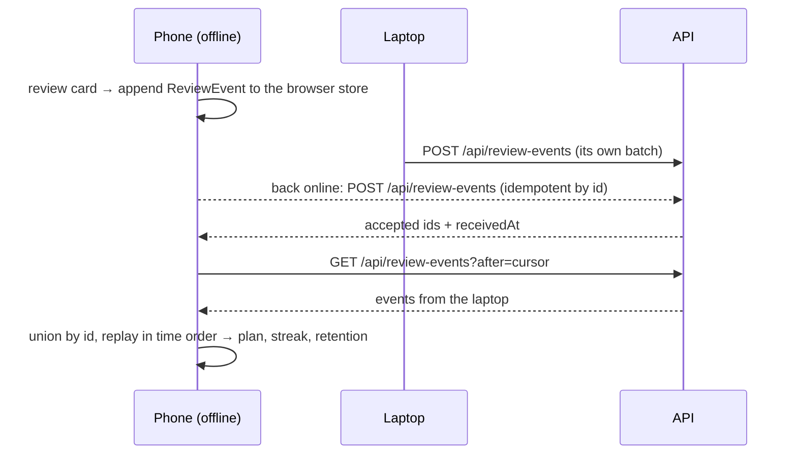

# Train my openings every day, and keep my progress on every device

## Perspectives confronted

The operator took eight decisions on 2026-11-12 and then delegated the remaining product calls to the agent, so no question blocks. Each call the agent took is marked "agent, 2026-11-12, reversible" below. No `> ⚠️ Missing` flag remains, because each perspective was examined against the live workspace.

- [x] **Client / business.** The operator is the client. He decided the audience (one synced account, everyone else local), the objective (deck retention), the level (1200 to 1600) and the launch decks.
- [x] **Product.** The home screen, the navigation priority and the content are decided. Grading, the daily limit, the day boundary and the place of name cards were taken by the agent.
- [x] **Tech-lead.** Sync and a back end are decided. The proposed design broke in five places under this hat, listed in the first rows of the decisions table.
- [x] **Developer.** The operator required a fully autonomous test strategy and one branch whose slices are commits. Every rule lands in a gated `*.core.ts` or `*.utils.ts` file.
- [x] **Designer.** Every screen is drawn for 375 px below. No mock-up was reviewed by a person, so `/visual-validation` at 375 px is the only design gate (stated, not hidden).

## Why

The operator opens the app, drills a variation and forgets it, because nothing asks him again and nothing follows him from his phone to his laptop. The app stores one localStorage record and no progress (measured in `site/src/state/persistedState.utils.ts` and `VOCABULARY.md`). This feature turns it into a daily trainer. A few hand-curated decks, a scheduler that asks each card again when it is about to be forgotten, and progress that syncs for him and stays in the browser for everyone else.

- **Output metric.** Deck retention, the share of due cards recalled on the first try, per deck and per week. It moves over months and no gate asserts it.
- **Input metrics.** (a) A reader finishes today's review session and the due count reaches 0. (b) A review made offline on one device appears on a second device after both come online. (c) Every launch deck builds from its content files with no code change.
- **Field observation.** The earlier spec deferred spaced repetition because it "needs persistence we don't have yet" (read in `learn-by-tree/spec/spec.md`, Q2 and Q4). The Albin Countergambit sits as one variation among 45 inside "Queen's Gambit Declined", and 12 of its 13 lines stop at 10 plies or fewer (measured on the shipped `openings.json`). Deck lines default to 6 to 10 moves, which is 12 to 20 plies.
- **The operator's games** (measured by the coordinator's analysis of the Chess.com public API, 1,127 games from 2025-12-03 to 2026-11-12, of which 1,102 bullet). His ratings are rapid 1304, blitz 1322 and bullet 1016 (read in the aggregates file). As White he plays 1. e4 in 560 of 563 games. The Italian scores 46.6% over 132 games. Against the Sicilian, 2. Nc3 scores 58.7% over 23 games and 2. Nf3 42.2% over 58. Against the Caro-Kann, the Two Knights scores 47.6% over 42 games. As Black he plays the Scandinavian with 2...Qxd5 and 3...Qa5 in all 346 games against 1. e4 and scores 55.9%. His weak spot there is 2. Nf3, the Tennison Gambit, at 34.2% over 19 games. Against 1. d4 he scores 49.4% over 161 games, always with 1...d5. The Albin already appears 33 times at 51.5%, the London 42 times at 48.8%, and 2...Nc6 against 2. Nf3 scores 38.0%. Only 7 of 535 losses end before move 15, so early traps are not his problem (inferred).

## Result

Four tabs in a bottom bar, each at least 44 px high. **Today** is the home screen. Its retention list sits in its own section tab, by the fold rule in `apps/borsouvertures/DESIGN.md`.

```
┌────────── 375 px ──────────┐   ┌────────────────────────────┐
│ Borsouvertures          ⚙  │   │ Albin Countergambit · 3/14 │
│ [ Session ][ Retention ]   │   │      [ board, Black ]      │
│  12 due   5 new   🔥 6 days│   │ White played 3. dxe5       │
│  ┌──────────────────────┐  │   │ Your move                  │
│  │        Start         │  │   │ ── after the answer ───────│
│  └──────────────────────┘  │   │ Idea: the d4 pawn cramps   │
│                            │   │ White's queenside …        │
├────────────────────────────┤   │ [ Show the move ] [ Next ] │
│ Today  Decks  Stats  Explore│  └────────────────────────────┘
└────────────────────────────┘
```

- **Decks.** One row per deck with its side, card counts and retention. A deck page shows its lines, its ideas, *Review this deck*, and *Play it against Stockfish*.
- **Stats.** Retention per deck by week over 12 weeks, the streak, and accuracy per opening. Counters appear here when move statistics exist.
- **Explore.** The existing learn and play screens over the whole catalogue, split into section tabs by the fold rule so each state fits one phone screen. Nothing done there creates a review.
- **Account.** A sign-in link in the settings sheet, which the gear in the top bar opens (operator delegation, 2026-11-13: the phone-first redesign keeps the top bar at 48 px). There is no sign-up. A reader without an account sees every screen.
- **Credits.** A screen naming Lichess (CC0), Wikipedia (CC BY-SA 4.0) and Stockfish (GPL-3.0, with its source link). The app ships no attribution today (measured, no match in `site/src`).
- **Audience.** Public at `borsouvertures.borso.fr`. The API serves one account.

## Use cases / edge cases



Happy path:

1. The reader opens the app. Today shows the due count, the new count, the streak and Start.
2. Start opens a session in review mode. Due cards come first, then new cards up to the daily limit.
3. A move card shows a FEN of the deck and replays the opponent's last move. The reader plays the book move. The card is recalled, and its idea appears.
4. A move outside the deck, or a tap on *Show the move*, marks the card missed. The book move is shown and the card returns later in the same session.
5. A name card shows a FEN and four opening names. A trap card plays the opponent's move, then the reader plays the whole solution.
6. At the end the screen shows the session's recalled share and tomorrow's due count.
7. On a deck page the reader starts a game. The auto opponent plays the deck's moves, then Stockfish at the chosen strength once the deck ends. The game creates no review.
8. The operator signs in. His local events are pushed, the account's events are pulled, and every screen recomputes.

Edge cases:

- Nothing due and no new card left. Today says so and offers a deck to review ahead. A review of a card that is not due is stored and does not count in retention.
- The same card is reviewed on two offline devices. Both events are kept and replayed in time order. The second one found the card not due, so retention ignores it.
- A deck file is removed. Its events stay stored and stop being replayed. Restoring the file restores the history.
- The reader changes time zone. Each event keeps the calendar day of the device that made it.
- Sign-out keeps the local events and stops syncing.
- The Stockfish worker is not cached and the device is offline. The game ends where the deck ends, with a message.
- A deck has no matching puzzle. It ships with no trap card.

Error cases:

- The browser store cannot open (private mode, quota). The session runs in memory and a banner says progress will not be kept. Sync still pulls every page into the open tab, and its cursor stays in memory, because the events it covers are not stored.
- A push is refused with a 4xx. The batch stays queued, the banner shows "sync paused", and Sentry receives it.
- The session cookie expired. The API answers 401, a band under the top bar says the session expired, its *Sign in* button opens the settings sheet on the sign-in form, and reviews continue locally.
- A device clock runs ahead. The server keeps its own `receivedAt` and the replay uses the earlier of the two.

## Questions, Options and Decisions

| Question | Options | Decision (date) |
| --- | --- | --- |
| Where does the proposed design break? | See the next five rows. | Recorded 2026-11-12. |
| Can the dataset's lines, pruned by popularity, be the deck? | (a) Yes. (b) Hand-curated lines in content files. | **(b), agent, reversible.** The dataset lines are too short (measured above). A deck also needs exactly one reader move per FEN, and the dataset offers three bishop moves in the Albin Fianchetto Variation (measured). Popularity can only prune the opponent's moves. |
| What groups lines into a deck? | (a) Name prefix, as today. (b) One deck per `Family: Variation` name, 587 decks (measured). (c) A deck file that names a side and its lines from move 1. | **(c), agent.** A gambit becomes a deck because a file says so. Decks are found by a glob over `content/decks/*/deck.json`, so adding or removing a deck needs no code change (operator requirement). |
| Do three card kinds share one scheduler and one retention figure? | (a) All kinds inside each deck. (b) Move and trap cards in their deck, name cards in a deck of their own. | **(b), agent, reversible.** Naming an opening is another skill, and mixing it would blur per-deck retention. |
| Is pragma's shared-password ADR the sign-in precedent? | (a) Shared password, ADR-2026-05-19T1955. (b) pragma's current per-credential slice. (c) Passkey only. | **(b) without passkeys, agent.** The shared-password ADR is superseded by [ADR-2026-09-14T1903](../../../../adr/2026-09-14T1903-per-member-credentials-replace-the-shared-password.md) (read). The slice is copied, because apps do not import each other. One `operator_credential` row, an argon2id hash, a signed `HttpOnly` cookie and a rate limit. No route enrols anyone, because on a public site a first-caller rule lets a stranger take the account. A script the operator runs writes the row on prod, and the fixture seed writes it on a preview ([ADR-2026-11-13T0002](../../../../adr/2026-11-13T0002-the-operator-credential-is-written-by-a-script-and-no-route-enrols.md)). |
| Can analytics events measure the objective? | (a) Sentry breadcrumbs. (b) The `review_event` table. | **(b), agent.** A breadcrumb leaves the browser only with an error (inferred from the `observability-adapter` blueprint). Retention is read from the table for the operator and is unknown for readers without an account. |
| What are the launch decks? | Operator decision 5, revised 2026-11-12. | **Decided, five decks, settled by his game statistics.** (1) Black, the Albin Countergambit with answers to 2. Nf3, the London and 2. e3. (2) Black, the Scandinavian with 3...Qa5. Its main line is short and the weight is on the side lines, the Tennison Gambit first, then 2. d4, 2. d3, 2. Nc3 and 2. e5. (3) White, the Caro-Kann Two Knights Attack. (4) White, the Vienna Game and Vienna Gambit. (5) White, the Grand Prix Attack with 2. Nc3. Each has hand-written ideas. |
| How long is a deck line? | (a) 8 to 12 moves, the first decision 6. (b) 6 to 10 moves. | **(b), revised 2026-11-12** to match a 1300 player. It is a default in the deck build, and a deck file may exceed it. |
| Which White opening replaces the Italian Game (1. e4 e5 2. Nf3 Nc6 3. Bc4), which the operator finds bland? | (a) The Vienna Game and Vienna Gambit. (b) The Scotch Game. (c) The King's Gambit. | **(a), agent, reversible by deleting a deck folder.** 2. Nc3 is the same second move as his Two Knights Attack against the Caro-Kann. |
| Does a Grand Prix Attack deck against the Sicilian ship? | (a) Yes. (b) No. | **(a), decided 2026-11-12.** His 2. Nc3 already outscores his 2. Nf3 against the Sicilian (measured above). It is one deck folder. |
| How is a review graded? | (a) Automatic and binary. (b) The reader picks one of four grades. | **(a), agent, reversible.** The objective is "recalled on first try", which is binary. Recalled maps to the scheduler's Good and missed to Again. Showing the move counts as missed. |
| How many new cards per day? | (a) 5. (b) 10. (c) 20. | **(b), agent, reversible.** 10 is a guess. It is a setting from 0 to 30, kept on the device. |
| What is a day for the streak? | (a) UTC. (b) Europe/Paris, as pragma. (c) The device's calendar day, stamped on the event. | **(c), agent, reversible.** The streak is the run of consecutive calendar days holding a review, ending today or yesterday. A stamped day is the same on every device after sync. |
| What is the event and sync shape? | (a) Mutable card rows, last write wins. (b) Immutable review events merged by id. | **(b), operator design kept.** The types are under Changes. Card state, plan, streak and retention are replayed from events and never stored. The scheduler runs with fuzz off so every device computes the same state. |
| How are two devices and a wrong clock reconciled? | (a) Trust the device clock. (b) Reject skewed events. (c) Keep both times and replay on the earlier. | **(c), agent.** A rejected event would stay queued forever. A clock running behind cannot be detected and is accepted. The pull re-reads a one-minute overlap and removes duplicates by id. |
| Where is progress stored in the browser? | (a) localStorage. (b) IndexedDB through one adapter. (c) The `idb` library. | **(b), agent.** No runtime dependency. `fake-indexeddb` (Apache-2.0, measured on npm) is a dev dependency for the adapter's tests. |
| Where do move statistics come from? | (a) The Lichess explorer API with a personal token at build time. (b) The CC0 game dumps, size unknown. (c) None. | **(a) as an optional slice, agent.** The API answered 401 without a token (measured by the research agent). The script reads `LICHESS_TOKEN`, writes only the FENs of the decks to a committed `move-statistics.json`, and records the fetch date and filters in it. Without the token the slice is skipped and nothing else depends on it. The file's size is unknown until it is built. |
| How are ideas keyed and written? | (a) JSON keyed by FEN. (b) One Markdown file per deck and language, each heading a SAN path. (c) i18n catalogues. | **(b), agent.** The build turns each path into a position key, the first four FEN fields, so transpositions share an idea. It fails when English and French differ in keys, and when two paths reach one key with different text. Ideas are content, so they stay out of `en.json` (a stated divergence from the i18n rule). A file based on Wikipedia carries its source and is CC BY-SA 4.0. |
| How is hand-written chess checked? | (a) Legality only. (b) Legality, plus a Stockfish check that no reader move loses more than a set margin against the best move. | **(b), agent.** An agent writes the lines, so a gate has to read them. The margin is set in the plan. |
| What are the engine's obligations? | (a) Stockfish as an unmodified, separate worker file. (b) Bundled into the app. (c) No engine. | **(a), agent.** `stockfish` is GPL-3.0 (measured on npm, version 19.0.1). The licence text, the notice and a link to the exact upstream source ship in `THIRD_PARTY_NOTICES.md` and on Credits. The app talks to it by UCI messages only, so it is treated as a separate program (inferred, not legal advice). The repository has no licence file (measured). The lite single-threaded build is two files, 28,230 and 1,845,971 bytes, and needs no cross-origin isolation header (measured in the npm tarball and read in its README on 2026-11-12). They are committed, not installed, because the package tarball is 161 MB (measured). |
| How strong is the opponent? | `UCI_Elo` floors at 1320 (measured, the engine prints min 1320 and max 3190, and `Skill Level` 0 to 20). | **Default 2000, operator, 2026-11-13.** The agent first picked 1320, the floor beside his rapid 1304. The operator asked for an opponent stronger than him. Selectable from 1320 to 2500, and three easier steps through `Skill Level`, shown without a rating. |
| Is the Lichess data pinned? | (a) `refs/heads/master`, as today (measured in `build-openings.ts`). (b) A commit SHA. | **(b).** The puzzle import records the dump's date the same way. |
| Are Lichess studies a source? | The earlier spec planned an importer and called them CC BY-SA. | **No.** Studies carry no reuse licence (measured by the research agent). That importer was never built (measured, no such file). |
| How does Explore become practical, and how does a line found there reach the reader's reviews? | (a) Keep the learn and play screens. (b) An open explorer over the shipped book, with a personal deck fed from it. | **(b), operator, 2026-11-13.** Explore shows the board with arrows and a list of the book moves, grouped by what each leads to (openings, then variations, then lines), and the last named opening above the board. The board takes any legal move, and off the book the screen says so and keeps the last name. *Add to my deck* puts the line in "My lines" for the side he plays, refused when it holds no move of his, is already there, or gives him a second move at a position of the deck. Its cards show the opening name in place of an idea and come up from the next day, outside the new card limit. The five commented decks are unchanged. The deck is a log of line events synced like reviews ([ADR-2026-11-13T1619](../../../../adr/2026-11-13T1619-borsouvertures-personal-deck-is-a-log-of-line-events-merged-by-id.md)). The deck game's book move is picked with a weight of one per deck line through it (2. c4 comes up 7 times in 13 in the Albin deck, measured on the built decks). |

**Out of scope:** sign-up and other accounts, passkeys, synced settings, push reminders, a paid LLM at runtime, Lichess studies, editing a deck in the app. **Next decks**, out of this pull request: White against the Scandinavian, White against the Pirc and Modern, and 1...b6. **Endgames** are out of this pull request. Once trap cards exist, an endgame deck costs one theme filter in the deck file and one content file (inferred), so it is cheap and not free. It has no entry line and no idea, and it would add a retention figure that is not about openings.

## Architectural choices

Six ADRs are written, one per row. The agent decided them on 2026-11-12, delegated by the operator, and they are ratified at pull-request review.

| ADR | Decision | What it constrains downstream |
|---|---|---|
| [ADR-2026-11-12T2359](../../../../adr/2026-11-12T2359-borsouvertures-becomes-a-full-stack-app-for-one-account.md) | borsouvertures gains `api/`, `cdk/`, `domain/` and a DSQL schema for one account | `StaticSite` becomes `PreviewableApp`. Previews get a schema. It reverses "no DSQL, no auth" in the earlier spec. |
| [ADR-2026-11-13T0002](../../../../adr/2026-11-13T0002-the-operator-credential-is-written-by-a-script-and-no-route-enrols.md) | Operator sign-in copies pragma's credential and cookie slice, with no enrolment route. A script writes the one row on prod and the fixture seed writes it on a preview | New secret material (an HMAC key and a hash, in the database). No passkey. Recovery is a rerun of the script. A preview clones nothing from prod. |
| [ADR-2026-11-13T0000](../../../../adr/2026-11-13T0000-progress-is-a-log-of-immutable-review-events-merged-by-id.md) | Progress is a log of immutable review events, local first, merged by id | No stored card state anywhere. IndexedDB adapter. `fake-indexeddb` dev dependency. |
| [ADR-2026-11-13T0001](../../../../adr/2026-11-13T0001-ts-fsrs-schedules-the-cards-with-fuzz-off.md) | `ts-fsrs` schedules the cards | MIT, 6.0.0, Node 24 or later, with one dependency, `@open-spaced-repetition/srs-kit` 1.0.0, BSD-3-Clause (measured on npm). Fuzz off, every option pinned. |
| [ADR-2026-11-13T0003](../../../../adr/2026-11-13T0003-stockfish-runs-as-two-vendored-unmodified-gpl-worker-files.md) | Stockfish runs as a separate GPL-3.0 worker, two committed and unmodified files | Notices and source link. Loaded on demand, cached by the service worker after first use. 1,874,201 bytes in git (measured). |
| [ADR-2026-11-13T0004](../../../../adr/2026-11-13T0004-decks-and-ideas-are-content-files-and-lichess-data-is-pinned.md) | Decks, ideas and Lichess-derived files are content, built and pinned | `LICHESS_TOKEN` is read by one script, never by CI or the deployed app. Attribution duties. Ideas outside the i18n catalogues. |

## Changes

### Vocabulary changes to `VOCABULARY.md`

- **Add** deck, card (kinds `move`, `name`, `trap`), review, review event, due, new, daily plan, streak, retention, idea, position key, account, explore.
- **Outcome** is `recalled` or `missed`. "Out of book" stays the word for a move. "Wrong", "mistake" and "quiz" stay banned.
- **Session** gains a third mode, `review`. Today's session is a session in review mode.
- **Auto opponent** gains a move source, `book` then `stockfish`. Identifiers say `stockfish`. "Engine", "bot" and "AI" stay banned as domain nouns.
- **Position** stays banned for a stored value. The stored value is a `positionKey`.
- **Repertoire** and **family** stay banned. A name card asks for the **opening**. "Puzzle" names only the Lichess source row.
- **Fix** the opening paragraph (no server, no account) and the counts. The file says 1837 lines and 477 variations, the dataset holds 2313 and 587 (measured).

### Types / domain model

```ts
// domain/review-event.core.ts, read by the site and the API
type CardKind = 'move' | 'name' | 'trap';
type ReviewOutcome = 'recalled' | 'missed';
type PositionKey = string;            // first four FEN fields
type CardId = string;                 // `move:<deckId>:<positionKey>` | `name:<positionKey>` | `trap:<puzzleId>`
type CalendarDay = string;            // YYYY-MM-DD on the device
interface ReviewEvent {
  id: string;                         // UUID made on the device, the merge key
  cardId: CardId;
  outcome: ReviewOutcome;
  reviewedAt: string;                 // device instant, ISO 8601
  calendarDay: CalendarDay;
  deviceId: string;
  receivedAt: string | null;          // server instant, null until pushed
}
// content, parsed at build
interface Deck { id: string; nameKey: string; side: Side; lines: DeckLine[]; trapFilter?: { openingTags: string[] } }
interface DeckLine { name: string; movesSan: string[] }   // main line first
interface Idea { positionKey: PositionKey; en: string; fr: string; source?: 'wikipedia' }
// derived, never stored
interface CardState { cardId: CardId; dueAt: string | null; stability: number; difficulty: number; lapses: number }
interface DailyPlan { day: CalendarDay; dueCardIds: CardId[]; newCardIds: CardId[] }
interface DeckRetention { deckId: string; weekStart: CalendarDay; dueReviews: number; recalled: number }
```

A FEN held by two decks belongs to the first deck in file order, so it is one card.

### Database changes

```sql
CREATE TABLE review_event (
  id uuid PRIMARY KEY,               -- uniqueness held by the key, as DSQL requires
  card_id text NOT NULL, outcome text NOT NULL,
  reviewed_at timestamptz NOT NULL, calendar_day text NOT NULL,
  device_id uuid NOT NULL, received_at timestamptz NOT NULL);
CREATE INDEX ASYNC review_event_received ON review_event (received_at, id);
CREATE TABLE operator_credential (id uuid PRIMARY KEY, password_hash text NOT NULL,
  session_epoch integer NOT NULL, created_at timestamptz NOT NULL);
CREATE TABLE app_config (id text PRIMARY KEY, hmac_key text NOT NULL);
CREATE TABLE sign_in_attempt (address_hash text PRIMARY KEY,  -- one atomic counter per address
  attempt_count integer NOT NULL, window_started_at timestamptz NOT NULL);
```

There is no account column, because there is one account. A preview clones nothing from prod, so it never carries the credential or the operator's events (ADR-2026-11-13T0002).

### Files to change

```
apps/borsouvertures/
  content/decks/<deck-id>/deck.json, ideas.en.md, ideas.fr.md   // NEW, five launch decks
  scripts/build-openings.ts            // UPDATE: pin a commit SHA
  scripts/build-decks.ts, check-decks.ts, build-traps.ts, build-move-statistics.ts   // NEW
  domain/review-event.core.ts, position-key.core.ts, calendar-day.core.ts            // NEW
  site/src/decks/      deck.utils, card.core, idea.utils, pawn-structure.core        // NEW
  site/src/review/     scheduler.core, daily-plan.core, streak.core, retention.core,
                       review-machine.utils, review-event-store.adapter, sync.core, sync.adapter   // NEW
  site/src/opponent/   stockfish.adapter, opponent-strength.core                     // NEW
  site/public/stockfish/   the two engine files and Copying.txt, unmodified          // NEW
  site/src/components/ Today, Decks, Stats, Credits, SignIn, TabBar                  // NEW
  site/src/state/persistedState.utils.ts, i18n/en.json, fr.json, vite.config.ts      // UPDATE
  api/src/auth/*, api/src/review-events/* (controller, service, repository, schema), database/   // NEW
  cdk/lib/stack.ts, bin/app.ts, drizzle.config.ts, vitest.config.ts (core, back-e2e, site)      // NEW or UPDATE
  VOCABULARY.md, README.md, THIRD_PARTY_NOTICES.md                                   // UPDATE or NEW
docs/operator-backlog.md, scripts/database/read-target.utils.ts, .github/path-filters.yml   // UPDATE
scripts/seed-operator-credential.sh                                                         // NEW
```

### Slices, in commit order

1. **Local decks.** Deck and idea build, the Albin deck with its 1. d4 side lines, move cards, the scheduler, the browser store, Today, Decks, the tab bar, Explore, Credits, the dataset pin. Usable alone.
2. **The other launch decks.** One content commit per deck.
3. **Stats and streak.**
4. **Name cards and trap cards.**
5. **The Stockfish opponent.**
6. **Sync.** `domain/`, `api/`, `cdk/`, sign-in.
7. **Move statistics and counters.** Only if the token exists.

Cut first, in this order: rule-derived notes, slice 7, trap cards, name cards, slice 5. Trap cards rank below move cards and their ideas, because early traps are not where he loses (inferred above). Sync is an operator decision and is never cut.

### Test strategy

Every check is automated. No manual check exists.

- **Unit, 100% coverage.** Every `*.core.ts`, `*.utils.ts`, `*.adapter.ts` and `*.schema.ts` above. The scheduler replay takes `now` as an argument. Named cases: two devices replayed in either arrival order give the same state, a future `reviewedAt` is clamped, a not-due review leaves retention unchanged, the streak across a time-zone change, an en passant square that changes a position key.
- **Content gates.** `build-decks` fails on an illegal move, two reader moves for one FEN, a missing translation, or an idea whose path is in no deck. `check-decks` runs Stockfish over every reader move.
- **Back e2e, real Postgres.** A pushed batch is idempotent. A pull returns only events after the cursor. `POST /api/auth/enrol` answers 404, and a sign-in before the credential exists answers `auth-not-bootstrapped`. An unsigned request gets 401. The sixth failed sign-in is rate limited.
- **Site.** Component tests by role for Today, a review session and the tab bar.
- **Visual validation, at 375 px and at desktop width, input metrics only.** Each numbered step, edge case and error case above is one row. Further rows: every tab fits 375 px with no horizontal scroll, the interface and the ideas switch between English and French, Credits names three sources, an Explore drill leaves the due count unchanged, a review made in one browser profile shows in a second after sign-in. The output metric is not asserted.
- **Technical validation.** Lint, typecheck, build, the suites above and one pass per decision row.

## Production strategy

### Analytics

**Input metrics.** The observability adapter gains a closed union of events: `review_session_started`, `review_session_completed`, `card_reviewed`, `new_cards_introduced`, `deck_opened`, `opponent_game_started`, `opponent_left_deck`, `sync_completed`. They are breadcrumbs, so they give context to an error and are not counts. The counts come from `review_event`, read with `APP=borsouvertures scripts/db-read.sh`: reviews per day, days with a completed plan, and the delay between `reviewed_at` and `received_at`. Success is a completed plan on 5 of 7 days over a rolling four weeks (a target, set by the agent).

**Output metric.** Deck retention per deck and week, from the same table and on the Stats screen. The operator reads it monthly. If the plan is completed and retention falls, the scheduler settings or the content are wrong. Retention for readers without an account is not measured.

### Zero-defect strategy

- `DeckContentInvalidError`. A built deck file fails to parse at load. Tag `deckId`. Alert on the first occurrence in prod.
- `ReviewEventStoreUnavailableError`. IndexedDB cannot open or write. Tag `operation`. Alert at 5 in a day.
- `SyncRejectedError`. A push or pull gets a 4xx other than 401. Tags `status`, `route`. Alert on the first occurrence, because queued events stay on one device.
- `StockfishLoadFailedError`. The worker fails to load or to answer `uci` in time. Tag `online`. Alert at 5 in a day.
- `StockfishIllegalMoveError`. The worker returns a move the board refuses. Alert on the first occurrence.
- Offline is not an error and reports nothing.

### Rows to add to `docs/operator-backlog.md`

| Task | Right it needs | How to check it is done |
| --- | --- | --- |
| Create a Lichess personal API token and store it as `LICHESS_TOKEN` where a session can read it | The operator's Lichess account, a secret | `pnpm --filter @borso-app/borsouvertures run build:move-statistics` writes a file with at least one FEN |
| Run `scripts/seed-operator-credential.sh` once after the merge that ships sync, and again to change the password | The `borso-admin` AWS profile, with `psql` and `node` | A sign-in with a wrong password on `borsouvertures.borso.fr` answers 401 and no longer `auth-not-bootstrapped` |
| Grant `AI-Dev-ReadOnly` invoke on the borsouvertures agent-reader Lambda | IAM | `APP=borsouvertures scripts/db-read.sh "SELECT 1 AS ok"` returns `{"ok":1}` |
| Give the borsouvertures API Lambda its Sentry DSN in the `prod` environment (inferred from rows #235 and #263) | GitHub environment variables | A cold start of `borsouvertures-prod-api` reports a span to Sentry |
