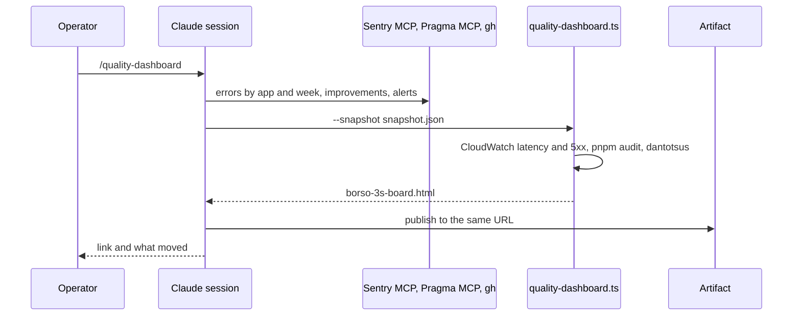

# The operator reads the quality of every borso.fr app on one private page

## Perspectives confronted

- [x] **Client / business**. The operator wants the Theodo 3S ritual (Security, Stability, Speed) applied to borso.fr, with the weak point map, on one page.
- [x] **Product**. The criteria were chosen one by one: Dependabot, `pnpm audit` and secret scanning; errors on previews and in production; API p50 and p95; the varicelle map coloured by stage A to E. On 2026-11-04 the operator chose a private page over a public one.
- [x] **Tech-lead**. A session refreshes the page with the access it already holds, so no role, token or database grant is added ([ADR 202611041200](../../../../adr/202611041200-the-quality-dashboard-is-a-private-artifact-a-session-refreshes.md)).
- [x] **Developer**. Every source was probed from a session on 2026-11-04 (see *Sources*).
- [x] **Designer**. One 3S band of three columns, then the varicelle map at full width, stacked at 375 px.

## Why

borso.fr has no equivalent of the 3S ritual. The signals are scattered across CloudWatch, Sentry, GitHub and the dantotsu record, and nobody reads four places.

- **Output metric:** fewer defects reaching stages D and E, counted weekly on the varicelle map.
- **Input metric:** each refresh shows a value and an eight-week trend for every indicator that applies to an app.
- **Gemba (measured 2026-11-04):** pragma production answered 574 API calls with a 5xx in seven days, and Sentry recorded 19 pragma errors. Nobody had looked at either number.

## Result

A private claude.ai artifact, [borso.fr 3S board](https://claude.ai/artifact/1kJhriURt4bM8bZLsoFmBe). It shows a banner naming any source that could not be read, then three columns (Security, Stability, Speed) with one row per app, then the engaged weak points and the defect map.

No value is coloured until the operator writes a ceiling in `docs/quality/targets.md`. The first week is a baseline.

## Use cases / edge cases



1. The operator asks for a refresh.
2. The session follows `.claude/skills/quality-dashboard/SKILL.md`, writes the snapshot, renders and republishes.

Edge cases:

- A source the session cannot read is written as `{ "unavailable": "<why>" }` and shows in the banner. The rest of the page renders.
- A malformed snapshot stops the render. A wrong number on the board is worse than no board.
- Preview 5xx counts only previews still deployed, because an API Gateway API's name carries no pull request number.
- An app with no API or no preview says so in the cell, never zero.
- Production throttles are a Stability column. On 2026-11-05 they explained the 5xx: pragma's API is reserved 10 concurrent executions and was throttled 545 times in seven days, against 574 gateway 5xx (measured).
- A Sentry week from before the `app` tag existed (before 2026-10-26) shows no data rather than zero.
- The page is private, but Security still shows counts only, never a package name.
- Stage mapping: A = `typing`, `linter`, `local`, `ci`; B = `review`; C = `qa`, `staging`; D = `production`, `operator-deploy`; E = a pragma improvement with `kind = 'bug'`, placed on pragma's row.

## Questions, Options and Decisions

| Question | Options | Decision (date) |
| --- | --- | --- |
| Where does the page live? | Pages built in CI; private artifact; vendor console | Private artifact refreshed by a session (2026-11-04, replaces the 2026-10-13 Pages choice) |
| Which CloudWatch error metric? | Lambda `Errors`; API Gateway `5xx` | API Gateway `5xx`. Hono turns a thrown error into a 500 response, so Lambda `Errors` stays at zero. |
| Latency measure | mean; p50 + p95 | p50 + p95 from API Gateway `Latency`, the slower API when an app has two |
| How are Sentry errors split by app? | one project per app; the `app` tag | The `app` tag. The organization has one project, `borsofr`, and every app sets the tag (2026-11-05). Previews run with Sentry off. |
| Source of stage E | a dantotsu field; the `improvement` table | The `improvement` table, through the Pragma MCP, with a new `kind` column |
| Targets | baseline first; zero everywhere | Baseline first, written in `docs/quality/targets.md` |

Out of scope: a scheduled refresh, web vitals, end-to-end coverage, alerting.

## Architectural choices

| ADR | Decision | What it constrains downstream |
|---|---|---|
| [202611041200](../../../../adr/202611041200-the-quality-dashboard-is-a-private-artifact-a-session-refreshes.md) | Private artifact refreshed by a session | No CI job, role or secret. A refresh needs a session with AWS read, the Sentry MCP and the Pragma MCP. |

## Changes

### Sources

| Source | Read by | Status on 2026-11-04 |
| --- | --- | --- |
| CloudWatch latency and 5xx | the renderer, with the session's AWS keys | read |
| `pnpm audit` | the renderer | read |
| Sentry errors by `app` and environment | the session, Sentry MCP `search_errors` | read |
| pragma bug reports | the session, Pragma MCP `list_improvements` | unavailable until this branch ships `kind` and `createdAt` in that tool |
| Dependabot alerts | the session, `gh api` | disabled on the repository |
| Secret scanning alerts | the session, `gh api` | refused by the hosted-session proxy |

### Database changes

```sql
ALTER TABLE "improvement" ADD COLUMN IF NOT EXISTS "kind" text;
```

DSQL refuses `NOT NULL DEFAULT` on an added column. The API writes `kind` on every insert and reads a null as `idea`.

### Files to change

```
scripts/quality/quality-dashboard.ts                // NEW: --snapshot, --output
scripts/quality/quality-dashboard.core.ts           // NEW: snapshot schema, indicators, targets
scripts/quality/quality-dashboard-page.core.ts      // NEW: the page, as an artifact fragment
scripts/quality/quality-sources.adapter.ts          // NEW: CloudWatch, pnpm audit, the snapshot file
scripts/quality/weak-points*.ts, quality-page.core.ts // UPDATE: stage colours, theme tokens
.claude/skills/quality-dashboard/SKILL.md           // NEW: the refresh procedure
apps/pragma/...                                     // UPDATE: kind on improvements, in the form, the list and the MCP tool
docs/quality/targets.md                             // NEW, empty
```

### Test strategy

- `scripts/quality/*.core.ts` at 100% coverage, mutation-tested.
- pragma's core and e2e tests cover `kind` and the MCP tool's new fields.
- `/visual-validation` drives the improvements screen at 375 px and 1280 px for the kind choice and the bug badge.

## Production strategy

### Analytics

The board is the analytics. Each refresh tells the operator which values moved.

### Zero-defect strategy

Every refresh lists each unavailable source in the banner and in the session's reply.
