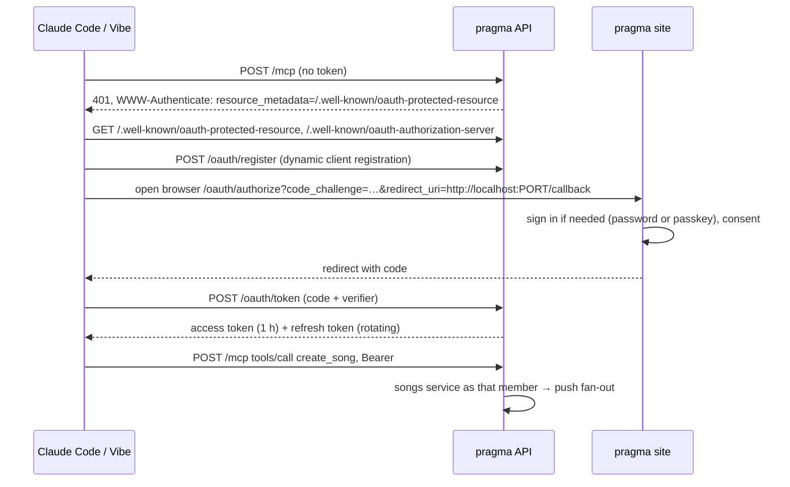

# A member connects Claude Code, Mistral Vibe, claude.ai or Le Chat to pragma in one command and a browser login, and the assistant can read and change the band's songs, sessions, setlists, takes, bars and tasks as that member

## Perspectives confronted

- [x] **Client / business**: the operator asked on 2026-10-23 for an MCP server that lets every member of the band add songs, create sessions and setlists, and change transitions and lineups, "everything the API allows", installable easily from Claude Code or Mistral Vibe.
- [x] **Product**: the operator put every area in scope: catalogue and lineups, sessions and setlists, takes and comments, band operations. A change made through an assistant notifies the band through push exactly like one made in the app, and there is no free-text notify tool (2026-10-23).
- [x] **Tech-lead**: the operator chose OAuth with a browser login over a personal token, and an authorization server inside the pragma API over oidc-provider, Cognito, Auth0 or WorkOS (2026-10-23).
- [x] **Developer**: every tool is a thin call into an existing service, so the proof is the same back-end e2e suite driven through the MCP client of the official SDK, plus the OAuth flow run end to end against the local API (proposed with the ADRs and ratified with them, 2026-10-23).
- [x] **Designer**: the only screens are the consent page and the Account section that shows the install commands and the connected assistants; both follow the existing account page (2026-10-23).

## Why

Members already ask an assistant to draft setlists, compare lineups or tidy the catalogue, then copy the answer into pragma by hand. Letting the assistant act on pragma directly removes the copying, and makes pragma usable from wherever a member already talks to an assistant: the terminal, claude.ai or Le Chat.

- **Output metric:** the number of members who used an assistant on pragma in the month, read from `assistant_grant.last_used_at`, with no event pipeline.
- **Input metrics:** (1) `claude mcp add --transport http --scope user pragma https://pragma.borso.fr/mcp`, then `/mcp`, ends with pragma's tools listed; (2) the same with Vibe's `config.toml` block; (3) a song created through the MCP appears in the catalogue and notifies the other members.
- **Gemba:** the request comes from the operator, who is a member, on 2026-10-23, together with the takes feature this one builds on.

## Result

**Account page, "Connect an assistant" section.** Three copyable blocks and the list of connected assistants:

```
Claude Code        claude mcp add --transport http --scope user pragma https://pragma.borso.fr/mcp
                   then type /mcp in Claude Code and choose "Authenticate"
Mistral Vibe       add to ~/.vibe/config.toml:
                   [[mcp_servers]]
                   name = "pragma"
                   transport = "streamable-http"
                   url = "https://pragma.borso.fr/mcp"
                   [mcp_servers.auth]
                   type = "oauth"
                   scopes = ["pragma"]
claude.ai, Le Chat Settings → Connectors → Add custom connector → https://pragma.borso.fr/mcp

Connected assistants
Claude Code · since 23 Oct · last used 2 min ago     [Revoke]
```

**Consent page** at `/oauth/consent`, reached after the member is signed in: "Claude Code wants to act on pragma as Hugo. It will be able to do everything you can do in the app." with **Allow** and **Deny**.

**MCP tools**, the 35 the operator approved on 2026-10-29 (see the last row of *Questions, Options and Decisions*):

- sessions and setlists: `find_sessions`, `save_session`, `get_session`, `list_setlists`, `get_setlist` (with the transition comments), `save_setlist`, `link_setlist`, `add_setlist_entries`, `update_setlist_entry`, `remove_setlist_entries`, `reorder_setlist`
- catalogue: `find_songs`, `get_song` (with the song's mastery scores), `search_deezer`, `save_song`, `set_song_mastery`
- takes: `list_takes`, `get_take`, `request_take_upload`, `create_take`
- band: `list_members`, `set_member_instruments`, `list_instruments`, `list_bars`, `search_bar_places`, `get_bar`, `save_bar`, `list_improvements`, `save_improvement`, `list_tasks`, `save_task`, `list_free_slots`
- the member: `get_me` (with the studies overview), `update_me` (contact details, and logging a study)
- `delete { kind, id }` for a bar, improvement, session, setlist, song, take or task

Every route in `app.ts` has a tool or a reason it has none. A route without either, or a tool without a route, fails a test, so the two cannot drift.

## Use cases / edge cases



**Happy path**
1. The member copies the Claude Code command from the Account page and runs it.
2. `/mcp` → Authenticate opens the browser on pragma; the member signs in if not already, and allows.
3. Claude Code lists pragma's tools; "add Seven Nation Army to Saturday's setlist" calls `search_songs`, then `add_setlist_entry`.
4. The other members get the setlist push, grouped as for an app change. The member who asked is not notified.

**Edge cases**
- The assistant acts as the member who allowed it: takes, comments and votes are attributed to that member, and push skips that member.
- Redirect URIs must be `https://` or a loopback `http://localhost` / `http://127.0.0.1` address on any port (RFC 8252), since Vibe and Claude Code each choose their own callback port.
- Every client is a public client using PKCE with `S256`; `plain` is refused.
- A refresh token is rotated on every use; replaying an old one revokes the whole grant.
- Revoking on the Account page deletes the grant; the next call answers 401 and the client asks the member to sign in again.
- A member whose credential changes (password reset) loses every grant, the same rule `judgeMemberSession` applies to cookies.
- Adding a take from the terminal: `request_take_upload` returns a presigned PUT, the assistant uploads the local file, then calls `create_take`.
- Deleting a member deletes their grants.
- Previews: the authorization server runs per stage with its own signing material, and grants are blocklisted from the preview clone, so a production token never works on a preview.

**Error cases**
- An unknown tool or a schema error returns an MCP error naming the field, never a 500.
- A service refusal (not found, conflict) is returned as a tool error with the same code the HTTP route returns.
- More than 10 dynamic client registrations per hour from one address are refused (429), so the open endpoint cannot fill the table.

## Questions, Options and Decisions

| Question | Options | Decision (2026-10-23) |
| --- | --- | --- |
| How does a member authenticate an assistant? | personal token / OAuth / token now, OAuth later | OAuth with a browser login. It also opens claude.ai and Le Chat connectors, which need OAuth. |
| Who runs the authorization server? | in the pragma API / oidc-provider / Cognito / Auth0 or WorkOS | In the pragma API, reusing the MCP SDK's OAuth schemas. See ADR-0042. |
| How are notifications triggered? | the existing fan-out / plus a free notify tool | The existing fan-out, because tools call the same services. No free-text push. |
| Which areas get tools? | catalogue / sessions and setlists / takes / band ops | All four. |
| Tools from HTTP routes or from services? | call the HTTP API from the MCP handler / call the services | Call the services, with the routes' own Zod schemas. One process, no second authentication hop. |
| Where does the MCP server run? | the existing API Lambda / its own Lambda | The existing API Lambda at `/mcp`, stateless Streamable HTTP. See ADR-0041. |
| Token lifetimes | — | Access token 1 hour, refresh token 90 days, rotated on use. Stored as SHA-256 hashes. |
| Which actions get a tool? (2026-10-29, after the preview trial) | every route a member can call / a smaller list chosen per action | The operator approved 35 tools on 2026-10-29, which narrows "anything the member can do". Assistants do not vote (improvement votes, setlist votes, live concert votes), do not change notification preferences, do not write take comments or transition comments (they read the transition comments through `get_setlist`), do not create, change, reorder or delete instruments, do not set mastery defaults, do not edit the outreach template, and do not add, change or remove members. Creation and change of the same noun share one `save_<noun>` tool, and every deletion goes through one `delete { kind, id }` tool whose description asks the assistant to confirm with the user. Plan D14. |

**Out of scope:** a personal-token fallback; scopes finer than "everything the member can do"; a free-text notify tool; MCP resources and prompts (tools only); streaming tool output.

**Sequencing:** this builds on the takes and push branch (`claude/pragma-takes-and-push`) and is implemented after it merges.

## Architectural choices

| ADR | Decision | What it constrains downstream |
|---|---|---|
| [ADR-0041](../../../../adr/0041-pragma-serves-mcp-from-its-api-lambda.md) | `@modelcontextprotocol/sdk` with `@hono/mcp`, stateless Streamable HTTP at `/mcp` on the existing API Lambda | two new dependencies; a new server and transport per request; tools call services, never HTTP |
| [ADR-0042](../../../../adr/0042-pragma-is-its-own-oauth-authorization-server.md) | pragma is its own OAuth 2.1 authorization server: discovery, dynamic client registration, PKCE S256, rotating refresh tokens, login through the existing member session | three new tables; grants per stage and kept out of preview clones; the security code is ours and carries the coverage and mutation gates |

## Changes

### Types / domain model

New nouns for `VOCABULARY.md`:

- **Assistant client**: an OAuth client that registered itself (Claude Code, Vibe, claude.ai, Le Chat). Not an *app* or an *integration*.
- **Assistant grant**: one member's permission for one assistant client, holding the refresh token hash. What the Account page lists and revokes.
- **Tool**: one MCP operation, mapped to one service call.

### Database changes

```sql
CREATE TABLE assistant_client (id text PRIMARY KEY, name text NOT NULL, redirect_uris text NOT NULL,
  created_at timestamptz NOT NULL DEFAULT now());
CREATE TABLE assistant_authorization_code (code_hash text PRIMARY KEY, client_id text NOT NULL, member_id uuid NOT NULL,
  redirect_uri text NOT NULL, code_challenge text NOT NULL, expires_at timestamptz NOT NULL);
CREATE TABLE assistant_grant (id uuid PRIMARY KEY, client_id text NOT NULL, member_id uuid NOT NULL,
  refresh_token_hash text NOT NULL UNIQUE, access_token_hash text, access_expires_at timestamptz,
  credential_version integer NOT NULL, created_at timestamptz NOT NULL DEFAULT now(), last_used_at timestamptz);
```

`assistant_grant` and `assistant_authorization_code` join the preview clone's `tableBlocklist`.

### Files to change

```
apps/pragma/api/src/oauth/oauth.{controller,service,repository,schema,core,types}.ts   // NEW: metadata, register, authorize, token, revoke
apps/pragma/api/src/oauth/bearer-session.middleware.ts                                // NEW: resolves the member from a Bearer token
apps/pragma/api/src/mcp/mcp.controller.ts                                             // NEW: /mcp, stateless transport
apps/pragma/api/src/mcp/tools/<area>.tools.ts                                         // NEW: one file per area, each tool = schema + service call
apps/pragma/api/src/mcp/tool-coverage.test.ts                                         // NEW: every route has a tool and back
apps/pragma/api/src/app.ts                                                            // UPDATE: mount /mcp, /oauth, /.well-known
apps/pragma/site/src/routes/oauth/ConsentPage.tsx                                     // NEW
apps/pragma/site/src/components/organisms/AssistantConnections.tsx                    // NEW: install blocks + grants list
apps/pragma/cdk/lib/stack.ts                                                          // UPDATE: blocklist, CloudFront behaviour for /.well-known and /oauth
apps/pragma/VOCABULARY.md, site i18n en/fr                                            // UPDATE
```

### Test strategy

- **Pure cores at 100% coverage and mutation-gated:** PKCE verification, redirect URI acceptance (loopback any port, https, nothing else), code and token expiry with `now` as a parameter, refresh rotation and replay detection, credential-version invalidation, the registration rate limit.
- **Back-end e2e on the local Postgres:** the full OAuth flow driven as a client would (register, authorize with a seeded member session, token, refresh, replay, revoke); then the official SDK's `Client` with `StreamableHTTPClientTransport` lists the tools and calls one per area, asserting the database change and that the push adapter fake was called for the other members only.
- **Tool coverage test:** the list of mounted routes and the list of tools match, with an explicit exclusion list (auth, audience, test seed, uploads signing used internally).
- **Visual validation:** the Account section shows the three install blocks and a seeded grant that Revoke removes; the consent page Allow and Deny redirect correctly, at 375 px and 1280 px.
- **Not provable here:** a real Claude Code, Vibe, claude.ai or Le Chat completing the flow against a deployed preview. That is the manual smoke after deploy, one client per member.

## Production strategy

### Analytics

**Input metrics:** `assistant_client_registered`, `assistant_grant_created`, `assistant_grant_revoked`, `mcp_tool_called` (tool name, outcome). Success: within a month, at least half the members have one grant.

**Output metric:** the monthly count of members with a grant used that month, reviewed by the operator once a month against how many still copy answers by hand.

### Zero-defect strategy

- `OAuthTokenReplay` (API): a refresh token used twice; alert on the first, because it means a leaked token.
- `McpToolFailed` (API, tagged with tool name and error code): alert on 5 unexpected failures in 10 minutes; schema errors are reported as breadcrumbs only.
- `OAuthRegistrationRateLimited` (API): logged, alert on 3 in a day.
