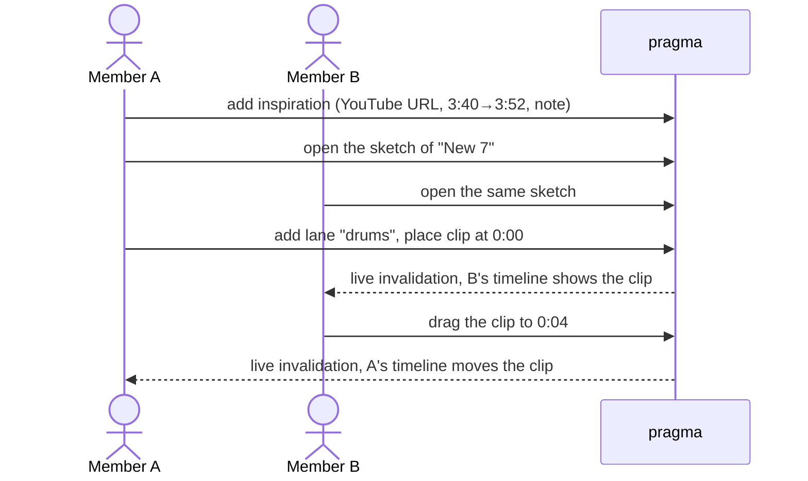

# Members sketch a composition from passages of songs they love

## Perspectives confronted

- [x] **Client / business** — The operator picked "more compositions per quarter" as the one objective, on 2026-11-13.
- [x] **Product** — The operator picked a timestamped YouTube link as the only playback source, with no audio stored. On review, the operator asked for the Deezer search to find the song, then a prefilled YouTube search link to find the video (2026-11-13).
- [x] **Tech-lead** — The operator first picked an edit lock, then dropped it on review for last-write-wins with live invalidation. Clips are played one at a time, never layered (2026-11-13).
- [x] **Developer** — The operator picked refusing to delete an inspiration that a sketch still uses (2026-11-13).
- [x] **Designer** — The operator picked a GarageBand-like timeline with free lanes, measured in seconds and fully editable at 375 px (2026-11-13). On the preview, the operator asked to create an inspiration from inside the sketch, and to start a composition without a catalogue song (2026-11-13).

## Why

The band wants to write its own songs and takes ideas from songs that work. Today a member who hears "the trumpet in Call Me Maybe" or "the drum break at bar 14 of that Phil Collins song" has nowhere in pragma to keep that moment, share it, or set it beside another one. This feature gives the band two things. The first is a shared library of passages, each a YouTube link with a start, an end and a note. The second is, on each composition, a timeline sketch where members lay those passages out on lanes, the way they would lay out regions in GarageBand.

- **Gemba (measured on 2026-11-13 with `scripts/db-read.sh`).** Production holds 124 songs, 123 with `origin = cover` and 1 with a null origin. It holds **zero compositions**. The compositions screen exists and has never been used.
- **Output metric.** Compositions created per quarter (`composition` rows grouped by `created_at`). The baseline is 0.
- **Gemba, second pass (measured 2026-11-13).** The band's own song "Avignon Nice" sits in the catalogue as `origin = cover`. The operator says it was written outside pragma and does not belong on the compositions screen. A song is created when a composition is finished, never before.
- **Input metrics.**
  - Inspirations added per week, and by how many distinct members.
  - Sketches holding at least two clips.

## Result

Three screens.

**Inspirations** (`/inspirations`, in the Band tab after compositions). This is the band's library of passages. Each card shows the title, the artist, `0:52 → 1:04`, the note, the author, and the number of sketches that use it. **New inspiration** is the one primary action. **Edit** on a card opens the same form, filled in. It opens a form with these fields:

- the Deezer search already used to add a song (`GET /songs/search`, `AddSongForm`). Picking a hit fills the title, the artist and the Deezer album id, and the card shows `AlbumCover`. Typing the title and artist by hand stays possible when Deezer has no match.
- a **Search on YouTube** button that opens `youtube.com/results?search_query=<artist> <title>` in a new tab
- a YouTube link, pasted back from that tab
- a start and an end, set while the embedded video plays, with "set start here" and "set end here" buttons
- a note

**Compositions** (`/compos`, replacing today's list of original songs). It lists compositions, newest first. **New composition** asks only for a title, prefilled with "Composition N", where N is one more than the highest number already used, and opens the empty sketch. A composition added to the catalogue carries an "In the catalogue" badge.

**Sketch** (`/compos/:compositionId/sketch`, opened from each composition).  Its header shows the composition's title, which can be renamed, and **Add to catalogue**. That creates a song with the composition's title, `origin = original` and `status = idea`, and links it. The song's page then shows **Open the sketch**. The composition stays on the compositions screen and its sketch stays editable. This is a horizontal timeline with a seconds ruler (0:00, 0:10…). It has any number of named lanes (for example "drums" or "brass"). Each clip is a block whose width is its passage's length.

- Every member can edit at the same time. There is no Edit button and no lock. Any member can:
  - add a lane, rename it or delete it
  - add a clip from the library, or create a new inspiration from the same sheet with the library's form. The new inspiration joins the library and lands on that lane at the current scroll position.
  - drag a clip in time or onto another lane (a long press on a phone)
  - remove a clip
- Each change is saved on its own. Other open screens update through the existing live invalidation.
- Tapping a clip opens the YouTube player starting at the clip's start second. The player pauses at its end second.

```
 0:00      0:10      0:20      0:30
 |---------|---------|---------|----
 drums  [ In the Air Tonight 3:40→3:52 ]
 brass             [ Call Me Maybe 0:52→1:04 ]
 + lane
```

**Audience.** Signed-in band members only, like the rest of pragma.

## Use cases / edge cases



**Happy path.**
1. A member searches Deezer for the song and picks it, opens the prefilled YouTube search, then pastes the video link. They set a start and an end, and add a note.
2. The inspiration appears in the library for every member, newest first.
3. A member taps **New composition**, keeps or changes the title, and lands on its empty sketch.
4. They add a lane, then add a clip from the library, or create a new inspiration from the lane. Either way the clip lands on that lane at the timeline's current scroll position.
5. They drag the clip to another time or lane. The new position is saved when they drop it.
6. They tap the clip. The video plays from its start and pauses at its end.
7. Another member who has the sketch open sees each change without reloading.
8. When the composition is finished, a member taps **Add to catalogue**. A song appears in Songs, and its page links back to the sketch.

**Edge cases.**
- Two members drop the same clip at the same moment. The last drop saved wins, and the other screen shows the clip jump to that position.
- A dropped clip snaps to whole seconds and cannot go before 0:00.
- Editing an inspiration's start or end changes the width of every clip already placed from it, in every sketch. Its offset does not move.
- Clips may overlap, on the same lane or across lanes. The timeline is a sketch, so overlapping is allowed.
- The timeline extends 30 seconds past the last clip's end, so there is always room to the right.
- Deleting a lane removes its clips. The inspirations stay in the library.
- Deleting the composition removes its lanes and clips, keeps the inspirations, and keeps its catalogue song.
- Deleting the catalogue song keeps the composition and clears its link, so **Add to catalogue** is offered again.
- **Add to catalogue** tapped twice, or by two members at once, creates one song.
- **Add to catalogue** that fails (offline, server error) shows an error under the button, and the button can be tapped again.
- Songs with `origin = original` that no composition links, such as a song written outside pragma, stay in Songs and never appear on the compositions screen.
- Deleting a member keeps their inspirations, and the card then reads "former member".
- Some videos are blocked from being embedded by their owner. The player then shows "Open on YouTube", which opens `youtube.com/watch?v=…&t=<start>`.

**Error cases.**
- The URL is not a YouTube video (`watch?v=`, `youtu.be/`, `shorts/`). The form refuses it.
- The end is not after the start, or the passage is longer than 10 minutes. The form refuses it, and the API refuses it again.
- Deleting an inspiration that a sketch uses is refused with `inspiration-in-use`, naming those sketches.
- A clip names an inspiration or lane that another member deleted meanwhile, or a clip that was removed meanwhile. The write is refused with `inspiration-not-found`, `lane-not-found` or `clip-not-found`, and the screen reloads the sketch.
- An edit of an inspiration that another member deleted meanwhile is refused with `inspiration-not-found`.

## Questions, Options and Decisions

| Question | Options | Decision (date) |
| --- | --- | --- |
| Where does the sound come from? | Timestamped link · uploaded extract · both | **Timestamped YouTube link.** No copyrighted audio is stored on S3, and the feature works on a phone at once (2026-11-13). |
| How does a member find the song and its video? | YouTube only · Deezer search plus a pasted YouTube link · Deezer search plus an automatic YouTube match | **Deezer search, then a prefilled YouTube search link.** Deezer finds the song and fills the title, artist and cover. It only offers a fixed 30-second preview, so YouTube plays the passage. An automatic match would need a YouTube Data API key, which is a secret with a daily quota, so the operator declined it (2026-11-13, revised the same day). |
| How are clips arranged? | Facet columns · infinite canvas · ordered list · free-lane timeline | **Free-lane timeline**, as the operator asked (2026-11-13). |
| What does play do? | Sketch, one clip at a time · chained playhead · layered | **Sketch.** Separate YouTube players cannot be layered in sync. This is inferred and was not prototyped. Layering would require uploads (2026-11-13). |
| Timeline unit? | Seconds · bars with a tempo | **Seconds.** It needs no tempo field. Bar numbers go in the note (2026-11-13). |
| Phone? | Full editing · read-only | **Full editing**, with a long press to drag (`@dnd-kit` is already installed) (2026-11-13). |
| Two editors at once? | Last write wins · edit lock | **Last write wins**, one write per clip move, with live invalidation. The operator chose a lock first and dropped it on review (2026-11-13). |
| Deleting a used inspiration? | Remove it everywhere · refuse | **Refuse** (2026-11-13). |
| Can an inspiration be edited? | No edit · note only · every field | **Every field**, including the passage. Placed clips follow the new length (2026-11-13). |
| Where is an inspiration created? | Library page only · also inside the sketch | **Also inside the sketch**, landing on the lane it was started from. The library page stays as a list (operator, on the preview, 2026-11-13). |
| What is a composition? | A song with `origin = original` · its own record that becomes a song at the end | **Its own record.** A song is created by **Add to catalogue** when the composition is finished (operator, on the preview, 2026-11-13). |
| What does creating one ask? | A title · nothing | **A title**, prefilled with "Composition N" (2026-11-13). |
| After Add to catalogue? | Linked and still editable · frozen · merged into the song | **Linked and still editable**, with a badge and a link both ways (2026-11-13). |
| What does the compositions screen list? | Compositions only · compositions and original songs | **Compositions only.** "Avignon Nice" stays in Songs (2026-11-13). |

**Out of scope.**
- Audio upload.
- Layered or chained playback.
- Tempo and bars.
- Links drawn between clips.
- Spotify, Deezer or SoundCloud as a playback source.
- An automatic YouTube match, which would need a YouTube Data API key.
- A sketch on a cover.
- Inspirations from the MCP server. A later feature can add them.
- An edit lock or presence ("Thomas is here").

## Architectural choices

None. `@dnd-kit` and the YouTube embed are already used. The YouTube IFrame Player API is loaded from `youtube.com`, a host the embeds already reach. No new secret is needed, and no schema column is driven by an external service.

## Changes

### Types / domain model

```ts
// Inspiration: a passage of a published song a member wants the band to steal from.
type Inspiration = {
  id: string; youtubeVideoId: string; title: string; artist: string; deezerTrackId: string | null; deezerAlbumId: string | null;
  startSeconds: number; endSeconds: number; // whole seconds, 0 <= start < end, end - start <= 600
  note: string; authorMemberId: string | null; createdAt: string; sketchCount: number;
};
// Composition: a piece the band is writing. It becomes a catalogue song only when a member adds it.
type Composition = { id: string; title: string; songId: string | null; createdAt: string };
// Sketch: the timeline of one composition. There is no row of its own; it is its lanes and clips.
type SketchLane = { id: string; compositionId: string; name: string; position: number };
type SketchClip = { id: string; laneId: string; inspirationId: string; offsetSeconds: number };
type Sketch = { composition: Composition; lanes: SketchLane[]; clips: SketchClip[] };
```

"Lane" names the row the operator called a *piste*. It is not called a "track", because pragma already uses that word for a Deezer track (`deezerTrackId`). VOCABULARY.md gains entries for **Inspiration**, **Sketch**, **Sketch lane** and **Sketch clip**, and its **Composition** entry is rewritten: a composition is now its own record, and a song's `origin` only says whether the band wrote it.

### Database changes

```sql
-- 0026_inspirations_and_sketches.sql (DSQL: no foreign keys; cascades run in the repository, in one transaction)
CREATE TABLE inspiration (id uuid PRIMARY KEY, youtube_video_id text NOT NULL, title text NOT NULL,
  artist text NOT NULL DEFAULT '', deezer_track_id text, deezer_album_id text, start_seconds integer NOT NULL, end_seconds integer NOT NULL,
  note text NOT NULL DEFAULT '', author_member_id uuid, created_at timestamptz NOT NULL);
CREATE TABLE composition (id uuid PRIMARY KEY, title text NOT NULL, song_id uuid, created_at timestamptz NOT NULL);
CREATE TABLE sketch_lane (id uuid PRIMARY KEY, composition_id uuid NOT NULL, name text NOT NULL, position integer NOT NULL);
CREATE TABLE sketch_clip (id uuid PRIMARY KEY, lane_id uuid NOT NULL, inspiration_id uuid NOT NULL, offset_seconds integer NOT NULL);
CREATE INDEX ASYNC sketch_lane_composition ON sketch_lane (composition_id);
CREATE INDEX ASYNC composition_song ON composition (song_id);
CREATE INDEX ASYNC sketch_clip_lane ON sketch_clip (lane_id);
CREATE INDEX ASYNC sketch_clip_inspiration ON sketch_clip (inspiration_id);
```

### Files to change

```
domain/inspiration.core.ts                       NEW  parse YouTube id, validate a passage, format m:ss, build the YouTube search URL
domain/sketch.core.ts                            NEW  snap/clamp an offset, timeline length
api/src/inspirations/*.{controller,service,repository,schema}.ts   NEW  CRUD, refuse delete in use
api/src/sketches/*.{controller,service,repository,schema}.ts       NEW  read sketch, lane and clip writes
api/src/songs/songs.repository.ts                UPDATE  song delete cascades lanes and clips
api/src/members/members.repository.ts            UPDATE  member delete clears inspiration author
domain/stale-scope.core.ts                       UPDATE  new written roots: inspirations, sketches
api/src/database/migrations/0026_…sql            NEW
site/src/routes/inspirations/                    NEW  library page, form reusing the Deezer search, YouTube search link, embedded player
site/src/routes/compos/sketch/                   NEW  timeline, lanes, draggable clips, clip player
site/src/routes/band/band-destinations.core.ts   UPDATE  add Inspirations after compositions
site/src/lib/embed.utils.ts                      UPDATE  accept shorts/ and start/end
site/src/i18n/{en,fr}.json                    UPDATE
apps/pragma/VOCABULARY.md                        UPDATE
```

### Test strategy

- **Unit tests at 100% coverage.** `inspiration.core.ts` covers URL forms, bounds and formatting. `sketch.core.ts` covers snapping, clamping, and length. The `embed.utils.ts` additions are covered too.
- **Controller tests** (Postgres):
  - refusing a delete in use
  - two moves of the same clip at the same moment, leaving one clip at one of the two positions
  - placing a clip while its inspiration or lane is deleted, leaving no orphan clip
  - a clip naming a deleted lane or inspiration
  - the song and member delete cascades
- **Visual validation** at 375 px and at 1280 px. It drives happy path steps 1 to 8, the Add to catalogue edge cases, including the Deezer search (the plan names how the dev server answers it), a second member's screen updating after a move, and the error messages in the form. It drives input metrics only. A green run does not show that more compositions get written.
- **Not automatable.** Whether a real video starts at the right second in the YouTube player. The validator asserts the `start` and `end` the player is given.

## Production strategy

### Analytics

**Input metrics.** These are wide-event fields on the existing request log:
- `inspiration_created` (author)
- `sketch_clip_placed` (composition)
- `composition_created`
- `composition_cataloged`
- `sketch_clip_moved`

One query to watch is inspirations per week by distinct author. Another is sketches with at least two clips.

**Output metric.** Each quarter, the operator runs `scripts/db-read.sh` with `SELECT count(*) FROM composition` per quarter, and compares it with the baseline of 0. Compositions added to the catalogue count the ones finished.

### Zero-defect strategy

- `inspiration-in-use`, `inspiration-not-found`, `lane-not-found` and `clip-not-found` are expected 409 and 404 answers. They are logged with their code and are not sent to Sentry.
- Any 5xx on `/api/inspirations` or `/api/sketches` goes to Sentry, under a transaction named after the route (for example `POST /api/sketches/:compositionId/clips`), through the existing shared alert.
- If members report moves that undo each other, that is the signal to revisit the lock decision.
