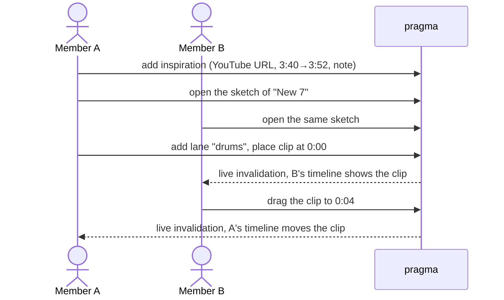

# Members sketch a composition from passages of songs they love

## Perspectives confronted

- [x] **Client / business** — The operator picked "more compositions per quarter" as the one objective, on 2026-11-13.
- [x] **Product** — The operator picked a timestamped YouTube link as the only source. No audio is stored, and the title and artist are typed by hand (2026-11-13).
- [x] **Tech-lead** — The operator first picked an edit lock, then dropped it on review for last-write-wins with live invalidation. Clips are played one at a time, never layered (2026-11-13).
- [x] **Developer** — The operator picked refusing to delete an inspiration that a sketch still uses (2026-11-13).
- [x] **Designer** — The operator picked a GarageBand-like timeline with free lanes, measured in seconds and fully editable at 375 px (2026-11-13).

## Why

The band wants to write its own songs and takes ideas from songs that work. Today a member who hears "the trumpet in Call Me Maybe" or "the drum break at bar 14 of that Phil Collins song" has nowhere in pragma to keep that moment, share it, or set it beside another one. This feature gives the band two things. The first is a shared library of passages, each a YouTube link with a start, an end and a note. The second is, on each composition, a timeline sketch where members lay those passages out on lanes, the way they would lay out regions in GarageBand.

- **Gemba (measured on 2026-11-13 with `scripts/db-read.sh`).** Production holds 124 songs, 123 with `origin = cover` and 1 with a null origin. It holds **zero compositions**. The compositions screen exists and has never been used.
- **Output metric.** Compositions created per quarter (`song.origin = 'original'` grouped by `created_at`). The baseline is 0.
- **Input metrics.**
  - Inspirations added per week, and by how many distinct members.
  - Sketches holding at least two clips.

## Result

Two new screens.

**Inspirations** (`/inspirations`, in the Band tab after compositions). This is the band's library of passages. Each card shows the title, the artist, `0:52 → 1:04`, the note, the author, and the number of sketches that use it. **New inspiration** is the one primary action. It opens a form with these fields:

- a YouTube link
- a title
- an artist
- a start and an end, set while the embedded video plays, with "set start here" and "set end here" buttons
- a note

**Sketch** (`/compos/:songId/sketch`, opened from each composition). This is a horizontal timeline with a seconds ruler (0:00, 0:10…). It has any number of named lanes (for example "drums" or "brass"). Each clip is a block whose width is its passage's length.

- Every member can edit at the same time. There is no Edit button and no lock. Any member can:
  - add a lane, rename it or delete it
  - add a clip from the library
  - drag a clip in time or onto another lane (a long press on a phone)
  - remove a clip
- Each change is saved on its own. Other open screens update through the existing live invalidation.
- Tapping a clip opens the YouTube player starting at the clip's start second. The player pauses at its end second.

```
 0:00      0:10      0:20      0:30
 |---------|---------|---------|----
 drums  [ In the Air Tonight 3:40→3:52 ]
 brass             [ Call Me Maybe 0:52→1:04 ]
 + lane
```

**Audience.** Signed-in band members only, like the rest of pragma.

## Use cases / edge cases



**Happy path.**
1. A member adds an inspiration from a YouTube link, with a start, an end, a title, an artist and a note.
2. The inspiration appears in the library for every member, newest first.
3. A member opens a composition's sketch.
4. They add a lane, then add a clip from the library. The clip lands on that lane at the timeline's current scroll position.
5. They drag the clip to another time or lane. The new position is saved when they drop it.
6. They tap the clip. The video plays from its start and pauses at its end.
7. Another member who has the sketch open sees each change without reloading.

**Edge cases.**
- Two members drop the same clip at the same moment. The last drop saved wins, and the other screen shows the clip jump to that position.
- A dropped clip snaps to whole seconds and cannot go before 0:00.
- Clips may overlap, on the same lane or across lanes. The timeline is a sketch, so overlapping is allowed.
- The timeline extends 30 seconds past the last clip's end, so there is always room to the right.
- Deleting a lane removes its clips. The inspirations stay in the library.
- Deleting the composition removes its lanes and clips, and keeps the inspirations.
- Deleting a member keeps their inspirations, and the card then reads "former member".
- Some videos are blocked from being embedded by their owner. The player then shows "Open on YouTube", which opens `youtube.com/watch?v=…&t=<start>`.

**Error cases.**
- The URL is not a YouTube video (`watch?v=`, `youtu.be/`, `shorts/`). The form refuses it.
- The end is not after the start, or the passage is longer than 10 minutes. The form refuses it, and the API refuses it again.
- Deleting an inspiration that a sketch uses is refused with `inspiration-in-use`, naming those sketches.
- A clip names an inspiration or lane that another member deleted meanwhile, or a clip that was removed meanwhile. The write is refused with `inspiration-not-found`, `lane-not-found` or `clip-not-found`, and the screen reloads the sketch.

## Questions, Options and Decisions

| Question | Options | Decision (date) |
| --- | --- | --- |
| Where does the sound come from? | Timestamped link · uploaded extract · both | **Timestamped YouTube link.** No copyrighted audio is stored on S3, and the feature works on a phone at once (2026-11-13). |
| Deezer to fill the title? | Deezer search plus a YouTube link · YouTube only | **YouTube only, with the title typed by hand.** A Deezer track only offers a fixed 30-second preview, so it cannot target a passage (2026-11-13). |
| How are clips arranged? | Facet columns · infinite canvas · ordered list · free-lane timeline | **Free-lane timeline**, as the operator asked (2026-11-13). |
| What does play do? | Sketch, one clip at a time · chained playhead · layered | **Sketch.** Separate YouTube players cannot be layered in sync. This is inferred and was not prototyped. Layering would require uploads (2026-11-13). |
| Timeline unit? | Seconds · bars with a tempo | **Seconds.** It needs no tempo field. Bar numbers go in the note (2026-11-13). |
| Phone? | Full editing · read-only | **Full editing**, with a long press to drag (`@dnd-kit` is already installed) (2026-11-13). |
| Two editors at once? | Last write wins · edit lock | **Last write wins**, one write per clip move, with live invalidation. The operator chose a lock first and dropped it on review (2026-11-13). |
| Deleting a used inspiration? | Remove it everywhere · refuse | **Refuse** (2026-11-13). |

**Out of scope.**
- Audio upload.
- Layered or chained playback.
- Tempo and bars.
- Links drawn between clips.
- Spotify, Deezer or SoundCloud as a source.
- A sketch on a cover.
- Inspirations from the MCP server. A later feature can add them.
- An edit lock or presence ("Thomas is here").

## Architectural choices

None. `@dnd-kit` and the YouTube embed are already used. The YouTube IFrame Player API is loaded from `youtube.com`, a host the embeds already reach. No new secret is needed, and no schema column is driven by an external service.

## Changes

### Types / domain model

```ts
// Inspiration: a passage of a published song a member wants the band to steal from.
type Inspiration = {
  id: string; youtubeVideoId: string; title: string; artist: string;
  startSeconds: number; endSeconds: number; // whole seconds, 0 <= start < end, end - start <= 600
  note: string; authorMemberId: string | null; createdAt: string; sketchCount: number;
};
// Sketch: the timeline of one composition. There is no row of its own; it is its lanes and clips.
type SketchLane = { id: string; songId: string; name: string; position: number };
type SketchClip = { id: string; laneId: string; inspirationId: string; offsetSeconds: number };
type Sketch = { songId: string; lanes: SketchLane[]; clips: SketchClip[] };
```

"Lane" names the row the operator called a *piste*. It is not called a "track", because pragma already uses that word for a Deezer track (`deezerTrackId`). VOCABULARY.md gains entries for **Inspiration**, **Sketch**, **Sketch lane** and **Sketch clip**.

### Database changes

```sql
-- 0026_inspirations_and_sketches.sql (DSQL: no foreign keys; cascades run in the repository, in one transaction)
CREATE TABLE inspiration (id uuid PRIMARY KEY, youtube_video_id text NOT NULL, title text NOT NULL,
  artist text NOT NULL DEFAULT '', start_seconds integer NOT NULL, end_seconds integer NOT NULL,
  note text NOT NULL DEFAULT '', author_member_id uuid, created_at timestamptz NOT NULL);
CREATE TABLE sketch_lane (id uuid PRIMARY KEY, song_id uuid NOT NULL, name text NOT NULL, position integer NOT NULL);
CREATE TABLE sketch_clip (id uuid PRIMARY KEY, lane_id uuid NOT NULL, inspiration_id uuid NOT NULL, offset_seconds integer NOT NULL);
CREATE INDEX ASYNC sketch_lane_song ON sketch_lane (song_id);
CREATE INDEX ASYNC sketch_clip_lane ON sketch_clip (lane_id);
CREATE INDEX ASYNC sketch_clip_inspiration ON sketch_clip (inspiration_id);
```

### Files to change

```
domain/inspiration.core.ts                       NEW  parse YouTube id, validate a passage, format m:ss
domain/sketch.core.ts                            NEW  snap/clamp an offset, timeline length
api/src/inspirations/*.{controller,service,repository,schema}.ts   NEW  CRUD, refuse delete in use
api/src/sketches/*.{controller,service,repository,schema}.ts       NEW  read sketch, lane and clip writes
api/src/songs/songs.repository.ts                UPDATE  song delete cascades lanes and clips
api/src/members/members.repository.ts            UPDATE  member delete clears inspiration author
api/src/realtime/stale-scope.core.ts             UPDATE  new scopes: inspirations, sketch:<songId>
api/src/database/migrations/0026_…sql            NEW
site/src/routes/inspirations/                    NEW  library page, form with embedded player
site/src/routes/compos/sketch/                   NEW  timeline, lanes, draggable clips, clip player
site/src/routes/band/band-destinations.core.ts   UPDATE  add Inspirations after compositions
site/src/lib/embed.utils.ts                      UPDATE  accept shorts/ and start/end
site/src/locales/{en,fr}.json                    UPDATE
apps/pragma/VOCABULARY.md                        UPDATE
```

### Test strategy

- **Unit tests at 100% coverage.** `inspiration.core.ts` covers URL forms, bounds and formatting. `sketch.core.ts` covers snapping, clamping, and length. The `embed.utils.ts` additions are covered too.
- **Controller tests** (Postgres):
  - refusing a delete in use
  - two moves of the same clip at the same moment, leaving one clip at one of the two positions
  - placing a clip while its inspiration or lane is deleted, leaving no orphan clip
  - a clip naming a deleted lane or inspiration
  - the song and member delete cascades
- **Visual validation** at 375 px and at 1280 px. It drives happy path steps 1 to 7, a second member's screen updating after a move, and the error messages in the form. It drives input metrics only. A green run does not show that more compositions get written.
- **Not automatable.** Whether a real video starts at the right second in the YouTube player. The validator asserts the `start` and `end` the player is given.

## Production strategy

### Analytics

**Input metrics.** These are wide-event fields on the existing request log:
- `inspiration_created` (author)
- `sketch_clip_placed` (song)
- `sketch_clip_moved`

One query to watch is inspirations per week by distinct author. Another is sketches with at least two clips.

**Output metric.** Each quarter, the operator runs `scripts/db-read.sh` with `SELECT count(*) FROM song WHERE origin = 'original'` per quarter, and compares it with the baseline of 0.

### Zero-defect strategy

- `inspiration-in-use`, `inspiration-not-found`, `lane-not-found` and `clip-not-found` are expected 409 and 404 answers. They are logged with their code and are not sent to Sentry.
- Any 5xx on `/api/inspirations` or `/api/sketches` goes to Sentry, tagged `feature:composition-inspirations`, through the existing shared alert.
- If members report moves that undo each other, that is the signal to revisit the lock decision.
