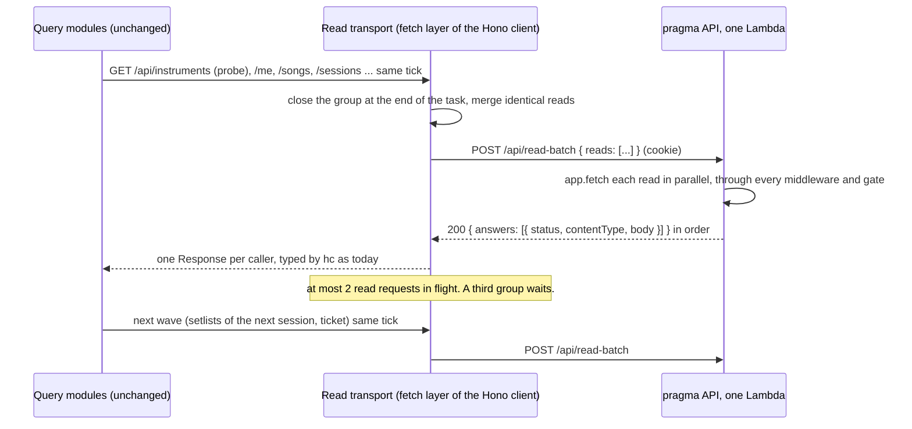

# pragma never asks the API for more than two things at once

## Perspectives confronted

- [x] **Client / business**. The operator ratified on 2026-11-05 that a cold open waits for its first answer behind the pragma logo, and that raising the concurrency is excluded (D6).
- [x] **Product**. The operator ratified on 2026-11-05 that every route meets the target, deep links included (D7), through a generic read batch (D1).
- [x] **Tech-lead**. Confronted against the dantotsu, the Hono client and app in this branch, hono 4.13.7's client source, the stale scope tables and the CDK limits (measured this session).
- [x] **Developer**. Confronted against the query modules, the session gate, the offline preload, the 40 site tests that stub `fetch` and the lint rule blueprints (measured this session).
- [x] **Designer**. The operator set the opening screen on 2026-11-05: the pragma logo with a striking loading animation, an error with a retry. The choreography below is this spec's proposal, and `/visual-validation` checks it.

## Why

On 2026-11-04 at 17:48 UTC one member opened pragma. The API served 45 requests and refused 193 in one minute (measured, see [the dantotsu](../../../../dantotsus/forty-requests-at-a-ten-seat-function.md)). `pragma-prod-api` has a reserved concurrency of 10, which is also its ceiling. PR #261 removed the per-song preload. A cold open of `/` still sends 13 requests with 9 at once (inferred from the code, table below). So one open still nearly fills the ten seats, and any screen with one more read fills them. Raising the ceiling is excluded by CLAUDE.md "Lower the water".

The smallest change that holds on every route is in the transport, not in the screens. The site folds every read issued in the same tick into one request, and keeps at most two such requests in flight. One Lambda answers each one.

- **Output metric.** No pragma API request is refused for concurrency. Read as `Throttles` = 0 for `pragma-prod-api` over a rolling seven days, against a baseline of 738 throttles a week (measured, dantotsu).
- **Input metrics.**
  - I1. On every route, cold and warm, each tick group of reads leaves the browser as one request, and at most 2 read requests are in flight at once (target, measured by `/visual-validation` against `pnpm dev`, table in Test strategy).
  - I2. Returning to a hidden tab sends at most 2 read requests (target).
  - I3. `pnpm lint` refuses a planted `Promise.all(ids.map((id) => queryClient.query(...)))` and an awaited read inside a loop in `apps/*/site/src` (target).
- **Gemba.** The cold open of `/` today, read from the code on this branch (inferred, not run).

| Wave | Requests | Fired by |
| --- | --- | --- |
| 0 | `GET /api/instruments` | the session probe (`auth.queries.ts`, `probeSession`), alone, before any screen mounts |
| 1 | `GET /api/me`, `/sessions`, `/songs`, `/instruments`, `/members`, `/tasks`, `/streaks` | `AppShell` and `HomePage` |
| 1 | `GET /api/realtime/ticket` | `startLiveInvalidation` once signed in |
| 1 | `GET /api/offline-manifest` | `startOfflineReading` |
| 2 | `GET /api/setlists/by-session/:id`, `GET /api/sessions/:id` | `HomePage` and `loadNextSession` |
| 3 | `GET /api/setlists/:id/entries`, once per setlist of the next session | `HomePage` and `loadNextSession` |

A warm open refetches every mounted query older than 5 minutes in one burst (`staleTime` 300 000 ms in `query-client.setup.ts`, measured). Returning to a hidden tab reopens the socket, and `openSocket` in `live-invalidation.core.ts` invalidates every query, a second burst of the same width (measured in the code, width inferred).

## Result

**The network panel.** Every read goes through one transport. A tick group of two or more reads becomes one `POST /api/read-batch`. A group of one read leaves as its own `GET`. Writes are unchanged.

| Open | Today (inferred) | After (target, inferred) |
| --- | --- | --- |
| Cold open of `/` | 13 requests, peak 9 | 3 requests, peak at most 2 |
| Warm open of `/`, cache younger than 5 min | 1 request plus refetches of stale keys | 1 request (the ticket) |
| Warm open of `/`, cache older than 5 min | about 10, peak about 9 | at most 3, peak at most 2 |
| Return to a hidden tab | ticket, then about 8 refetches | at most 2 |
| Lint of a `.map` fan-out or an awaited read in a loop | passes | refused by `borso/no-request-fan-out-in-site` |

**The opening screen.** It shows only when nothing is cached: a first open, a cache older than its 7 days, or right after sign-in. A warm open renders the cached screen at once, as today.

- **Layout at 375 px.** A full `h-dvh` page on the surface token, no horizontal scroll. The mark is centred at 9 rem wide (`sm:` 11 rem). One caption sits under it, "Tuning up…" (`opening.loading`, French "On s'accorde…"), in `role="status"`. The mark is `aria-hidden`.
- **The mark.** An inline SVG traced from `public/icons/pragma-logo.png`, in four groups: the left note, the three keys, the right note, and the pale offset echo the PNG already carries. No vector of the mark exists in the repo today (measured, the PNG is 755 × 522 RGB and the only source).
- **The animation, "the downbeat".**
  1. Entrance, once, 500 ms. The two notes slide in from 24 px out on each side and meet the keys. The keys rise from below, 60 ms apart.
  2. Loop, 1.6 s. The keys press in an arpeggio, left, centre, right, 120 ms apart. Each dips 4 px and deepens its fill. On the third key both notes swing 8° toward the centre around their note heads and spring back with an overshoot, like two hands on the downbeat. An accent halo behind the mark swells with the swing, scale 0.9 to 1.1 and opacity 0 to 0.35 to 0.
  3. The pale echo layer follows the mark 90 ms late, which gives the loop depth.
  4. Exit, 200 ms, when the first answer lands. The mark grows to 1.08 and fades with the overlay, revealing the screen already filled.
  - Only `transform` and `opacity` animate, so no layout runs per frame (inferred smooth on a phone). Nothing flashes more than 3 times a second (WCAG 2.3.1).
- **Reduced motion.** Under `prefers-reduced-motion: reduce` (`motion-reduce:`), the mark is static, with no entrance, loop or exit motion. The caption carries the progress. The overlay goes away without a fade.
- **Failure.** The mark stops and stays static. The text reads "pragma could not reach the band's data." and, when the browser is offline, "You are offline." A primary "Try again" button refetches every active query in one group and restarts the loop.

**Audience.** Members of the band. The batch route carries each read's own gate, so it opens nothing a member's browser could not already read. The public vote pages batch too, with no session.

## Use cases / edge cases



Happy path.

1. A member with a session cookie and an empty cache opens any route. The gate shows the opening screen and mounts the route beneath it, inert and hidden. The probe and the route's reads leave in one batch. The answer fills the cache, the overlay exits, and the screen shows its data. Dependent waves (the next session's setlists, then their entries) each leave as one more request.
2. The same member reopens within 7 days. The persisted cache renders at once. The ticket leaves alone. Mounted queries older than 5 minutes refetch in one batch.
3. The member hides the tab and comes back. The ticket and any focus refetch leave in one group. When the socket opens, the `all` invalidation refetches the mounted queries in one more batch.
4. Another member reorders a setlist. The stale message names `setlists`. The mounted `setlists` keys refetch in one batch.
5. Offline, the restored cache answers the catalogue and the next session's setlist and entries, as ADR-2026-11-01T1313 promises. The offline preload fills them with plain query reads, grouped by the transport.

Edge cases.

- Two callers read the same path in one group (the probe and the instruments list both `GET /api/instruments`, measured). The group sends one item and hands each caller its own `Response`.
- A group holds more than 10 reads. It leaves as consecutive batches of at most 10, under the 2-in-flight cap.
- A read carries a header. Only the headers in `PRAGMA_REQUEST_HEADERS` ride on an item (`x-ballot-token` on audience reads, measured in `audience.queries.ts`).
- The next session is today and already started. The preload picks it with `selectNextSession` (`domain/session-schedule.core.ts`, Paris calendar day), as home does. Today's manifest uses "strictly after now" instead (measured in `offline-manifest.core.ts`), so the two disagreed. This change ends that.
- A route that reads nothing past the shell. `AppShell` reads `me` on every gated route (measured), so the first batch always brings band data and the overlay lifts.
- No session ahead. The preload stops after the lists.

Error cases.

- One read fails inside a batch (`4xx`, `5xx`, or an unhandled throw answered `500` by `answerUnhandledError`). Only that caller sees the failure. The others get their data (D9).
- `401` with an ended-session body on any item. `fetchWatchingSessionEnd` sees it per item, as today, and `onSessionEnded` clears band data. The gate sends the member to `/login`.
- The batch itself fails (network error, `5xx`, or a throttle `429` or `503` from API Gateway). Every caller in the group gets that failure. `retry: 1` resends them once, again as one group.
- A cold open whose first batch fails. The opening screen shows the failure and its retry. Today a probe network failure sends the member to `/login` instead (measured in `session-gate.core.ts`, an undefined probe that is not pending reads as sign-in required).
- A malformed batch (not JSON, no reads, more than 10, a path outside `/api/`, `/api/read-batch` itself, or a header outside the allowed list). The API answers `400` with `read-batch-invalid` and runs nothing.

## Questions, Options and Decisions

| # | Question | Options and cost | Decision (2026-11-05) |
| --- | --- | --- | --- |
| D1 | One read per screen, one opening read, or a generic batch? | **a. One opening read** covering shell, home and offline. Routes outside it keep their own calls, and deep links stay at 2 to 4 calls on top. **b. One read per screen.** About ten endpoints and seed functions to keep in step with the query modules. **c. A generic read batch** in the client's fetch layer. Covers every route, deep links, future screens and refetches after invalidation. Query modules do not change. Dependent waves still cost one request each. | **c**, ratified by the operator. Recorded in the ADR below. |
| D2 | Does the shell data go into the opening read? | Moot. There is no opening read. The probe stays `GET /api/instruments` and rides the first batch, merged with the instruments list. | Moot by D1. |
| D3 | What replaces `/api/offline-manifest`? | **a. Keep the manifest**, whose reads ride the batch. Keeps its "strictly after now" rule, which disagrees with home, and its per-setlist `.map`. **b. Delete it.** The preload reads the songs and sessions lists, picks the next session with `selectNextSession`, then reads that session, its setlists and their entries. The songs list carries every song's detail (measured, #261 seeds `songKeys.byId` from it), so no per-song read is left. | **b**. The route, its core and test, its stale-scope rows and its MCP exclusion are deleted. |
| D4 | How does a seeded key stay consistent with live invalidation? | Moot. Nothing is seeded. An `all` invalidation refetches the mounted queries, and the transport sends them as one batch. `refetchOnWindowFocus` keeps its default. | Moot by D1. |
| D5 | Does a mounted seeded query refetch on mount? | Moot. A warm open's stale refetches leave as one batch. | Moot by D1. |
| D6 | Does the first open wait? | **Wait only when nothing is cached**, behind the opening screen, with an error and a retry on failure. | Ratified by the operator, with the animated logo and reduced-motion handling above. "Nothing cached" means no band query holds data. So it also covers the open right after sign-in. |
| D7 | Which routes meet the target? | Every route, deep links included. Acceptance is a request count per route, cold and warm, in Test strategy. | Ratified by the operator. |
| D8 | Does the realtime ticket get its own path? | Moot. `requestRealtimeTicket` calls `api.api.realtime.ticket.$get` (measured), so the ticket joins whatever group is open. It is never cached, so its 60 s life is unaffected. The live connection machine does not change. | Moot by D1. |
| D9 | One read fails on the server. | **All or nothing.** One bad read fails the screen. **Per-item status.** Each answer carries its own status and body, and the transport rebuilds one `Response` per caller. | **Per-item status**, as the operator asked. The batch answers `200` whenever it parsed. |
| D10 | Does rule B allow a bounded literal array? | **Allow** `Promise.all([a(), b()])` with no spread (the two `voting.queries.ts` invalidations). **Refuse every `Promise.all`.** Hits cache deletion and the PDF worker, which send no request. | **Allow literals.** Refuse a `.map`, `.flatMap` or `Array.from` mapping, spread or not, whose callback sends a request directly or through a same-file function (blueprint `lint-rule-transitive-call`). `useQueries` and `useSuspenseQueries` over a mapping are refused too. |
| D11 | What does rule B protect now, and what does it say? | The batch makes a pragma fan-out of 10 or fewer reads safe for the ceiling. The rule still protects three things. Code that bypasses the batch, such as the other full-stack apps (`talos`, `last-loop-lepin`, `banana-rush`), which have no batch. A fan-out over an unbounded list, which turns into many batches and one database read per item in one Lambda. And an awaited read in a loop, which sends one request per turn and never shares a group. | Two messages. **Fan-out:** "One request per item grows with the number of items, and the API serves 10 at once. A batch folds at most 10 reads, so a longer list becomes several batches and one database read per item. Read the collection in one request, or seed per-item keys from a list response with `setQueryData`. See docs/standards/06-data-fetching.md." **Loop:** "Each awaited read waits for the one before, so N reads take N round trips and never share a batch. Read the collection in one request. See docs/standards/06-data-fetching.md." The loop check covers a `$get`, `queryClient.query` or `queryClient.fetchQuery` awaited in a `for`, `for…of` or `while` body, directly or through a same-file function. Writes in a loop stay allowed, because their order matters (`practice-songs.queries.ts:57`, measured). |
| D12 | The fan-out left after D3, entries per setlist of one session (`useEntriesOfSetlists` at `setlist-entries.queries.ts:64`, and the preload). | **Inline disable** in one shared helper in `setlist-entries.queries.ts`, reason "one read per setlist of one session; production holds at most 1 per session (measured)". **A server read** of entries per session. One more endpoint. | **Inline disable**, one helper used by both callers. |
| D13 | Where does the coalescing sit? | **The `fetch` option of `hc`**, under `fetchWatchingSessionEnd`. hono 4.13.7 calls it synchronously from `$get` when no header function is passed (measured in `dist/client/client.js`). Every pragma read goes through it, and no site code calls `fetch` on the API elsewhere (measured, the only other `fetch` is the S3 upload). **A TanStack `queryFn` wrapper.** Misses `requestRealtimeTicket` and the mutation refetches. | **The `fetch` option.** A group closes at the end of the task that opened it. The plan's first step prototypes `queueMicrotask` against `setTimeout(…, 0)` in `pnpm dev` and keeps the microtask unless it yields more groups per route (measured there). |
| D14 | How does the server run the reads? | **`app.fetch` per read**, with the outer request's headers and `context.env`, so the gate, validation, controllers, logger and tracing run unchanged. **Call services directly.** Duplicates every route. | **`app.fetch`**, in parallel with `Promise.all`. The route is mounted in `createApp` outside the typed chain, as the test-seed router is (measured in `app.ts`). Each item keeps the outer headers, minus `content-type` and `content-length`, plus its own allowed headers. Answers drop every header but `content-type`. No GET route sets a cookie (measured, `setCookie` appears only in `auth.controller.ts` and in `PUT /api/me/password`). |
| D15 | Maximum batch size, and the cap on requests in flight. | **10 reads per batch**, the default pool size of `postgres` 3.4.9 (measured in its README), so every item can hold a connection at once. The largest group on `/` is about 8 reads after merging (inferred). **2 read requests in flight** per tab, the operator's target. A third group waits for a slot. | **10 and 2**, in `domain/read-batch.core.ts` so both sides read one constant. |
| D16 | Are writes batched? | **No.** A write is user-paced, needs its own status and `x-pragma-client` signing, and is announced on its own path by the stale-scope middleware. Writes skip the in-flight cap. | **Writes stay unbatched.** |
| D17 | A group of one read. | **Send it as a plain `GET`.** No wrapping, and API Gateway's log keeps the path. **Always batch.** One code path. | **Plain `GET`**. The batch path still runs on every open. |
| D18 | Where does the opening screen's wait end? | **When the probe settles.** Misses the open right after sign-in, where the probe is already set. **When band data first lands, or nothing is in flight.** One rule for both cases. | **When band data first lands.** With nothing in flight and no band data, the gate shows the failure. |

**Out of scope.** Raising the reserved concurrency. A CloudWatch alarm on `Throttles` (dantotsu option C, a separate infra change). Batching in `talos`, `last-loop-lepin` or `banana-rush`. Batching writes. Offline writes.

## Architectural choices

| ADR | Decision | What it constrains downstream |
| --- | --- | --- |
| to write, `pragma-reads-leave-in-one-batch-per-tick` | pragma's site sends every API read through one transport. Reads issued in the same tick leave as one `POST /api/read-batch`, answered by one Lambda that runs each read through the app with per-read status, at most 10 reads per batch and at most 2 read requests in flight per tab. It amends ADR-2026-11-01T1313, whose offline manifest it deletes. | A new screen or read needs nothing to stay under the ceiling. A read must go through `api`. A new GET route returns text or JSON, since an answer body travels as text. A per-call header must be listed in `PRAGMA_REQUEST_HEADERS` to ride a batch. |

Inputs for `/adr`, piloted mode.

- **Context.** The dantotsu above. 13 cold requests against a ceiling of 10. Two later bursts of the same width.
- **Rejected. One opening read** (`GET /api/opening`) that seeds the cache. Covers `/` and the tabs only. Deep links stay at 2 to 4 more calls. Every shell-wide read must be added to it, and live invalidation needs a seeding path.
- **Rejected. One read per screen.** About ten endpoints and seed functions to keep in step with the query modules. Every new screen needs one.
- **Rejected. A client concurrency limit alone.** Keeps 13 requests and 13 Lambda invocations, through 2 lanes, so the open takes several round trips more (inferred).
- **Rejected. Raising the concurrency.** Excluded by CLAUDE.md "Lower the water".
- **Consequences.** API Gateway's access log shows `POST /api/read-batch` for grouped reads. Hono's logger still prints each read's path in the Lambda log (inferred from it running per `app.fetch`). One slow read holds its whole batch.

No new dependency, no new secret, no new request header.

## Changes

### Types / domain model

Add **Read batch** to `apps/pragma/VOCABULARY.md`, and remove **Offline manifest**. Add **Opening screen** (the gate's wait when nothing is cached).

```ts
// domain/read-batch.core.ts
export const READ_BATCH_PATH = '/api/read-batch';
export const MOST_READS_PER_BATCH = 10;
export const MOST_READS_IN_FLIGHT = 2;

export interface BatchedRead {
  readonly path: string; // starts with /api/, query string included
  readonly headers: Readonly<Partial<Record<PragmaRequestHeader, string>>>;
}
export interface ReadBatch { readonly reads: readonly BatchedRead[] } // 1 to 10

export interface BatchedAnswer {
  readonly status: number;
  readonly contentType: string | null;
  readonly body: string; // the read's body as text, '' for 204
}
export interface ReadBatchAnswer { readonly answers: readonly BatchedAnswer[] } // same order

// site/src/components/organisms/session-gate.core.ts
export type SessionGateState = 'sign-in-required' | 'opening' | 'opening-failed' | 'granted';
```

Stale scope. `POST /api/read-batch` joins `SILENT_WRITE_PATHS`, since it writes nothing. `offline-manifest` leaves `UNANNOUNCED_API_ROOTS`, `DERIVED_READ_ROOTS` and `QUERY_READ_ROOTS`.

### Database changes

None.

### Files to change

```
apps/pragma/domain/read-batch.core.ts(+test)               NEW  constants, types, isBatchableRead (core-lookup-table)
apps/pragma/api/src/read-batch/read-batch.schema.ts(+test) NEW  zod body: 1 to 10 reads, /api/ paths, not itself, allowed headers
apps/pragma/api/src/read-batch/read-batch.controller.ts    NEW  POST /api/read-batch, takes the app's fetch (controller-dispatch)
apps/pragma/api/src/read-batch/read-batch.core.ts(+test)   NEW  read to Request, Response to BatchedAnswer (core-projection)
apps/pragma/api/src/read-batch/read-batch.controller.test.ts NEW back e2e against seeded Postgres (test-back-e2e)
apps/pragma/api/src/app.ts                                 UPDATE mount the batch in createApp, drop /api/offline-manifest
apps/pragma/api/src/sessions/offline-manifest.core.ts(+test), sessions.controller.ts, sessions.service.ts  UPDATE delete the manifest
apps/pragma/api/src/realtime/stale-scope.core.ts           UPDATE silent write path api/read-batch
apps/pragma/api/src/realtime/derived-read-roots.test.ts    UPDATE drop the offline-manifest row
apps/pragma/api/src/mcp/tool-coverage.core.ts              UPDATE exclusion POST /api/read-batch replaces the manifest's
apps/pragma/domain/stale-scope.core.ts                     UPDATE drop offline-manifest
apps/pragma/site/src/lib/read-batch.core.ts(+test)         NEW  merge identical reads, split by 10, rebuild Responses, 100% covered
apps/pragma/site/src/lib/read-batch.adapter.ts(+test)      NEW  the transport: groups, 2-in-flight queue, POST, single GET
apps/pragma/site/src/lib/api.client.ts                     UPDATE fetchWatchingSessionEnd sends reads through the transport
apps/pragma/site/src/lib/queries/offline-reading.queries.ts(+test)  UPDATE lists, selectNextSession, session, setlists, entries
apps/pragma/site/src/lib/queries/offline-reading.utils.ts(+test)    UPDATE drop selectOfflineReadingTargets, keep isSignInUpdate
apps/pragma/site/src/lib/queries/setlist-entries.queries.ts UPDATE one entries-of-setlists helper with the D12 disable
apps/pragma/site/src/lib/queries/query-read-roots.core.ts  UPDATE drop offline-manifest
apps/pragma/site/src/lib/queries/queries.test-utils.tsx    UPDATE stubFetch unwraps a batch into item Requests
apps/pragma/site/src/lib/query-client.setup.ts             UPDATE the restore start reads the cached probe and never fetches it
apps/pragma/site/src/components/organisms/RequireSession.tsx, session-gate.core.ts(+test)  UPDATE D6 and D18
apps/pragma/site/src/components/organisms/OpeningScreen.tsx(+test)  NEW  overlay, caption, failure and retry
apps/pragma/site/src/components/atoms/PragmaMark.tsx       NEW  traced SVG in four groups, motion-safe classes
apps/pragma/site/src/styles/tokens.css                     UPDATE keyframes and --animate-* tokens of the downbeat
apps/pragma/site/src/i18n/en.json, fr.json                 UPDATE opening.loading, opening.failed, opening.offline, opening.retry
apps/pragma/VOCABULARY.md                                  UPDATE Read batch and Opening screen in, Offline manifest out
eslint-rules/no-request-fan-out-in-site.js(+test)          NEW  rule B, both checks (lint-rule, test-lint-rule, lint-rule-transitive-call)
eslint-rules/index.js, .oxlintrc.json                      UPDATE register, error on apps/*/site/**/*.{ts,tsx}
docs/standards/06-data-fetching.md                         UPDATE the read batch, and the section rule B's messages point to
docs/adr/<UTC>-pragma-reads-leave-in-one-batch-per-tick.md NEW  via /adr
```

Rule B hits today (measured, `grep -rn -E "Promise\.(all|allSettled)\(" apps/*/site/src` plus `useQueries`, tests excluded, and `oxlint -A all -D no-await-in-loop` on every site).

| Line | Sends a read per item | After this change |
| --- | --- | --- |
| `pragma/.../offline-reading.queries.ts:37`, `:52`, `:70` | yes | rewritten by D3, the entries read uses the D12 helper |
| `pragma/.../setlist-entries.queries.ts:64` (`useQueries`) | yes | the D12 helper, inline disable |
| `pragma/.../voting.queries.ts:114`, `:134` | literal pair of invalidations | allowed |
| `pragma/.../recovery.adapter.ts:5`, `:10`, `talos/.../offline-cache.adapter.ts:20`, `banana-rush/.../main.worker.ts:25`, `pragma/.../pdf-text.adapter.ts:27` | no | allowed |
| 18 `await` in a loop across `pragma` and `last-loop-lepin` | no, writes, uploads, PDF pages and tests | allowed, none awaits a read |

Risks.

- **A group splits across tasks** (the cache restore, the sign-in notification, the React commit). It costs a request more, never more than 2 in flight. The D13 prototype measures it, and `query-client.setup.ts` stops probing on restore, which removes one known split (inferred).
- **The 40 site test files that stub `fetch`** (measured) answer by URL. `stubFetch` unwraps a batch into item `Request`s and records them in `calls`, so those tests keep their assertions. A test that flushes only microtasks needs the D13 choice to be the microtask.
- **A cold Lambda opens up to 10 database connections** for one batch, each signing a DSQL token. The batch's latency is unknown and reported in the PR.

### Test strategy

- **Unit, 100% coverage.** `domain/read-batch.core.ts` allows `/api/songs?x=1` and refuses `/mcp`, `/api/read-batch` and `/api/../x`. `site/.../read-batch.core.ts` merges identical reads, splits 23 reads into 10, 10 and 3, and rebuilds a `Response` per caller from each answer, a `204` included. `api/.../read-batch.core.ts` builds a `Request` with the outer cookie and the item's ballot token, and drops `set-cookie` from an answer. `session-gate.core.ts` covers no marker, band data present, a read in flight, nothing in flight with no data, and `401`.
- **Adapter.** `read-batch.adapter.test.ts` with a fake `fetch`. Two reads in one task leave as one `POST`. One read leaves as a `GET`. A third group waits until one of two in-flight requests answers. A write passes through at once. A failed batch fails every caller with its status. A network error rejects every caller.
- **Back e2e.** `read-batch.controller.test.ts`. Three reads answer in order with their bodies. One read without a cookie answers `401` while a public read answers `200`. One read that throws answers `500` while the others answer `200`. 11 reads, a write method, a path outside `/api/` and the batch path each answer `400` with nothing run.
- **Rule B.** RuleTester suite. Invalid: the dantotsu's faulty line, a `.map` calling `queryClient.query`, a `$get` in a map, a same-file helper called in a map, `useQueries` over a map, a `$get` awaited in a `for…of`, `queryClient.fetchQuery` awaited in a `while`. Valid near misses: a literal pair, a map over `caches.delete`, a `$delete` awaited in a loop, a back-end file. `pnpm lint` passes on the repo after D12.
- **Visual validation (input metrics only).** Against `pnpm dev`, signed in with the seeded member. "Cold" clears `pragma.query-cache` in `localStorage` and keeps the cookie and the session marker. "Warm" reloads within 5 minutes of a cold open. Read requests are counted from `performance.getEntriesByType('resource')` through `agent-browser eval`, filtered on `/api/` and on `GET` or `POST /api/read-batch`, from navigation until 3 s with no request. "Peak" is the most entries whose `[startTime, responseEnd]` overlap. Each route fails above a peak of 2, or when one wave of reads, or one wave of dependent reads, leaves as more than one request. The per-route counts below are inferred guides, not bounds. Amended on 2026-11-05 with the operator's consent, after visual validation measured one more dependent wave on `/catalog/:songId` and both audience routes, and the deliberate `refetchOnMount: 'always'` (#247) on a warm `/setlists/:setlistId/order`. The seed's next session must hold at least one setlist.

| Entry route | Cold, expected (inferred) | Warm, expected (inferred) |
| --- | --- | --- |
| `/` | 3. The probe and the screen, then the ticket with the next session and its setlists, then their entries | 1, the ticket |
| `/catalog`, `/catalog/new`, `/catalog/add`, `/catalog/:songId`, `/catalog/:songId/edit` | 4. The probe and the screen, then the ticket with the preload's lists, then the next session and its setlists, then their entries | 1 |
| `/sessions`, `/sessions/slots`, `/sessions/:sessionId`, `/sessions/:sessionId/practice`, `/sessions/:sessionId/audience`, `/sessions/:sessionId/setlist` | 4 | 1 |
| `/setlists`, `/setlists/:setlistId`, `/setlists/:setlistId/order`, `/setlists/:setlistId/vote`, `/setlists/:setlistId/audience` | 4 | 1 |
| `/tasks`, `/band`, `/compos`, `/members`, `/instruments`, `/bars`, `/improvements`, `/account`, `/oauth/consent` | 4 | 1 |
| `/catalog/:songId/scene`, `/setlists/:setlistId/scene` | 4 | 1 |
| `/vote`, `/vote/:sessionId`, signed out | 2 | 2 |
| `/` after hiding and showing the tab, on the PR preview | not applicable | 2 |
| The opening screen at 375 px and at 1280 px, with and without reduced motion, and its failure with the API stopped | screenshots | not applicable |

  The measured count goes in the report beside each bound. The ticket answers no socket URL in `pnpm dev` (live-invalidation spec, behaviour 7), so the hidden-tab row runs on the PR preview. A warm open older than 5 minutes is covered by the adapter test, not by waiting in a browser. Visual validation does not prove the output metric. `Throttles` is read in production only.

## Production strategy

### Analytics

**Input metrics.** The Sentry span of `POST /api/read-batch`, its duration p50 and p90, and a `read_batch.size` attribute, all unknown today and reported in the PR from the preview. Hono's per-read log lines give the reads per open.

**Output metric.** `Throttles` and the `ConcurrentExecutions` maximum for `pragma-prod-api` over the seven days after the deploy, read on the 3S board. The scheduled check of 2026-11-12 (dantotsu) already reads them.

### Zero-defect strategy

- `read-batch-failed`. The transport reports a failed batch to Sentry with its status and size. Today a failed API call reports nothing (measured, dantotsu). Alert at 3 in 10 minutes.
- `read-batch-invalid`. The API reports a `400` on the batch route through the existing error reporting adapter, since only a client bug sends one. Alert on the first.
- A read that throws inside a batch is reported by `answerUnhandledError` per read, as today.
- A Lambda throttle never reaches Sentry. The 3S board's `Throttles` count is the only detector until dantotsu option C ships.
