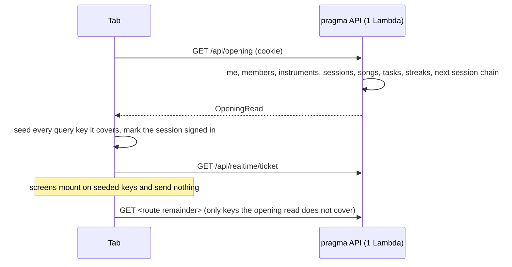

# pragma opens in two API calls, so no open is refused by the API

> ⚠️ Missing client discussion
> ⚠️ Missing product discussion
> ⚠️ Missing designer discussion

This spec was drafted by a piloted subagent that cannot ask the operator. The tech-lead and developer passes were done against the code and the production data. The three flags stay until the operator answers the decisions marked **open** below.

## Perspectives confronted

- [ ] **Client / business**. Not confronted. The operator still has to confirm that a cold open which waits on one read is acceptable (decision D6).
- [ ] **Product**. Not confronted. Which entry routes must meet the two-call target is open (D7).
- [x] **Tech-lead**. Confronted against the dantotsu, PR #261, the API layering and production row counts (measured this session).
- [x] **Developer**. Confronted against the query modules, the live invalidation machine and the lint rule blueprints.
- [ ] **Designer**. Not confronted. The error state of a first open that fails with nothing cached is new (D6).

## Why

On 2026-11-04 at 17:48 UTC one member opened pragma. The API served 45 requests and refused 193 in one minute (measured, see [the dantotsu](../../../../dantotsus/forty-requests-at-a-ten-seat-function.md)). `pragma-prod-api` has a reserved concurrency of 10, which is also its ceiling. PR #261 removed the per-song preload. The screen itself still sends about ten cold requests at once (inferred from the 17:48 logs and the code below), so one open still fills the ten seats. Raising the ceiling is excluded by CLAUDE.md "Lower the water".

- **Output metric.** No pragma API request is refused for concurrency. Read as `Throttles` = 0 for `pragma-prod-api` over a rolling seven days, against a baseline of 738 throttles a week (measured, dantotsu).
- **Input metrics.**
  - I1. A cold open of `/` sends exactly 2 requests to `/api/*`, of which 1 carries band data (target, measured by `/visual-validation`).
  - I2. Returning to a hidden tab sends at most 2 requests to `/api/*` (target).
  - I3. `pnpm lint` refuses a planted `Promise.all(ids.map((id) => queryClient.query(...)))` in `apps/*/site/src` (target).
- **Gemba.** The cold open of `/` today, read from the code on this branch (inferred, not run).

| Wave | Requests | Fired by |
| --- | --- | --- |
| 0 | `GET /api/instruments` | the session probe in `RequireSession` (`auth.queries.ts`, `probeSession`), only when no session is cached |
| 1 | `GET /api/me`, `/sessions`, `/songs`, `/instruments`, `/members`, `/tasks`, `/streaks` | `AppShell` and `HomePage` |
| 1 | `GET /api/realtime/ticket` | `startLiveInvalidation` once signed in |
| 1 | `GET /api/offline-manifest` | `startOfflineReading` on sign-in and on cache restore |
| 2 | `GET /api/setlists/by-session/:id`, `GET /api/sessions/:id` | `HomePage` and `loadNextSession` |
| 3 | `GET /api/setlists/:id/entries`, once per setlist of the next session | `HomePage` and `loadNextSession` |

That is 13 requests and a peak of 9 at once (inferred). Two more bursts of the same width exist (inferred from the code). A warm open refetches every mounted query older than 5 minutes (`staleTime` 300 000 ms, `query-client.setup.ts`). Returning to a hidden tab reopens the socket, and `openSocket` in `live-invalidation.core.ts` then invalidates every query, so every mounted query refetches. `refetchOnWindowFocus` keeps TanStack's default `true`, so a focus does the same.

## Result

No screen changes when the read succeeds. What changes is the network panel.

| Open | Today (inferred) | After (target) |
| --- | --- | --- |
| Cold open of `/` | 13 requests, peak 9 | `GET /api/opening`, then `GET /api/realtime/ticket` |
| Warm open of `/` | about 9 refetches | `GET /api/opening`, `GET /api/realtime/ticket` |
| Return to a hidden tab on `/` | ticket plus about 8 refetches | `GET /api/realtime/ticket`, `GET /api/opening` |
| Lint of a `.map` fan-out in site code | passes | refused by `borso/no-request-fan-out-in-site` |

**Audience.** Members of the band. The endpoint sits behind the member session like every band read.

## Use cases / edge cases



Happy path.

1. A member with a session cookie and an empty persisted cache opens `/`. The gate waits for the opening read, seeds the cache, then renders. The network shows the two requests of I1.
2. The same member reopens the app within 7 days. The gate renders the persisted cache at once. The opening read refreshes it in the background. Mounted seeded queries do not refetch.
3. The member hides the tab and comes back. The socket reopens. The `all` invalidation refetches the opening read once instead of each query.
4. Another member reorders a setlist. The stale message names `setlists`. Only the mounted `setlists` keys refetch, as today.
5. Offline, the restored cache answers every seeded key, the next session's setlist and entries included, as ADR-202611011313 promises.

Edge cases.

- The next session is today and already started. Home and the offline copy use `selectNextSession` from `domain/session-schedule.core.ts` (Paris calendar day). Today the offline manifest uses "strictly after now" instead, so the two can disagree (measured in `offline-manifest.core.ts` and VOCABULARY.md "Home"). See D3.
- No session ahead. `nextSession` is `null` and no session key is seeded.
- A song missing from the list. The list is the catalogue, so every song is in it (inferred). `loadSongDetails` and its per-song fallback go away with the offline manifest.
- An entry route outside the opening read, such as `/improvements`. The route's own query sends one more request (D7).

Error cases.

- `401` on the opening read. The session ended. `onSessionEnded` clears band data and the gate sends the member to `/login`, as the probe does today.
- `404 unknown-member`. Same as `401` (the cookie names a deleted member).
- `5xx` or network failure with a persisted cache. The gate renders the cache. No per-query fallback fires, so a struggling API gets no burst.
- `5xx` or network failure with nothing cached. The gate shows an error with a retry action (D6).
- A Lambda throttle (`429` or `503` from API Gateway). Treated as `5xx`. `retry: 1` sends it once more.

## Questions, Options and Decisions

| # | Question | Options and cost | Decision (2026-11-05) |
| --- | --- | --- | --- |
| D1 | One read for every route, one per screen, or a generic batch? | **a. One opening read** covering the shell, home and the offline copy. One endpoint, one seed function. Routes outside it keep one or two own calls. **b. One read per screen.** Exact fit per route, about ten endpoints and seed functions to keep in step with the query modules. **c. A client batch transport** (Hono client `fetch` option collecting GETs into one `POST /api/batch`, replayed in-process). Covers every route with no seeding, but dependent waves (sessions, then setlists, then entries) still cost 3 calls, every sub-request goes through one path in the API Gateway logs, and it is a new cross-cutting mechanism needing an ADR. | Recommended **a**. Proposed, awaits ratification. |
| D2 | Does the shell data (me, members, instruments) go into the read? | **Yes.** Every route reads it, and the read then doubles as the session probe, removing `GET /api/instruments` from the gate. **No.** The shell stays 3 calls on every route and the target fails. | Recommended **yes**, and the opening read replaces the session probe. |
| D3 | Does the opening read replace `/api/offline-manifest`? | **Replace.** The read carries the next session, its setlists and their entries, and the songs list already carries every song detail (measured in `loadSongDetails`). The manifest route, its core, its stale-scope root, its MCP exclusion and `offline-reading.queries.ts` are deleted. **Keep both.** Two reads of the same data, two "next session" rules. | Recommended **replace**, with the next session chosen by `selectNextSession`, so home and offline agree. |
| D4 | How does a seeded key stay consistent with live invalidation? | **a. Seed per key, refetch the read on `all`.** A stale message naming roots refetches the mounted keys of those roots, which is bounded by the screen. An `all` (socket reopen) marks every query stale without refetching, refetches the opening read, which reseeds and clears the stale mark, then refetches the mounted keys the read does not cover. `refetchOnWindowFocus` becomes `false` because the reopen already refreshes. The `opening` key root reads no announced root, so a targeted message never refetches the whole read. **b. Screens read the opening read through `select`.** No seeding, but every query module and screen changes. **c. Change nothing.** A return to the tab sends about 8 requests (inferred), which fails I2. | Recommended **a**. That `setQueryData` clears an invalidated mark is inferred from TanStack's source and is pinned by a unit test in the plan. |
| D5 | Does a mounted seeded query refetch on mount? | **No for seeded roots** (`refetchOnMount: false` through `setQueryDefaults` on each seeded key root). Freshness comes from the read at every open and from live invalidation. **Yes.** A warm open sends one request per stale key, which fails the target. | Recommended **no for seeded roots**. |
| D6 | **Open.** Does the first open wait for the opening read? | **Wait only when nothing is cached.** A cold open shows the existing checking screen until the read lands. A failure shows an error with a retry. A warm open renders at once. **Never wait.** Screens mount on an empty cache and fire their own queries, which is the burst. **Always wait.** A warm open offline would block on the network. | Recommended **wait only when nothing is cached**. Needs the operator, since the error screen is new. |
| D7 | **Open.** Which entry routes must meet "≤ 2 data calls"? | **a. Every route the shell tabs reach and `/`.** Exact counts below. Deep links from push (`/catalog/:id`, `/sessions/:id`, `/setlists/:id`) send the read plus their remainder, 2 to 4 data calls (inferred from their hooks, one level deep). That stays under 10 at once because the gate serialises the read before them. **b. Every route.** Needs D1 b or c. | Recommended **a**. Needs the operator, since it narrows the stated goal for deep links. |
| D8 | Does the opening read carry the realtime ticket? | **No.** The ticket keeps its own lifecycle in the live connection machine, and the open costs 2 calls. **Yes.** The open costs 1 call, but a 60 s ticket rides on a cached read and the machine needs a second path. | Recommended **no**. |
| D9 | One part of the read fails on the server. | **All or nothing.** The read answers `5xx` and the site follows the error cases above. **Partial.** Each part nullable, each screen handles a missing part. | Recommended **all or nothing**. The parts are small (115 songs, 30 578 chart bytes, 18 sessions, 5 members, 8 instruments, 3 tasks, measured in production this session). |
| D10 | Does rule B allow a bounded literal array? | **Allow** `Promise.all([a(), b()])` with no spread. The bound is visible in the code (the two `voting.queries.ts` invalidations). **Refuse every `Promise.all`.** Hits the cache-deletion adapters and the PDF worker load, which send no request. | Recommended **allow literals, refuse a `.map`, `.flatMap` or `Array.from` mapping**, spread or not, when its callback sends a request directly or through a same-file function (blueprint `lint-rule-transitive-call`). `useQueries` and `useSuspenseQueries` over a mapping are refused too. |
| D11 | What does rule B tell the author to do? | Message: "One request per item multiplies by the number of items, and the API serves 10 at once. Fetch the collection in one request: use or add a server read that returns every item, or seed per-item keys from a list response with `setQueryData`. See docs/standards/06-data-fetching.md." | Recommended as written. A new section in `06-data-fetching.md` holds the argument and the allowed shapes. |
| D12 | The one hit left after A, `useEntriesOfSetlists` (`setlist-entries.queries.ts:64`, used by `PracticeModePage`). | **Inline disable** with the reason "one query per setlist of one session; production holds at most 1 per session (measured)". **Server read** of entries per session. One more endpoint. | Recommended **inline disable**. The opening read seeds these keys for the next session, so practice mode on its day sends none. |

**Out of scope.** Raising the reserved concurrency. A CloudWatch alarm on `Throttles` (dantotsu option C, a separate infra change). Folding deep-link routes into reads (D7 b). Offline writes.

## Architectural choices

| ADR | Decision | What it constrains downstream |
| --- | --- | --- |
| to write, `pragma-opens-on-one-read` | The app opens on one aggregate read that seeds the query cache, replacing the offline manifest and the session probe (D1, D2, D3). It amends ADR-202611011313, whose prefetch it replaces. | Every new shell-wide or home-wide read is added to the opening read and its seed, not mounted as a separate query. |

No new dependency, no new secret.

## Changes

### Types / domain model

Add **Opening read** to `apps/pragma/VOCABULARY.md`, in place of **Offline manifest**. Each field reuses the body type of the endpoint it replaces, so a seeded key holds exactly what its query function returns.

```ts
// api: the payload; site: InferResponseType<typeof api.api.opening.$get, 200>
interface OpeningRead {
  readonly member: SignedInMember;                       // GET /api/me 200 body
  readonly members: MembersList['members'];              // GET /api/members
  readonly instruments: InstrumentsList['instruments'];  // GET /api/instruments
  readonly sessions: SessionsList['sessions'];           // GET /api/sessions
  readonly songs: SongsList['songs'];                    // GET /api/songs
  readonly tasks: TasksList['tasks'];                    // GET /api/tasks
  readonly streaks: StreaksView;                         // GET /api/streaks
  readonly nextSession: null | {
    readonly session: SessionById['session'];            // GET /api/sessions/:id
    readonly setlists: SetlistsOfSession['setlists'];    // GET /api/setlists/by-session/:id
    readonly entriesBySetlistId: Readonly<Record<string, SetlistEntries['entries']>>;
  };
}
```

| Seeded key | From |
| --- | --- |
| `authKeys.session()` | `{ authenticated: true }` on 200 |
| `meKeys.profile()` | `member` |
| `memberKeys.list()`, `instrumentKeys.list()`, `sessionKeys.list()`, `songKeys.list()`, `taskKeys.list()` | `{ members }`, `{ instruments }`, `{ sessions }`, `{ songs }`, `{ tasks }` |
| `songKeys.byId(id)` for each song | `{ song }` |
| `streakKeys.all` | `streaks` |
| `sessionKeys.byId(id)`, `setlistKeys.bySessionId(id)`, `setlistKeys.entriesOf(setlistId)` | `nextSession` parts |

Stale scope. `opening` joins `UNANNOUNCED_API_ROOTS` and `offline-manifest` leaves it. `DERIVED_READ_ROOTS.opening` lists `instruments`, `me`, `members`, `sessions`, `setlists`, `songs`, `streaks`, `tasks`. `QUERY_READ_ROOTS.opening` is `[]` (D4).

### Database changes

None.

### Files to change

```
apps/pragma/api/src/opening/opening.controller.ts        NEW  GET /api/opening behind requireMemberSession (controller-dispatch)
apps/pragma/api/src/opening/opening.service.ts           NEW  calls the existing services of each slice, no repository (service-clock-injected)
apps/pragma/api/src/opening/opening.core.ts              NEW  picks the next session with selectNextSession (core-projection)
apps/pragma/api/src/opening/opening.controller.test.ts   NEW  back e2e against seeded Postgres (test-back-e2e)
apps/pragma/api/src/app.ts                                UPDATE mount /api/opening, drop /api/offline-manifest
apps/pragma/api/src/sessions/offline-manifest.core.ts(+test), sessions.controller.ts, sessions.service.ts  UPDATE delete the manifest
apps/pragma/api/src/mcp/tool-coverage.core.ts             UPDATE exclusion GET /api/opening replaces the manifest's
apps/pragma/api/src/realtime/derived-read-roots.test.ts   UPDATE slice row opening
apps/pragma/domain/stale-scope.core.ts                    UPDATE roots as above
apps/pragma/site/src/lib/queries/opening.queries.ts       NEW  key, fetch, seed, refetch on all (query-module)
apps/pragma/site/src/lib/queries/opening-seed.core.ts(+test)  NEW  pure OpeningRead to [key, data] pairs, 100% covered
apps/pragma/site/src/lib/queries/offline-reading.queries.ts(+test), offline-reading.utils.ts(+test)  UPDATE delete, keep isSignInUpdate where it moves
apps/pragma/site/src/lib/queries/auth.queries.ts          UPDATE the probe reads the opening read
apps/pragma/site/src/lib/queries/query-read-roots.core.ts UPDATE opening [], drop offline-manifest
apps/pragma/site/src/lib/query-client.setup.ts(+test)     UPDATE refetchOnWindowFocus false, seeded roots refetchOnMount false, boot refresh
apps/pragma/site/src/lib/live-invalidation.setup.ts, live-invalidation.core.ts(+test)  UPDATE all refetches the opening read
apps/pragma/site/src/components/organisms/RequireSession.tsx, session-gate.core.ts(+test)  UPDATE gate per D6
apps/pragma/site/src/lib/queries/setlist-entries.queries.ts  UPDATE disable line per D12
apps/pragma/site/src/i18n/en.json, fr.json                UPDATE error and retry text of D6
apps/pragma/VOCABULARY.md                                 UPDATE Opening read replaces Offline manifest
eslint-rules/no-request-fan-out-in-site.js(+test)         NEW  rule B (lint-rule, test-lint-rule, lint-rule-transitive-call)
eslint-rules/index.js, .oxlintrc.json                     UPDATE register, error on apps/*/site/**/*.{ts,tsx}
docs/standards/06-data-fetching.md                        UPDATE section the rule message points to
docs/adr/<UTC>-pragma-opens-on-one-read.md                NEW  via /adr
```

Rule B hits today (measured, `grep -rn -E "Promise\.(all|allSettled)\(" apps/*/site/src` plus `useQueries`, tests excluded).

| Line | Sends a request per item | After this change |
| --- | --- | --- |
| `pragma/.../offline-reading.queries.ts:37`, `:52`, `:70` | yes | deleted by D3 |
| `pragma/.../setlist-entries.queries.ts:64` (`useQueries`) | yes | inline disable, D12 |
| `pragma/.../voting.queries.ts:114`, `:134` | literal pair of invalidations | allowed |
| `pragma/.../recovery.adapter.ts:5`, `:10`, `talos/.../offline-cache.adapter.ts:20`, `banana-rush/.../main.worker.ts:25` | no, cache and worker cleanup | allowed |
| `pragma/.../pdf-text.adapter.ts:27` | no, literal pair of imports | allowed |

### Test strategy

- **Unit, 100% coverage.** `opening-seed.core.ts` maps a full read and a read with `nextSession: null`. `opening.core.ts` picks a session later today, a tie and none. `session-gate.core.ts` covers cached, uncached, failed and `401`. `live-invalidation.core.ts` turns `all` into one opening refetch. A query-client test pins that seeding clears an invalidated mark (D4).
- **Type test.** Each `OpeningRead` field equals the body of the endpoint it replaces (`expectTypeOf`).
- **Back e2e.** `opening.controller.test.ts`: `401` without a cookie, the full payload on the seed, `nextSession` with entries, `null` with no session ahead.
- **Rule B.** RuleTester suite: invalid cases are the dantotsu's faulty line, a `.map` calling `queryClient.query`, a `$get` in a map, a same-file helper called in a map, and `useQueries` over a map. Valid near misses are a literal pair, a map over `caches.delete` and a back-end file. `pnpm lint` passes on the repo after D12.
- **Visual validation (input metrics only).** Against `pnpm dev`, with agent-browser's network log, after sign-in and a cleared `pragma.query-cache`. Count requests whose path starts with `/api/` from navigation until 3 s without a request.

| Entry route | Exact `/api/*` requests, `POST /api/auth/login` excluded | Of which data |
| --- | --- | --- |
| `/` | 2 (`GET /api/opening`, `GET /api/realtime/ticket`) | 1 |
| `/sessions`, `/tasks` | 2, as above | 1 |
| `/catalog` | 3 (adds `GET /api/studies/overview`) | 2 |
| `/setlists` | 3 (adds `GET /api/setlists`) | 2 |
| `/improvements` | 3 (adds `GET /api/improvements`) | 2 |
| `/` after hiding and showing the tab, on the PR preview | 2 (`GET /api/realtime/ticket`, `GET /api/opening`) | 1 |

  The ticket is sent once in `pnpm dev` too. There it answers no socket URL (live-invalidation spec, behaviour 7), so no socket opens and the hidden-tab row is checked on the PR preview instead. Visual validation does not prove the output metric. `Throttles` is read in production only.

## Production strategy

### Analytics

**Input metrics.** Sentry span `GET /api/opening` duration p50 and p90, and its response size, both unknown today and reported in the PR. API Gateway logs per path give the requests per open.

**Output metric.** `Throttles` and `ConcurrentExecutions` maximum for `pragma-prod-api` over the seven days after the deploy, read on the 3S board. The scheduled check of 2026-11-12 (dantotsu) already reads them.

### Zero-defect strategy

- `opening-read-failed`. The site reports a failed opening read to Sentry through the query `meta.reportFailure`, tagged with the status. Today a failed API call reports nothing (measured, dantotsu). Alert at 3 in 10 minutes.
- `opening-read-part-failed`. The server reports which part threw, through the existing error reporting adapter, before answering `5xx`.
- A Lambda throttle never reaches Sentry. The 3S board's `Throttles` count is the only detector until dantotsu option C ships.
