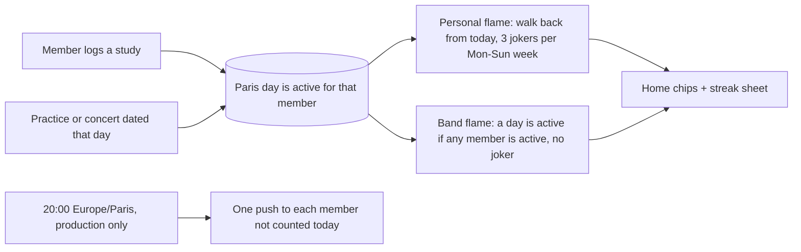

# Each member and the band see a practice flame on Home

## Perspectives confronted

The operator answered three rounds of questions in chat on 2026-10-29.

- [x] **Client / business**: the operator asked for a Duolingo-style streak while reviewing PR #216 and chose to count studies and practices, because "nobody logged a study because nobody knew it existed".
- [x] **Product**: the operator picked two flames (personal and band), a daily period, 3 jokers per Monday-to-Sunday week for the personal flame and none for the band, and a practice that counts for every member.
- [x] **Tech-lead**: the operator chose to replace the existing study streak rather than keep two, and to ship the 20:00 push job in this PR, knowing it adds a scheduled job and an ADR.
- [x] **Developer**: the operator confirmed that a band day needs only one member's study, and that jokers reset on Monday so the screen can count them. Both are pure rules a unit test holds.
- [x] **Designer**: the operator chose two chips on the title line of Home, a sheet on tap, and the flame in shades of pragma blue.

## Why

The band wants its members to practise between rehearsals. Pragma already lets a member log a study, and computes a streak from it. Nobody has used it.

- **Gemba** (production, read 2026-10-29 with `scripts/db-read.sh`): 0 studies ever and 0 mastery score changes. 17 takes, all by one member, recorded on 6 Oct and 13 Oct. 3 past practices (1 Sep, 6 Oct, 13 Oct), 3 upcoming (3, 14 and 15 Nov). 5 members.
- PR #216 removed the Studies page, the only screen that showed the streak. A study can still be logged from a song's round actions (`SongRoundActions`, the Practised button).
- **Output metric**: days per week on which at least one member logs a study. The baseline is 0 (measured).
- **Input metrics**: studies logged per member per week, and opens of the streak sheet.

## Result

Home, at 375 px:

```
Hi Hugo
Home                     [🔥 12] [👥 4]
┌──────────────────────────────────┐
│ Next practice · Tue 3 Nov        │
│ Setlist · 14 songs · 52 min      │
└──────────────────────────────────┘
[ Your part | Your tasks ]
...
            ( ▶ Practice mode )
```

- Two chips sit right of the `Home` title, on the `PageHeader` line. The first is the signed-in member's flame and its day count. The second is the band's flame, marked with the `members` glyph, and its day count.
- A new `flame` glyph joins `Icon.tsx`. The flame uses only the accent family from `tokens.css`. It is `accent` when today counts, `accent-soft` filled with an `accent` outline while today is still open, and `ink-faint` at 0.
- Each chip is a button with an accessible name, for example "Your flame, 12 days, today counted". Tapping either one opens the **streak sheet**.
- The streak sheet:
  - Your flame, large, with "Today counted" or "Today still open", and "2 jokers left this week".
  - The band flame, with its day count.
  - One row per member. Each row shows a dot in the member's stored colour, their first name, and their flame.
  - One footer button, `Study a song` with the `catalog` icon (the glyph of its destination). It is a `ButtonLink` to `/catalog?filter=learning`.
- No new primary action. The Home pill stays as #216 left it.
- Push, at 20:00 Paris time, at most once a day per member. A member whose day has not counted yet gets one of these two:
  - When their flame is above 2 days: "Keep your 12-day flame alive. Log a study before midnight."
  - Otherwise, when at least one member has counted today: "3 members already practised today. Your turn?"

## Use cases / edge cases



**The rules.** The day is the `Europe/Paris` calendar day, the same day `parisCalendarDay` uses for a study.

- A day is **active for a member** when that member logged a study that day, or when a `session` of either kind is dated that day.
- **Personal flame**. Walk back from today, one day at a time.
  - Today never breaks the flame. When today is not active, the walk starts from yesterday.
  - An active day adds 1.
  - A missed day spends one joker from its Monday-to-Sunday week. Each week has 3 jokers. A missed day with no joker left in its week ends the walk.
  - A joker bridges only a gap that has an active day on both sides. Missed days older than the first active day spend nothing.
  - The count is active days only. A day bridged by a joker adds nothing.
- **Band flame**. A day is active for the band when it is active for at least one member. Walk back from today as above, with no joker. The first missed day ends the walk.
- **Jokers left this week** is 3 minus the jokers the walk spent on days of the current week.

**Happy path**

1. Léa opens Home. Her chip shows 🔥 12 and the band chip shows 👥 4.
2. She taps her chip. The sheet shows her flame with "Today still open" and "1 joker left this week", the band flame, and the five members.
3. She taps `Study a song`. The catalogue opens on To learn. She marks a song Practised.
4. She goes back to Home. Her chip reads 13 in `accent`, and the band chip did not change because Tom had already studied today.
5. At 20:00, Tom has a 5-day flame and has not studied today. He gets "Keep your 5-day flame alive".

**Edge cases**

- A member with no activity ever: the chip reads 0 in `ink-faint`, and the sheet says "No flame yet".
- A practice today: every member's day is active, so nobody gets the 20:00 push.
- A session dated in the future counts only once its day comes. A deleted session stops counting on the next read, because nothing is stored.
- Undoing today's study removes today from the flame on the next read.
- A member who turned off the `streak` push category gets no 20:00 push. The category is on by default, like the others (`isCategoryEnabled` returns `true` when no row is stored).
- A member with no push subscription gets nothing, and the job carries on.
- The member list is read when the flames are computed, so a deleted member drops out of the sheet and out of the band count.
- Previews hold no push subscription (`push_subscription` is in the preview blocklist in `apps/pragma/cdk/lib/stack.ts`), and the job is not deployed there anyway.

**Error cases**

- The flame read fails: Home shows no chips, logs the error, and keeps working. A flame never blocks Home.
- One push fails: the job records it as Sentry tag `streak_push_failed` and carries on. An expired subscription is deleted as `notifyBand` does today.
- The job runs twice the same day (a retry): `notification_dispatch` claims the group key `streak:<memberId>:<day>`, so each member gets at most one push.

## Questions, Options and Decisions

| Question | Options | Decision (2026-10-29) |
| --- | --- | --- |
| What counts | Any activity; practices only; studies only; studies and takes | Studies and practices (operator). Takes are left out. |
| Who | Band; member; both | Both (operator). |
| Period and grace | Weekly; daily | Daily. The personal flame gets 3 jokers per week and the band flame none (operator). |
| Band day | One member; every member; a majority | One member's study, or a session that day (operator). |
| Joker reset | Monday to Sunday; any 7 days | Monday to Sunday, Paris time (operator). |
| Practice without attendance | Every member; band only; add attendance | Every member. No schema change (operator). |
| Old study streak | Replace; keep both | Replace. `computeStreak`, `buildMemberStreaks`, `StreakBadge` and the studies overview's `myStreak` and `band` go. The MCP tool reports the new flames (operator). |
| Pushes | 20:00 job; push on each study; none | 20:00 job, production only (operator). |
| Placement and tap | Header chips; own row; inside the next-session card. Sheet or nothing | Header chips that open a sheet (operator). |
| Concerts | Count; do not | Count, as sessions. The operator's "practice" answer named "a practice or concert" in its option. |
| Base branch | `main`; #216's head | #216 is open. This branch starts from `claude/pragma-ux-redesign-slice-6` and its PR targets that branch until #216 merges. |

**Out of scope**: takes in the streak, an attendance record, a streak on any screen other than Home and its sheet, and push wording per member.

## Architectural choices

| ADR | Decision | What it constrains downstream |
| --- | --- | --- |
| To write with `/adr` before code: pragma runs a daily job at 20:00 Europe/Paris | EventBridge Scheduler with a `Europe/Paris` time zone, against an EventBridge Rule in UTC (which drifts one hour twice a year) and a new Lambda against the API handler routing a scheduled event | pragma's CDK stack, the Lambda entry point, and the 100% coverage of `apps/pragma/cdk` tests |

## Changes

### Types / domain model

```ts
// domain/practice-flame.core.ts (shared by api and site)
type CalendarDay = string; // 'YYYY-MM-DD' in Europe/Paris
interface PersonalFlame { days: number; isTodayCounted: boolean; jokersLeftThisWeek: number }
interface BandFlame { days: number; isTodayCounted: boolean }
// GET /api/streaks
interface StreaksView {
  today: CalendarDay;
  mine: PersonalFlame;
  band: BandFlame;
  members: { memberId: string; firstName: string; color: string; flame: PersonalFlame }[];
}
```

VOCABULARY: **Streak** is rewritten as **Flame** (personal and band), with these rules. **Study** keeps its entry, and its "counts it in the streak" test is renamed.

### Database changes

None. Flames are computed on read from `study` and `session` over the last 400 days (`STREAK_LOOKBACK_DAYS`). The new push category `streak` is a value in `NOTIFICATION_CATEGORIES`, and preference rows are text.

### Files to change

```
apps/pragma/domain/practice-flame.core.ts (+ test)        NEW: both walks, pure
apps/pragma/api/src/studies/streak.core.ts (+ test)       DELETE
apps/pragma/api/src/studies/band-streaks.core.ts (+ test) DELETE
apps/pragma/api/src/streaks/                              NEW: controller, service, types for GET /api/streaks
apps/pragma/api/src/studies/studies.service.ts, .types.ts UPDATE: drop myStreak, band, myLine
apps/pragma/api/src/studies/study-tool.core.ts, me/me-tools.controller.ts UPDATE: report flames
apps/pragma/api/src/notifications/notifications.core.ts   UPDATE: 'streak' category, two messages
apps/pragma/api/src/streaks/streak-reminder.*             NEW: who gets which push, and the job entry
apps/pragma/cdk/lib/stack.ts (+ test)                     UPDATE: 20:00 Europe/Paris schedule, production only
apps/pragma/site/src/components/atoms/Icon.tsx            UPDATE: flame glyph
apps/pragma/site/src/components/molecules/FlameChip.tsx   NEW (replaces StreakBadge)
apps/pragma/site/src/components/organisms/StreakSheet.tsx NEW
apps/pragma/site/src/lib/queries/streaks.queries.ts       NEW; study mutations invalidate it
apps/pragma/site/src/routes/home/HomePage.tsx             UPDATE: chips in the header, the sheet
apps/pragma/site/src/components/organisms/NotificationSettings.tsx UPDATE: the streak toggle
apps/pragma/site/src/i18n/en.json, fr.json                UPDATE
apps/pragma/VOCABULARY.md                                 UPDATE
```

### Test strategy

- **Unit, 100% coverage and mutation**: `practice-flame.core.ts` holds every rule above, one test per rule and edge case. These include a joker crossing a Monday, a fourth missed day in one week, jokers before the first active day, today open, a practice day for all, and the band walk with no joker. The push selection (`streak-reminder` core) is tested for who gets which message and who gets none.
- **API controller tests**: `GET /api/streaks` after a study, after an undo, and with a session today. The 20:00 handler claims the dispatch once when run twice.
- **CDK test**: the schedule exists in production only, at `cron(0 20 * * ? *)` with time zone `Europe/Paris`.
- **Visual validation**, at 375 px and on a phone:
  - Both chips sit on the title line.
  - Their accessible names carry the counts.
  - A tap opens the sheet, with the member rows in their stored colours.
  - `Study a song` lands on To learn.
  - After a study, the chip shows the new count in `accent`.
  - The flame uses only accent tokens, checked against computed styles.
- Output metrics are not asserted by visual validation.

## Production strategy

### Analytics

**Input metrics**:

- `recordProductEvent('streak_sheet_opened')`.
- Studies per member per week, read from `study`.
- The job's log line `streak_reminder_sent` with `{ kind: 'at-risk' | 'band-count', count }`.

**Output metric**: days per week with at least one study across the band, read monthly with `scripts/db-read.sh`. Success is 3 or more days per week within a month of the merge, against a baseline of 0. That target is a guess.

### Zero-defect strategy

- `streak_push_failed` Sentry tag, one per failed delivery. Alert at 3 within a day.
- A job that throws reports through the existing error reporting, and its Lambda error metric alerts on any failure.
- `GET /api/streaks` errors surface as any API error does today.
