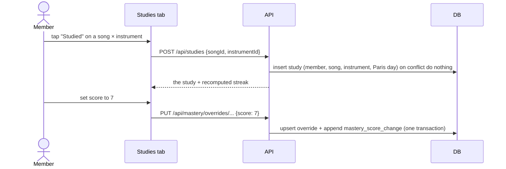

# Each member logs the songs they studied, keeps a streak, and sees whether the band is ready for the next concert

## Perspectives confronted

- [x] **Client / business**: the operator confirmed three problems at once. Personal work between practices is uneven across members, nobody can tell who stands where before a concert, and the operator cannot track their own progress.
- [x] **Product**: the definition of a study, the streak rule, the joker, the ban on back-dating, the undo, the full visibility and the screen without a concert were each chosen against named alternatives.
- [x] **Tech-lead**: mastery has no history today, because `mastery_override` is overwritten in place. Every override write now appends a history row in the same transaction.
- [x] **Developer**: the streak, the joker, the Paris calendar day, the readiness rule and the study ordering are pure functions taking `now`, so the whole rule set is provable without a browser.
- [x] **Designer**: one new tab, built for a phone right after practising. It shows my streak, then my songs to study (the not-ready ones first), then the band's streaks and the concert bar.

## Why

The band rehearses together, but the work that makes a rehearsal useful happens alone at home, and nothing records it. Some members work, some do not, and nobody can see the difference until a song falls apart in front of the others. Mastery scores exist, but they are a snapshot with no history, so no member can see their own progress either.

- **Output metric**: every song of a concert's setlists reaches a lineup mean mastery of 7 before the concert date. Reviewed by the operator after each of the next three concerts, not gated.
- **Input metrics**: the number of members holding a streak of 3 days or more on any given day; the number of studies logged per member per week; the share of not-ready concert songs that receive at least one study in the 7 days before the concert.
- **Gemba**: the operator reports uneven personal work between practices and cannot track their own. The `mastery_override` table holds only the latest score, so the app cannot show progress at all.

## Result

A new **Studies** tab (`/studies`, labelled *Révisions* in French) in the app shell, built for a 375 px screen first.

1. **My streak**: the number of days in the streak, whether today is already counted, and whether the weekly joker is still available.
2. **To study**: songs of the next upcoming concert's setlists where I hold an instrument in the lineup. Not-ready songs come first, then songs by my lowest effective mastery. Each row shows the song, my instrument, my score and a **Studied** button. Tapping it logs today's study and opens an inline 0 to 10 stepper to adjust my score, which I can skip. A study logged today shows as done and can be undone.
3. **Band**: one line per member, with their colour, their streak and their studies this week.
4. **Concert readiness**: *n of N songs ready* for the next concert, with the date and the not-ready songs listed under the bar.
5. **No upcoming concert, or a concert with no setlist**: section 2 lists every catalogue song where I hold an instrument, ordered by my lowest mastery; section 4 is replaced by one line saying no concert is planned.

The song detail page gains a small **progress** chart: one line per member and instrument, drawn from the mastery history.

## Use cases / edge cases



**Happy path**

1. A signed-in member opens the Studies tab and sees their streak, their songs to study for the next concert, the band's streaks and the readiness bar.
2. They tap **Studied** on a not-ready song. The row shows as done and the streak includes today.
3. They raise their score from 5 to 7. If the lineup mean reaches 7, the song moves to ready and the bar gains one.
4. Another member opening the tab sees the new streak and the moved bar.

**Edge cases**

- A second tap on the same song and instrument on the same day changes nothing: one study per member, song, instrument and Paris calendar day.
- A member holding two instruments on a song sees two rows, one per instrument.
- **Streak rule**: a day counts when it holds at least one study. One missed day in any rolling 7-day window is forgiven (the joker); a second missed day in that window ends the streak. Today never breaks the streak before it ends.
- The day boundary is midnight in `Europe/Paris`, whatever the device time zone.
- No back-dating: the server stamps the day from its own clock, and the body carries no date.
- Undo deletes only a study of mine logged today. Undoing the only study of today leaves today uncounted again.
- A song is ready when every member and instrument of its lineup has a score and the lineup mean is 7 or more. A song where one player has recorded nothing is not ready, even when the others average 7.
- The next concert is the earliest concert strictly after now. The readiness set is the union of the songs in every setlist linked to that concert, counted once each.
- A mastery default change writes no history row, because it is not about a song; only override writes are history.
- Deleting a song deletes its studies and its history rows; deleting a member deletes theirs.

**Error cases**

- `study-not-in-lineup`: the member holds no such instrument in the song's lineup. 422, and a front-end bug, since the screen only offers lineup pairs.
- `study-not-found`: undoing a study that is not mine or not today's. 404.
- `song-not-found` / `instrument-not-found`: 404.

## Questions, Options and Decisions

| Question | Options | Decision (2026-10-12) |
| --- | --- | --- |
| What is a study? | A practice session with a duration; a tap per song; a mastery increase | A tap per song and instrument, with an optional score adjustment. Progression is read from the mastery history. |
| What moves a streak? | A study log; a mastery increase only; a weekly study | A study log, daily, with one joker per rolling 7 days. A mastery-only streak breaks too often and pushes members to inflate scores. |
| Collective goal | Concert setlist readiness; a study count; a free-form goal | Readiness of the next concert's setlists. It answers "are we ready?", and it points studies at the songs that block it. |
| Readiness threshold | Fixed 7; per concert; every member-instrument at least 7 | A fixed 7, as a named constant, on the lineup mean. |
| Back-dating | Up to yesterday; today only; unlimited | Today only. It keeps the streak honest. |
| Undo | Own studies; none | Own studies, today's only. Undoing an older study would rewrite a streak. |
| Does undo revert a score changed during the study? | Yes; no | No. The study and the score are two independent writes, and the history keeps both rows. |
| A lineup member with no score at all (found at implementation, 2026-10-13) | Skip them, as `meanForSong` does; count the song not ready | Not ready. `meanForSong` skips unscored players, so one drummer at 7 made a four-person song ready while three people had said nothing. Readiness is the band's answer, so a silent player blocks it. |
| Score inflation: readiness reads self-assessed scores | Trust; a feed of who raised what | Trust, and keep the competition on showing up every day rather than on how well one plays. The streak rewards the daily study, never a score. Known risk, accepted. |
| Visibility | All to all; personal private | All to all. Five members, one shared app, and the comparison is the point. |
| Mastery history source | Every override write; studies only | Every override write, from the matrix, the song page or the Studies tab. Otherwise the curve has holes. |
| Granularity | Song × instrument; song only | Song × instrument, matching mastery. |
| Naming | `revision`, `practice`, `study` | `study`. `practice` is already a session kind (a band rehearsal) and `revision` reads as a version in code. |

**Out of scope**: study duration; notifications or reminders; badges and rewards beyond the streak; a configurable threshold; back-dated studies; history for mastery defaults; a ranking by study count.

## Architectural choices

None. Two new tables in the existing DSQL schema, no new dependency, no new secret, no external service.

## Changes

### Types / domain model

```ts
interface Study { memberId: string; songId: string; instrumentId: string; studiedOn: string; createdAt: Date }
interface MasteryScoreChange { memberId: string; instrumentId: string; songId: string; score: number; changedAt: Date }
interface Streak { days: number; includesToday: boolean; jokerAvailable: boolean }
interface ConcertReadiness { concertId: string; date: Date; readySongIds: string[]; notReadySongIds: string[] }
```

`VOCABULARY.md` gains **Study** (not to be confused with a practice), **Streak** and **Mastery score change**.

### Database changes

```sql
-- 0015_studies.sql
CREATE TABLE IF NOT EXISTS "study" (
  "member_id" uuid NOT NULL, "song_id" uuid NOT NULL, "instrument_id" uuid NOT NULL,
  "studied_on" date NOT NULL, "created_at" timestamptz NOT NULL,
  PRIMARY KEY ("member_id", "song_id", "instrument_id", "studied_on"));
CREATE TABLE IF NOT EXISTS "mastery_score_change" (
  "id" uuid PRIMARY KEY, "member_id" uuid NOT NULL, "instrument_id" uuid NOT NULL,
  "song_id" uuid NOT NULL, "score" integer NOT NULL, "changed_at" timestamptz NOT NULL);
CREATE INDEX ASYNC IF NOT EXISTS "mastery_score_change_song" ON "mastery_score_change" ("song_id");
```

No foreign keys, because DSQL has none; the services check existence and the delete cascades remove the rows.

### Files to change

```
apps/pragma/api/src/studies/studies.{controller,service,repository,schema,types}.ts   // NEW
apps/pragma/api/src/studies/streak.core.ts                                             // NEW: streak + joker, takes now
apps/pragma/api/src/studies/paris-day.core.ts                                          // NEW: Europe/Paris calendar day of an instant
apps/pragma/api/src/studies/study-queue.core.ts                                        // NEW: ordering of the to-study list
apps/pragma/api/src/studies/concert-readiness.core.ts                                  // NEW: ready rule; only the API reads it, the site gets the answer from the overview
apps/pragma/api/src/mastery/mastery.{repository,service,schema}.ts                     // UPDATE: append history on override upsert; history read
apps/pragma/api/src/songs/ + members/ delete cascades                                  // UPDATE: delete studies and history
apps/pragma/api/src/database/migrations/0015_studies.sql                               // NEW
apps/pragma/site/src/routes/studies/StudiesPage.tsx                                    // NEW
apps/pragma/site/src/components/organisms/{StudyQueue,BandStreaks,ConcertReadinessBar}.tsx // NEW
apps/pragma/site/src/components/molecules/{StreakBadge,StudyRow}.tsx                   // NEW
apps/pragma/site/src/components/organisms/MasteryProgressChart.tsx                     // NEW, on SongDetailPage
apps/pragma/site/src/lib/queries/studies.queries.ts                                    // NEW: optimistic log/undo, settled from the response
apps/pragma/site/src/components/organisms/AppShell.tsx                                 // UPDATE: Studies tab
apps/pragma/site/src/i18n/{en,fr}.json                                                 // UPDATE
apps/pragma/VOCABULARY.md                                                              // UPDATE
```

### Test strategy

- **Pure cores at 100% coverage plus mutation**: `streak.core.ts` (consecutive days, one joker per rolling 7 days, the second miss ends the streak, today not yet counted, an empty log); `paris-day.core.ts` (23:30 UTC in summer and in winter, the DST switch days); `concert-readiness.core.ts` (mean exactly 7, nothing recorded, a song in two setlists, no upcoming concert, a concert today counts as past); `study-queue.core.ts`.
- **Back-end e2e** on the local Postgres: logging twice is idempotent; undo refuses another member's study and yesterday's; an override upsert appends exactly one history row; deleting a song or a member removes its studies and history.
- **Visual validation** at 375 px and 1280 px: every happy-path step and every edge case above, including two instruments on one song, undo, the readiness bar moving after a score change, and the screen with no upcoming concert.
- **Touch**: `scripts/argent.sh` taps **Studied** and the score stepper with a thumb at 375 px.

## Production strategy

### Analytics

**Input metrics**, from the request lines the API's request logger already writes, with their status (decided at implementation, 2026-10-13: the repository's lint rule allows no `console.info`, and no application here emits named events yet, so the richer fields below wait for the first event pipeline):

- `study_logged` is `POST /api/studies` answering 201, and `study_undone` is `DELETE /api/studies/…` answering 200. Whether the song was ready at that moment is not recorded.
- `mastery_score_changed` is `PUT /api/mastery/overrides`, and the `mastery_score_change` table holds every value with its time. The source screen is not recorded.
- Thresholds: at least 3 of 5 members log a study in the week after the deploy; `study_undone` stays under 10% of `study_logged`, or the button is too easy to hit by mistake.

**Output metrics**, reviewed by the operator, not gated: the readiness bar shows N of N on the morning of each of the next three concerts.

### Zero-defect strategy

| Error class | Fires when | Surfaces as |
| --- | --- | --- |
| `study-not-in-lineup` | a study names a pair outside the song's lineup | a front-end bug: alert on the first occurrence |
| `study-not-found` | undo on a study that is not mine or not today's | expected after midnight on a stale screen, logged at info; alert above 10 per hour |
| `mastery-history-write-failed` | the history insert fails inside the override transaction | the whole write rolls back; alert on the first occurrence |
