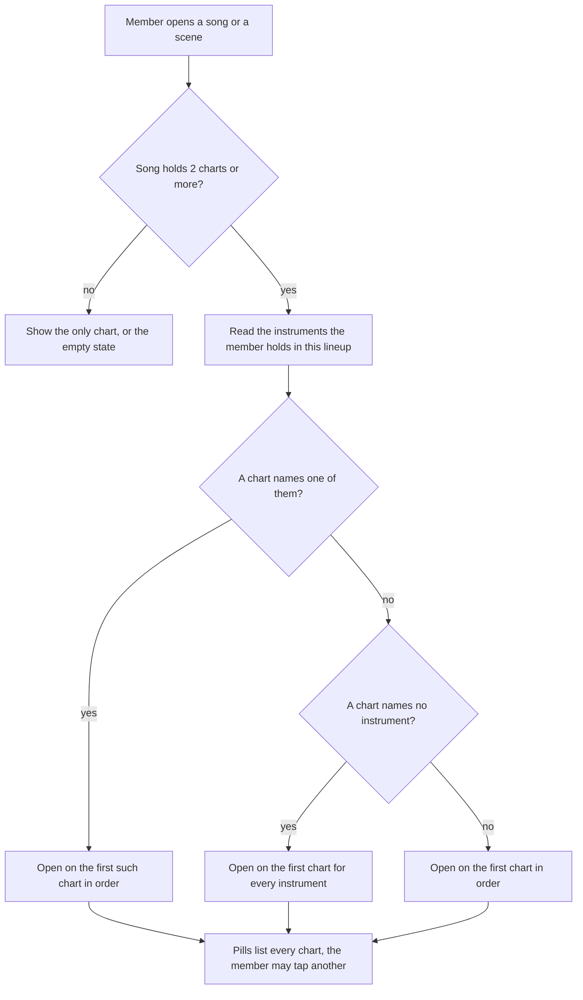

# Each member opens a song on the chord chart for the instrument they play

## Perspectives confronted

- [x] **Client / business**. The operator asked for several charts per song, each for one or several instruments, such as a guitar tablature for Guitare and a chord grid for Guitare and Piano (brief of 2026-11-16).
- [x] **Product**. The operator's call (brief of 2026-11-16). A member opens a song on the chart for an instrument they hold in that song's lineup. The other charts stay one tap away, each named by its instruments. With no match, the first chart shows. Nothing is hidden from anyone.
- [x] **Tech-lead**. The main session decided the migration, the meaning of a chart with no instrument, the kinds and limits, and the assistant tools (brief of 2026-11-16). This spec picks the data shape under *Questions, Options and Decisions*.
- [x] **Developer**. Every surface that reads `song.chart` is listed under *Files to change*, found with `grep -rlE "\bchart\b|ChordChart|SongChart"` over `api/src`, `site/src` and `domain` this session.
- [x] **Designer**. The spec author decided the edit form and the chart switcher from components the app already ships (`SectionTabs`, `ToggleButtonGroup`, `ChartKindIcon`). No mockup canvas was made. The PR preview is where the operator validates the layout (CLAUDE.md, *Commits, pull requests, merges*).

## Why

The band reads one chord chart per song today (`chart` column, `api/src/songs/songs.schema.ts`). A guitarist who wants a tablature and a pianist who wants the grid must share one text. The operator wants each instrument to get its own chart, and each member to land on theirs without searching.

- **Output metric.** Songs holding two charts or more, read monthly with `APP=pragma scripts/db-read.sh`. Today the count is 0 by construction, because a song holds one chart. 52 of 129 songs hold a chart, all ChordPro, and none holds a tab block (measured this session with `scripts/db-read.sh`).
- **Input metric.** Of the times a member opens a song holding two charts or more, the share where they switch to another chart. A low share says the opening chart was the right one. The target is under 20 % over a rolling 30 days. That number is a target chosen here, not a measurement.
- **Gemba.** The `{start_of_tab}` support already exists (`api/src/songs/INVARIANTS.md`, *Chord chart*), yet no production chart uses it (measured). Inferred: a tablature has nowhere to live without pushing the grid out of the one chart a song holds.

## Result

- **Song page, Chords tab** (`SongDetail.tsx`). A song with two charts or more shows a row of chart pills above the chart. Each pill shows the chart's kind icon and its title, such as "Guitare + Piano" or "Guitare · Solo". The pill of the opening chart is selected. A song with one chart looks as it does today. A song with none shows today's empty state.
- **Setlist entry sheet, Chords tab** (`SetlistEntrySheet.tsx`). Same row and same rule, read against the lineup of that setlist entry.
- **Song scene view** (`SongScenePage.tsx`) and **setlist scene view** (`SetlistScenePage.tsx`). The same row in the stage tones, under the header, listing the ChordPro charts only.
- **Song edit form** (`SongEditForm.tsx`, `SongChartFields.tsx`). A *Chord charts* section holds one card per chart, in order. Each card has the instrument chips, an optional label, today's paste, photo and PDF buttons with their editor and preview, and move up, move down and remove buttons. An *Add a chart* button closes the section.
- **Assistant tools.** `get_song` and `save_song` read and write `charts`, each with its instruments by name.
- **Catalogue rows** (`SongCard.tsx`). The kind icon is the first chart's kind, so every row looks as it does today.
- **Audience.** Signed-in band members only, as for every pragma page (`apps/pragma/VOCABULARY.md`, header).

## Use cases / edge cases



Happy path:

1. A member edits a song, taps *Add a chart*, pastes a guitar tablature and picks the Guitare chip. They save.
2. The song now holds the migrated chart first (no instrument, so for every instrument) and the tablature second (Guitare).
3. A member who holds Guitare in the song's lineup opens the Chords tab. The tablature shows, under a selected "Guitare" pill. The "All instruments" pill sits beside it.
4. A member who holds Piano opens the same tab. The chart for every instrument shows.
5. A member who sits the song out, or who is not in its lineup, opens it. The chart for every instrument shows.
6. In the setlist scene view, the guitarist moves to the next song. The opening chart is chosen again for that entry, against the lineup the entry resolves to.

Edge cases:

- Two charts name Guitare. The first one in order opens.
- A chart names Guitare and Piano, and a later one names Guitare. A guitarist opens on the first one, because it comes first.
- The member holds two instruments, Chant and Guitare. Any chart naming either one matches, and the first match in order opens.
- A setlist entry overrides the lineup and moves the guitarist to Basse. The entry sheet and the setlist scene open the Basse chart. The song page keeps reading the song's default lineup.
- The signed-in member is still loading. The first chart shows, and the opening chart replaces it once the member is known, unless the member already tapped a pill.
- The member taps a pill, then changes setlist entry in the scene. The new entry opens on its own opening chart, and the transpose resets as it does today (`SetlistScenePage.tsx`, `goToIndex`).
- The member taps a pill, then transposes. The transpose offset is kept across pills of the same song.
- A song holds a PDF chart and a ChordPro chart. The scene views list only the ChordPro chart. A song with no ChordPro chart shows today's scene message.
- An instrument is deleted. Its id leaves every chart. A chart left with no instrument becomes a chart for every instrument. No chart is deleted.
- A chart names an instrument id no instrument holds any more. Its title skips that name. If no name is left, the title reads "All instruments".
- A chart card is left empty (no kind chosen) on save. It is dropped from the saved list.
- The song reaches six charts. *Add a chart* is disabled and a hint says the limit.
- A browser tab opened before the deploy reads the new response. Its scene views find no `chart` field and show "No ChordPro chart" until reloaded (inferred from `selectChordProText` returning null on `undefined`, `routes/catalog/chart-kind.utils.ts`). Its edit page fails its parse (`SongEditPage.tsx`, `singleSongSchema.safeParse`) and cannot save.

Error cases:

- A save with seven charts, a label over 64 characters, an instrument id that is not a UUID, or a list whose JSON is over 1 000 000 bytes answers 400, as any song validation failure does.
- `save_song` naming an instrument no instrument matches is refused the same way an unknown instrument in `defaultLineup` is (`resolveNamedLineupOrRefuse` in `api/src/songs/songs.service.ts`).
- A stored `charts` value that fails its schema throws in `rowToSong` and answers 500, as a broken `chart` does today (`api/src/songs/songs.repository.ts`).

## Questions, Options and Decisions

| Question | Options | Decision (date) |
| --- | --- | --- |
| Where do the charts live? | (a) A new `song_chart` table with `song_id`, `position`, the content and a JSON text of instrument ids. (b) A JSON array in the existing `chart` column. (c) A JSON array in a new `charts` text column, read with a fallback to `chart`. | **(c)** (2026-11-16). The form saves the whole song in one write, and the list is edited as one value. A table would need a multi-table transaction on every save, a cascade written by hand in `deleteSongWithCascade` because Aurora DSQL enforces no foreign key (`docs/standards/11-database.md`, *Aurora DSQL constraints*), and the instrument ids would still be JSON text. The instrument deletion already scrubs JSON in `song.default_lineup` with a `LIKE` scan (`dropInstrumentFromSongLineupsWithin`, `api/src/instruments/instruments.repository.ts`), and the charts take the same path. (b) is rejected because a rolled-back deploy would read an array where it expects an object and answer 500 on every song holding one. |
| How does the existing chart migrate? | (a) A SQL backfill of `charts` from `chart`. (b) A read-time lift with no data migration. | **(b)** (2026-11-16). A row whose `charts` is null reads its `chart` as the one-item list `[{ ...chart, instrumentIds: [], label: null }]`. A create always sets `charts`, as `[]` when empty, and an update sets it when it carries it, so a song whose charts were saved once never falls back. This is how `resolveInstrumentFamily` and `normalizeLineup` read rows older than their columns (`api/src/instruments/INVARIANTS.md`, `domain/INVARIANTS.md`). A backfill would miss a song written by the old Lambda between the migration and the switch. Nothing writes `chart` again. It stays in the table because DSQL refuses `DROP COLUMN` (`docs/knowledge/dsql-postgres-compat-gaps.md`, §10), like `mbid`. |
| How many charts per song? | 4, 6, 8. | **6** (2026-11-16). Eight instruments exist and one of them, Présence, plays nothing (measured). Six fits one chart per playing family with room left, and keeps the edit form short on a phone. Six ChordPro texts at the 64 000 character limit stay under DSQL's 1 MiB column limit for ASCII and accented text (limit read on the AWS *Cluster quotas and database limits* page this session). A 1 000 000 byte budget on the encoded list refuses the rare text that would not. |
| A label? | None, required, optional. | **Optional**, trimmed, 1 to 64 characters, an empty one stored as null (2026-11-16). Two charts for one instrument, such as a rhythm part and a solo, need a word to tell them apart. 64 matches the instrument name limit. |
| What does a pill read? | Instruments only, label only, both. | **Both** (2026-11-16). The instrument names in instrument order, joined by " + ", or "All instruments" when none, then " · " and the label when there is one. The operator asked for pills named by their instruments. |
| Which order? | Creation order, instrument order, member-arranged. | **Member-arranged** with move up and move down buttons on each card (2026-11-16). The first chart is the fallback, so the band must choose it. Buttons need no drag, which a phone tap test cannot fake (CLAUDE.md, *Checking a screen*). |
| Several charts match. Which opens? | (a) First match in order, a chart for every instrument counting as a match. (b) A chart naming the member's instrument ranks above a chart for every instrument, then first in order. | **(b)** (2026-11-16). After migration the old chart comes first and is for every instrument. Under (a) a guitarist would open it rather than the tablature written for Guitare, which defeats the request. Within each rank, the first chart in order wins. |
| Which lineup in setlist views? | Song default, entry-resolved. | **Entry-resolved**, `resolveLineup(song.defaultLineup, entry.lineupOverride)` (`domain/lineup.core.ts`), in the entry sheet and the setlist scene (2026-11-16). That is the lineup the member plays that night. The song page and song scene read the default lineup. |
| A deleted instrument? | Delete the chart, keep it with the id, drop the id. | **Drop the id** in the same transaction as the instrument (`deleteInstrumentWithLinks`) (2026-11-16). A chart left with no instrument is for every instrument. Losing music silently is worse than showing it to everyone. |
| Scene views and file charts? | List every chart, list ChordPro only. | **ChordPro only** (2026-11-16). The scene shows ChordPro alone today (`SongScenePage.tsx`). Showing a PDF on stage is new scope. |
| Is the tapped pill remembered? | Per visit, per member stored. | **Per visit**, held in component state (2026-11-16). The opening chart already carries the member's preference. |
| Keep a `chart` mirror in responses for tabs opened before the deploy? | Mirror, no mirror. | **No mirror** (2026-11-16). An old tab degrades to "No ChordPro chart" and crashes nowhere (see *Edge cases*). A mirror would be a field nothing removes. |

**Out of scope:**

- Showing PDF and image charts in the scene views.
- Remembering a chart pick per member across visits.
- Assigning a chart to a member rather than an instrument.
- What happens to the stored file of a removed chart. This spec does not change it.
- Leaner song list payloads. The list already carries the chart text (`listSongsNewestFirst` selects `PROJECTION`), and the charts follow it.

## Architectural choices

No decision here needs an ADR. The change adds no dependency, no secret and no cross-app structure. It follows the JSON text column blueprint `repository-json-column` (`api/src/songs/songs.repository.ts`) and the lineup scrub already in `instruments.repository.ts`.

## Changes

### Types / domain model

```ts
// api/src/songs/songs.schema.ts
export const SONG_CHARTS_MAX = 6;
export const SONG_CHART_LABEL_MAX_LENGTH = 64;
export const SONG_CHARTS_MAX_ENCODED_BYTES = 1_000_000;

const chordChartAssignmentShape = {
  instrumentIds: z.array(z.guid()).transform(dedupe),          // [] means every instrument
  label: z.string().trim().max(SONG_CHART_LABEL_MAX_LENGTH).nullable(), // '' stored as null
};
export const chordChartSchema = z.union([
  z.object({ kind: z.literal('chordpro'), text: ..., ...chordChartAssignmentShape }),
  z.object({ kind: z.literal('pdf'), s3Key: ..., ...chordChartAssignmentShape }),
  z.object({ kind: z.literal('image'), s3Key: ..., ...chordChartAssignmentShape }),
]);
export const songChordChartsSchema = z
  .array(chordChartSchema)
  .max(SONG_CHARTS_MAX)
  .refine(fitsEncodedBudget);

// songFieldShape: `chart` is replaced by `charts: songChordChartsSchema`, default [].
// SongRow.charts: ChordChart[]. HTTP create, update and read carry `charts`, never `chart`.

// MCP (song-tool.core.ts, songs-tools.controller.ts)
// get_song summary: charts: { kind; instruments?: string[]; label?: string }[]  (empty instruments and null label omitted, to fit the tool budget)
// get_song detail:  charts: { kind; text | s3Key; instruments: string[]; label }[]
// save_song input:  charts?: { kind; text | s3Key; instruments?: string[]; label?: string | null }[]
//                   instruments by name or id, resolved like defaultLineup; replaces the whole list.

// site/src/routes/catalog/opening-chart.core.ts
export function selectOpeningChartIndex(
  charts: readonly { readonly instrumentIds: readonly string[] }[],
  heldInstrumentIds: readonly string[],
): number; // -1 when charts is empty
```

Vocabulary (`apps/pragma/VOCABULARY.md`):

- **Chord chart** now reads "The written music for a song, in one of three forms, with the instruments it is for. A song holds an ordered list of them." *Lives in* becomes the `charts` column.
- New term **Opening chart**. The chord chart a member sees first on a song, chosen by the rule in *Use cases*. Lives in `site/src/routes/catalog/opening-chart.core.ts`. Invariants in `site/src/routes/catalog/INVARIANTS.md`.
- The word *tab* stays banned for the music (`VOCABULARY.md`, refused words). The operator's "tab" is a **chord chart** holding a **tab block**. The UI row of pills is the **chart switcher**.

Invariants:

- `api/src/songs/INVARIANTS.md`, *Chord chart*. The list holds up to six charts, in order. Each names zero or more instrument ids, none twice, and none means every instrument. The label is optional, up to 64 characters. A row whose `charts` is null reads `chart` as a one-item list. A create always sets `charts`, an update sets it when it carries it, and nothing writes `chart`.
- `api/src/instruments/INVARIANTS.md`, *Instrument*. Deleting an instrument also drops its id from every song's charts and default lineup in the same transaction. The lineup scrub exists today and is not written there.
- `site/src/routes/catalog/INVARIANTS.md`, new *Opening chart* section with the rule and its tests.
- `api/src/uploads/INVARIANTS.md`. "a chart's key is kept in `song.chart`" becomes `song.charts`.

### Database changes

```sql
-- 0031_song_charts.sql
-- A song holds an ordered list of chord charts, each naming the instruments
-- it is for. DSQL refuses ALTER COLUMN TYPE and DROP COLUMN, so the list gets
-- its own text column. "chart" stays, frozen, and is read only for a row
-- whose "charts" is null (resolveSongCharts).
ALTER TABLE "song" ADD COLUMN IF NOT EXISTS "charts" text;
```

### Records

No table is created. A chord chart stays part of its song, created from the song edit form and from `save_song`, as today. That follows from the operator's request that a song hold several charts (brief of 2026-11-16).

### Files to change

```
api/src/database/migrations/0031_song_charts.sql            NEW: the column above
api/src/songs/songs.schema.ts                               UPDATE: charts column, schemas and limits above
api/src/songs/song-charts.core.ts                           NEW: resolveSongCharts(charts, legacyChart), dropInstrumentFromCharts
api/src/songs/songs.repository.ts                           UPDATE: read charts with the fallback, write charts only
api/src/songs/songs.service.ts                              UPDATE: charts in valuesFromCreate, insertSuggestedSong, resolve chart instrument names for save_song
api/src/songs/song-tool.core.ts                             UPDATE: charts in projectSongForTool, instruments by name
api/src/songs/songs-tools.controller.ts                     UPDATE: get_song and save_song descriptions name charts and their instruments
api/src/instruments/instruments.repository.ts               UPDATE: dropInstrumentFromSongChartsWithin inside deleteInstrumentWithLinks
api/src/__test/test-seed.service.ts                         UPDATE: seed a song with two charts, one for Guitare
api/src/songs/INVARIANTS.md, api/src/instruments/INVARIANTS.md, api/src/uploads/INVARIANTS.md   UPDATE
site/src/routes/catalog/opening-chart.core.ts               NEW: selectOpeningChartIndex
site/src/routes/catalog/chart-title.utils.ts                NEW: describeChordChartTitle(chart, instruments, everyInstrumentText)
site/src/components/organisms/ChordChartSwitcher.tsx        NEW: the pill row on SectionTabs, kind icon per pill, stage tone option
site/src/components/molecules/InstrumentToggleGroup.tsx     NEW: multiple-selection chips on ToggleButtonGroup, in instrument order
site/src/components/organisms/SongChartPreviews.tsx         UPDATE: take charts and held instruments, show the switcher and the picked chart
site/src/components/organisms/SongChartFields.tsx           UPDATE: one card per chart, chips, label, move and remove, Add a chart, unique element ids per card
site/src/components/organisms/SongEditForm.tsx              UPDATE: charts array in the form, tonality fill from any ChordPro card
site/src/routes/catalog/song-draft.core.ts                  UPDATE: charts in songSchema, draft and payload, empty cards dropped
site/src/components/organisms/SongDetail.tsx                UPDATE: pass charts and the member's default-lineup instruments
site/src/components/organisms/SetlistEntrySheet.tsx         UPDATE: charts with the entry-resolved instruments
site/src/components/organisms/SetlistEditor.tsx             UPDATE: pass charts to the sheet
site/src/routes/catalog/SongScenePage.tsx                   UPDATE: switcher over ChordPro charts
site/src/routes/setlists/SetlistScenePage.tsx               UPDATE: switcher per entry, opening chart chosen at each entry change
site/src/routes/catalog/chart-kind.utils.ts                 UPDATE: selectors over a list
site/src/routes/catalog/catalog-page.core.ts                UPDATE: chartKind from the first chart
site/src/lib/queries/song-cache.core.ts                     UPDATE: charts: [] in new-song defaults
site/src/observability/product-event.adapter.ts             UPDATE: chord_chart_switched
site/src/i18n/en.json, site/src/i18n/fr.json                UPDATE: keys below
site/src/routes/catalog/INVARIANTS.md, apps/pragma/VOCABULARY.md   UPDATE
```

The test files beside each changed file follow it. `SetlistVotePage.tsx`, `MembersPage.tsx`, `SetlistOrderList.tsx` and `InterfaceGlyphs.tsx` match the grep only through the `chart` icon name and do not change.

i18n keys, English then French:

| Key | en | fr |
| --- | --- | --- |
| `catalog.chordCharts` | Chord charts | Grilles d'accords |
| `catalog.chordChartNumbered` | Chart {{number}} | Grille {{number}} |
| `catalog.chartAdd` | Add a chart | Ajouter une grille |
| `catalog.chartsMaxReached` | Up to {{max}} charts per song. | {{max}} grilles au plus par morceau. |
| `catalog.chartInstruments` | For | Pour |
| `catalog.chartInstrumentsHint` | None picked means every instrument. | Aucun choisi veut dire tous les instruments. |
| `catalog.chartLabel` | Label (optional) | Libellé (facultatif) |
| `catalog.chartLabelPlaceholder` | Solo, intro… | Solo, intro… |
| `catalog.chartMoveUp` | Move up | Monter |
| `catalog.chartMoveDown` | Move down | Descendre |
| `catalog.chartForEveryInstrument` | All instruments | Tous les instruments |
| `catalog.chartSwitcher` | Charts of this song | Grilles de ce morceau |
| `catalog.deleteConfirm` (changed) | Delete this song? Its charts, notes and links go with it. | Supprimer ce morceau ? Ses grilles, ses notes et ses liens partent avec. |
| `scene.noChordpro` (fr fixed) | unchanged | Aucune grille ChordPro pour ce morceau. |

The French `scene.noChordpro` reads "Aucun chord chart ChordPro" today, English leaking into French (`site/src/i18n/fr.json`). This change touches the scene message and fixes it.

Layout at 375 px. Each chart card stacks its rows. The chips wrap. The move and remove buttons sit in one row of 44 px targets. The switcher scrolls sideways with the overflow cues `SectionTabs` already draws.

### Test strategy

- **Unit tests at 100 %.** `opening-chart.core.ts` covers a specific match, a match over a chart for every instrument, the first match in order, a member holding two instruments, no match with and without a chart for every instrument, an empty list. `chart-title.utils.ts` covers names, no names, a label, an unknown id. `song-charts.core.ts` covers a null `charts` lifting `chart`, both null, `[]` not falling back, dropping an instrument id. `song-draft.core.ts` covers the round trip and an empty card dropped.
- **Back-end end-to-end** (`songs.controller.test.ts`). Each of the three kinds persists with instruments and a label. A row holding only `chart` reads as one chart for every instrument. Seven charts answer 400. Deleting an instrument drops its id from a song's charts (`members.controller.test.ts` holds the lineup case today). `save_song` with an instrument by name stores its id, and an unknown name is refused.
- **Visual validation** on `pnpm dev`, signed in as the seeded member, at 375 px:
  1. The seeded two-chart song opens on the Guitare chart for a member holding Guitare, with two pills.
  2. Tapping the other pill shows the other chart. The transpose offset stays.
  3. A member who holds no instrument on that song opens on the chart for every instrument.
  4. A one-chart song shows no pill row.
  5. The edit form adds a chart, picks two chips, moves it up, saves, and the pill reads "Guitare + Piano".
  6. *Add a chart* is disabled at six charts, with the hint.
  7. The setlist scene opens each entry on its own opening chart. An entry whose override changes the member's instrument opens that instrument's chart.
  8. No horizontal page scroll at 375 px on the song page, the edit form and both scene views.
- Visual validation drives the input metric only. A green run says nothing about the output metric.
- **Technical validation** runs lint, knip, typecheck, build, the units above and `check-migration-sql-dsql-compat.sh` on the migration.

## Production strategy

### Analytics

**Input metrics:**

- `chord_chart_switched`, sent when a member taps a pill other than the selected one, with `surface` (`song`, `setlist-sheet`, `song-scene`, `setlist-scene`) and `fromOpening` (whether the chart left was the opening chart). Read in Sentry metrics like the other product events (`product-event.adapter.ts`).
- Target. Under 20 % of opens of a song with two charts or more lead to a switch away from the opening chart, over 30 days. The open count is not instrumented today. The first month reads switches against the count of songs with two charts or more, and the plan decides whether an open event is worth adding.

**Output metric:**

- Monthly, the count of songs whose `charts` holds two items or more, with `APP=pragma scripts/db-read.sh`. If it stays at 0 after a month, the band did not need the feature, or did not find *Add a chart*.

### Zero-defect strategy

- A stored `charts` value failing its schema throws in `rowToSong`, reaches Sentry through the API's error handler, and answers 500. Any occurrence in production is a defect, because every write passes the same schema.
- DSQL's `maximum column size exceeded` (54000) should never fire, because the byte budget refuses first. Any occurrence means the budget is wrong.
- A 400 on `PUT /api/songs/:id` from the edit form means the form let through what the API refuses. The form disables *Add a chart* at six and caps the label input at 64, so the two should agree.
