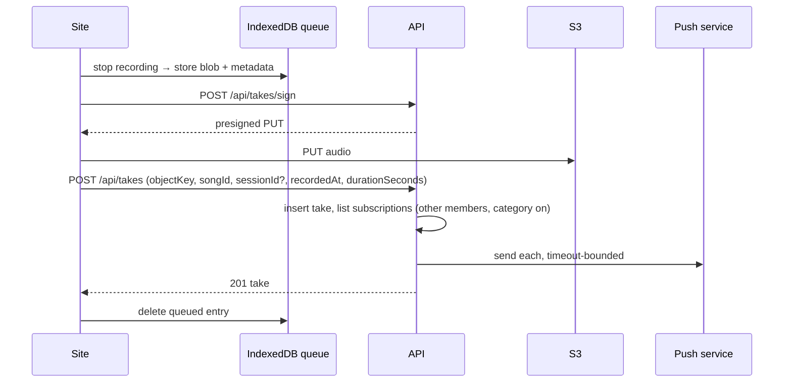

# Members record or upload takes of a song, replay its versions newest first, comment on them, and get a push notification when the band changes something

## Perspectives confronted

- [x] **Client / business**: a member asked for it in the band's chat on 2026-10-23: "téléverser les records audio, les rattacher à un morceau, écouter les différentes versions triées par timestamp décroissant". The operator answered the same day that both a live recording and an upload would be built.
- [x] **Product**: the operator chose one take per song over a whole-practice file, an optional link to a session, keeping every take with a 50 MiB cap, and comments that are either pinned to a moment or free in a thread (2026-10-23).
- [x] **Tech-lead**: the operator chose to keep offline takes on the device and retry, and to put web push in this same spec rather than a separate one, with four event categories, per-setlist grouping over 10 minutes, and one toggle per category (2026-10-23).
- [x] **Developer**: the operator ratified proving the microphone with Chromium's fake media device and push with a faked adapter, leaving a real iPhone delivery as the one manual smoke after deploy (2026-10-23).
- [x] **Designer**: the operator placed Record on each song of a practice's page and both Record and Upload on the song page (2026-10-23).

## Why

The band records practices on their phones and posts the audio in the group chat, where it is lost among other messages and cannot be found by song. Pinning each take to its song turns the song page into its own history, and comments on a take replace the chat messages that react to it.

Push exists because a take nobody hears about is a take nobody replays, and the same channel answers a wish the band has already stated twice: being told when a session, a setlist, a lineup or a transition changes.

- **Output metric:** the share of practices in a month that have at least one take attached, read from `take.session_id`, so no event pipeline is needed.
- **Input metrics:** (1) a take recorded on the practice page is listed on its song page, newest first, after one tap on Stop; (2) a take recorded offline appears as pending and uploads itself once the network is back; (3) a comment pinned at 1:42 moves the player to 1:42 when tapped; (4) a member with push enabled receives one notification per new take, and none for their own.
- **Gemba:** the request comes from a member, first hand, in the band's chat (screenshot of 2026-10-23).

## Result

**Practice page.** Each song of the practice's setlist gets a microphone button. Tapping it opens a recording sheet:

```
● 02:17   Seven Nation Army
[ Stop ]                  screen kept awake
```

Stop saves the take, linked to that song and that practice, and closes the sheet.

**Song page.** A new "Takes" section sits under the chord chart, with **Record** and **Upload** buttons:

```
Takes                                   [Record] [Upload]
▶ Sat 18 Oct · Practice · 3:52 · Hugo          2 comments
▶ Tue 14 Oct · Practice · 4:05 · Thomas        pending upload
▶ 2 Oct · no session · 3:40 · Emma
```

Opening a take shows a player, the comments that carry a moment as marks on the timeline, and one thread mixing both kinds in time order. The comment box has an "At 1:42" toggle that is on while the player is paused past zero.

**Account page.** A "Notifications" section has an "Enable on this device" button and four toggles: takes, comments, sessions, setlists and lineups and transitions. On an iPhone where pragma is not installed on the home screen, the section says that iOS only delivers push to an installed app, and how to install it.

**Install banner** (amendment of 2026-10-24, asked by the operator). Push on an iPhone needs pragma installed on the home screen, and the installed app is the better experience on Android too. While pragma runs in a browser tab on a phone, a dismissible banner sits at the top of every page inside the application shell. The two scene views, which are a full-screen stage mode, carry none:

```
Install pragma as an app, for notifications and full screen   [Show me]  [×]
```

"Show me" opens a sheet with a short looping walkthrough drawn in code and animated with CSS only. It matches the device:

- **iOS Safari:** tap Share → scroll → "Add to Home Screen" → Add.
- **Android Chrome:** tap ⋮ → "Install app" (or "Add to Home screen") → Install. When Chrome has offered the `beforeinstallprompt` event, the sheet also shows a real **Install** button that opens Chrome's own prompt.

The steps are captioned through i18n (fr, en). The banner never shows in the installed app, on a desktop browser, or after the member dismissed it on that device.

## Use cases / edge cases



**Happy path, live take**
1. A member opens a practice, taps the microphone on a song, and allows the microphone.
2. The sheet records, keeps the screen awake and shows the elapsed time.
3. Stop stores the take in the device queue, then uploads it and creates it.
4. The take appears first in that song's Takes, with the practice named.
5. The other members with push on for takes get "Hugo posted a take of Seven Nation Army".

**Happy path, upload**
1. On the song page, Upload accepts an audio file.
2. The form proposes the file's own date as the recording time, lets the member change it and pick a session (the practice closest to that date is preselected when one is within a day).
3. Save uploads and creates the take, as above.

**Comments**
1. A member pauses at 1:42, writes "the bass comes in late", leaves "At 1:42" on and sends.
2. The comment is in the thread and is a mark on the timeline; tapping either moves the player to 1:42.
3. A comment sent with the toggle off has no moment and sits in the thread only.

**Edge cases**
- The install banner shows only on a phone or tablet browser that is not running pragma installed (`display-mode: standalone`, or `navigator.standalone` on iOS); dismissing it is remembered on that device in local storage, and a storage that refuses the write only means the banner comes back next time.
- An iOS browser other than Safari (Chrome, Firefox on iOS) shows the iOS walkthrough with a first step "open this page in Safari", because Safari's menu is the one path every iOS version has. Since iOS 16.4 some other browsers can add to the home screen from their own menu, but their menus differ and are not drawn.
- Takes sort by `recordedAt` descending, not by upload time, so a take uploaded a week late lands where it happened.
- A take recorded offline shows "pending upload" on that device only; other members see it once it is created.
- The queue retries when the application opens and on the browser's `online` event. iOS has no background sync, so a take waits for the next time the application is opened.
- A session is optional. Deleting a session keeps its takes and clears their `session_id`, as setlists already do.
- Deleting a song deletes its takes, their comments and their audio objects.
- Any member can delete any take or comment; there are no roles.
- A member with push enabled on two devices gets the notification on both.
- Setlist, lineup and transition changes to the same setlist within 10 minutes send one notification, not one per write. A transition comment groups on its pair of songs.
- The member who made a change is never notified of it.
- Session changes group the same way, per session over 10 minutes.
- Tapping a notification opens the page of what changed: the take, the session or the setlist.
- Deleting a member keeps their takes and comments, shown as "former member", and deletes their push subscriptions and preferences.

**Error cases**
- Microphone denied: the sheet says so and offers Upload instead.
- The phone locks during a recording: iOS stops the recorder. What was recorded until then is kept as the take, and the sheet says the recording was cut.
- A file over 50 MiB or of a type other than audio: refused before upload, with the limit named.
- The device storage is full when queueing: the take is offered as a download so it is not lost.
- A push service answers 404 or 410: that subscription is deleted. Any other push failure is reported and never fails the write that triggered it.

## Questions, Options and Decisions

| Question | Options | Decision (2026-10-23) |
| --- | --- | --- |
| What does one recording cover? | one song / whole practice cut later / both | One take per song. Whole-practice files are out of scope. |
| What is feedback? | moment comments / thread / with rating | Both kinds in one table: a comment has an optional moment. |
| Must a take belong to a session? | always / optional / never | Optional. |
| Retention and size | keep all, 50 MiB / last N per song / 500 MiB | Keep all until deleted, 50 MiB per file. |
| Where is Record? | practice + song page / song page only / recording mode | Practice page per song, plus the song page. |
| Bad network in the practice room | queue on device and retry / fail and download | Queue in IndexedDB and retry. |
| Notifications | none / unseen badge / web push | Web push, in this spec. |
| Burst of setlist edits | group 10 min / every write / daily digest | One notification per setlist per 10 minutes. |
| Preferences | per category / all or nothing | One toggle per category, all on when push is first enabled. |
| How is push sent? | inline in the API Lambda / queue and worker Lambda | Inline, after the write commits, every send bounded by a timeout. Five or six members means a handful of sends per event; a queue is infrastructure with no matching need yet. Ratified in the ADR below. |
| How to explain installing the app? | member films the system screens / animated walkthrough in code / annotated screenshots | Animated walkthrough in code, in a dismissible banner (2026-10-24). It is a drawing of the system menus, so it needs updating when Apple or Google change them. |
| A member is deleted | keep their takes / delete them | Keep: takes are the band's history. Subscriptions and preferences go. |
| Which recording format? | one fixed format / whatever the browser records | Whatever `MediaRecorder` produces (`audio/mp4` on Safari, `audio/webm` on Chromium). Both play in every browser the band uses; transcoding would need a server-side job. |

**Out of scope:** whole-practice recordings and trimming; waveform rendering; transcoding; a "best take" marker; an "unseen" badge; notifications by e-mail; the MCP server, which gets its own spec next and will reuse this push channel.

## Architectural choices

| ADR | Decision | What it constrains downstream |
|---|---|---|
| [ADR-0040](../../../../adr/0040-pragma-sends-web-push-like-talos.md) | pragma sends Web Push with the `web-push` library, inline from the API Lambda, as talos does, with its VAPID key pair in two SSM SecureStrings per stage | a new dependency and a new secret; a send never fails the write that triggered it; one key pair per stage (`/pragma/<stage>/vapid-*`), and `push_subscription` stays out of preview clones |

## Changes

### Types / domain model

New nouns for `VOCABULARY.md`:

- **Take**: one recording of one song, optionally from one session. Not a *recording* (the act) nor a *version* (the word `revision` is already refused).
- **Take comment**: a note on a take, with an optional moment in seconds.
- **Push subscription**: one device of one member that accepted notifications.
- **Notification preference**: one member's toggle for one category.

```ts
type TakeContentType = 'audio/mp4' | 'audio/x-m4a' | 'audio/mpeg' | 'audio/webm' | 'audio/ogg' | 'audio/wav' | 'audio/aac';
type NotificationCategory = 'takes' | 'take_comments' | 'sessions' | 'setlists';
```

### Database changes

```sql
CREATE TABLE take (id uuid PRIMARY KEY, song_id uuid NOT NULL, session_id uuid, member_id uuid NOT NULL,
  object_key text NOT NULL, content_type text NOT NULL, duration_seconds integer NOT NULL,
  recorded_at timestamptz NOT NULL, created_at timestamptz NOT NULL DEFAULT now());
CREATE INDEX ASYNC take_song_recorded_idx ON take (song_id, recorded_at);
CREATE TABLE take_comment (id uuid PRIMARY KEY, take_id uuid NOT NULL, member_id uuid NOT NULL,
  body text NOT NULL, at_seconds integer, created_at timestamptz NOT NULL DEFAULT now());
CREATE TABLE push_subscription (id uuid PRIMARY KEY, member_id uuid NOT NULL, endpoint text NOT NULL UNIQUE,
  p256dh text NOT NULL, auth text NOT NULL, created_at timestamptz NOT NULL DEFAULT now());
CREATE TABLE notification_preference (member_id uuid NOT NULL, category text NOT NULL, enabled boolean NOT NULL,
  PRIMARY KEY (member_id, category));
CREATE TABLE notification_dispatch (group_key text PRIMARY KEY, last_sent_at timestamptz NOT NULL);
```

Previews clone prod's schema. `push_subscription` joins `tableBlocklist`, otherwise a preview would push to the band's real phones. `take` and `take_comment` join it too, because their object keys point at prod's bucket, which a preview cannot read.

### Files to change

```
apps/pragma/domain/take-upload.core.ts                    // NEW: content types, 50 MiB cap, comment length
apps/pragma/api/src/takes/takes.{controller,service,repository,schema,core,types}.ts   // NEW
apps/pragma/api/src/notifications/notifications.{controller,service,repository,schema,core}.ts  // NEW: subscribe, preferences, fan-out, grouping
apps/pragma/api/src/notifications/web-push.adapter.ts     // NEW: the only file importing web-push
apps/pragma/api/src/{sessions,setlists,transitions,songs}/*.service.ts  // UPDATE: notify after commit; songs and sessions cascade takes
apps/pragma/api/src/app.ts                                // UPDATE: mount /api/takes, /api/notifications
apps/pragma/api/src/database/{schema.ts,migrations/0017_takes_and_push.sql}  // NEW/UPDATE
apps/pragma/cdk/lib/stack.ts                              // UPDATE: VAPID parameter, blocklist, CORS unchanged
apps/pragma/site/public/sw.js                             // UPDATE: push + notificationclick handlers
apps/pragma/site/src/features/takes/*.queries.ts, take-queue.adapter.ts, recorder.adapter.ts  // NEW
apps/pragma/site/src/components/organisms/{TakeList,TakePlayer,RecordingSheet}.tsx  // NEW
apps/pragma/site/src/routes/{catalog/SongDetailPage,sessions/SessionDetailPage,account/*}.tsx  // UPDATE
apps/pragma/site/src/i18n/{en,fr}.json                    // UPDATE
apps/pragma/VOCABULARY.md                                 // UPDATE
```

### Test strategy

- **Install banner:** the platform and installed-mode decision is a pure `install-offer.utils.ts` at 100% coverage, reusing `isIosDevice`; visual validation at 375 px with an iPhone Safari user agent, an iPhone Chrome user agent and an Android Chrome user agent checks the matching walkthrough, checks the banner is absent at 1280 px desktop and under `display-mode: standalone` emulation, and checks it stays dismissed after a reload.

- **Pure cores at 100% coverage and mutation-gated:** take ordering, comment moment validation, take object key, upload limits, recipient selection (author excluded, category off excluded), the 10-minute grouping rule taking `now` as a parameter, and the session preselection by nearest date.
- **Back-end e2e on the local Postgres:** create, list newest first, delete with cascade; a song and a session deletion; the fan-out with the push adapter faked, asserting one send per eligible subscription, none to the author, deletion on 410, and a write that succeeds while the adapter throws.
- **Visual validation:** Chromium launched with `--use-fake-device-for-media-stream --use-fake-ui-for-media-stream` records a real take from the fake microphone on the practice page; the take is first on the song page; an upload of a fixture file; a comment at a moment moves the player; going offline with the browser's network emulation leaves a pending take that uploads after going back online; the Notifications section enables push and saves toggles (Chromium grants the permission; the push service itself is not reached).
- **Not provable here:** a notification arriving on a real iPhone. That is the one manual smoke after deploy.

## Production strategy

### Analytics

**Input metrics:** `take_created` (with `source: live | upload` and whether it came through the queue), `take_upload_retried`, `take_comment_created` (with or without a moment), `push_subscription_created`, `push_sent` and `push_failed` by status. Success: within a month of release, every practice has at least one take.

**Output metric:** the monthly share of practices with a take, read from the database and reviewed by the operator once a month.

### Zero-defect strategy

- `TakeUploadFailed` (site, Sentry tag `take.stage = sign | put | create`): any occurrence after the retry is exhausted.
- `TakeQueueWriteFailed` (site): IndexedDB refused the blob; alert on the first.
- `PushSendFailed` (API, tagged with the push service host and status): alert on 5 in 10 minutes. 404 and 410 are expected and not reported.
- `RecordingInterrupted` (site): reported as a breadcrumb, not an error, so the iOS lock rate is visible.
