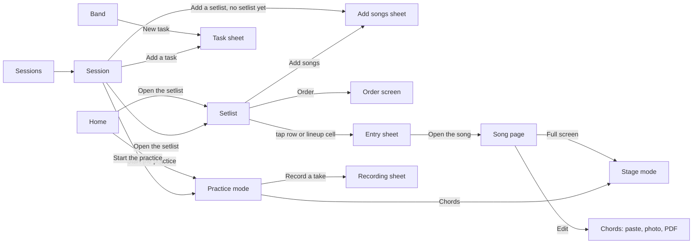

# Pragma redesign: prepare a setlist and learn a song in fewer taps, on one consistent design system

## Perspectives confronted

Written in non-interactive mode by the `spec-writer` agent. Each box is ticked from the operator's ratification in chat on 2026-10-27 ("Go avec Notebook + greffes, lance l'implémentation") of decisions D1 to D11 and of the comments on the audit deck. The operator then answered the spec review's five questions in chat on 2026-10-27: ADR-0048 and ADR-0051 accepted, members keep their stored colours and show them prominently (Q2b), the grid is designed for up to six members (Q3), and a practice mode is wanted (Q1). What the operator did not decide is written as an open question with a recommendation, never decided here.

- [x] **Client / business** — the operator named the two jobs in order (prepare and run setlists, then grow the catalogue and learn songs), the four complaints (double scrolling, hard-to-find buttons, a weak design system, usability not quite right), and that stage mode is low priority.
- [x] **Product** — D1 four tabs, D2 open on Home, D3 tasks linked to sessions, D6 total setlist time now and breaks later, D7 energy curve on a separate Order screen, D8 stage mode lower, D9 chords from paste, photo and PDF only; D4 attendance and D5 session messages are out of scope.
- [x] **Tech-lead** — D10 sheets on the native `<dialog>` with no library; the schema column for D3 and the new font are ADR triggers; the measuring harness and the slicing into six pull requests are below.
- [x] **Developer** — 37 confirmed findings with file and line (`baseline/verified-findings.md`) and a measured baseline per task and per route (`baseline/baseline.md`) give every target a before value and a rerunnable measure.
- [x] **Designer** — D11: the Notebook direction with the grafts listed in `design/comparison.md`; the operator's comments on lineup, key, the "Talk" label, the cover in the entry sheet, icons on every button, and adding songs from the setlist.

## Why

Pragma is the band's own app, installed on each member's phone. The audit found that the band's first job, preparing a setlist, is spread across two tabs, a drawer and overlays that close each other: preparing a practice costs 18 taps over 7 screens and overlays, a note written on a setlist entry or a transition does not show on the setlist after saving, the entry note can be cut off by racing saves, and a transition draft is thrown away by a tap on the backdrop. The second job, learning a song, starts on a page whose main button is stage mode and whose chords require ChordPro syntax. Around both, 181 of the 416 buttons on first load have no icon, 133 have no words, and only 14 of 32 primary actions sit in the bottom third of the screen.

- **Output metric** (lagging, out of CI): before a session, a member answers "what are we playing, what do I play, and what was decided for each song?" from the app alone, without a message in the band's chat. Measured by the operator asking at each practice.
- **Input metrics** (leading, measured by the task-metrics harness at 390x844, standalone, real argent taps):
  - taps, scroll gestures and screens for the 13 top tasks (table under *Acceptance criteria*);
  - primary actions in the bottom third on arrival: 14 of 32 -> at least 26 of 32;
  - text-only buttons over the 26 routes: 181 -> 0;
  - routes or sheets with two vertical scroll areas: 2 routes (`/catalog/:songId/edit`, `/bars`) and 2 sheets with an inner scroll -> 0.
- **Gemba**: `baseline/baseline.md` is the field observation: every number was measured on the current app with the audit seed on 2026-10-26 by walking each task with argent. `baseline/verified-findings.md` holds the 37 findings a second auditor reproduced or confirmed in code.

## Result

Mockups are in `mockups/` (390x844). They were drawn before D11, with the earlier `design-system/DESIGN.md` tokens: they show **structure and content**, and the look is the Notebook direction in `design/notebook/` plus the grafts in `design/grafts/`.

### Navigation

- Four tabs: **Home**, **Sessions**, **Songs**, **Band**. No count on any tab. The More drawer goes. (D1)
- The app opens on Home. (D2) The manifest shortcut points to Home instead of the catalogue.
- Sessions holds a **Sessions / Setlists** section switch; Setlists is today's setlist library.
- Band opens on tasks, with a row of links to members, instruments, bars, compositions, improvements and the account page above them (operator review 2, Q3). The language switch moves from the More drawer to the account page, on its own Language tab (Q8).
- Songs carries a **To learn** filter that replaces the Studies tab; a study row opens its song.
- Each destination has its own icon: Studies and Improvements no longer share `bolt` (rank 35).

### Home (`/`, mockup `after-home.png`)

The next session, practice or concert, whichever comes first: kind, date, place, setlist name, song count and total time, and **Open the setlist**; on the day of a practice, the primary action is **Start the practice** instead (see *Practice mode*, slice 5). Under it: **Your part** (the songs of that setlist where the signed-in member plays, with their instruments) and **Your tasks** (open tasks assigned to the member, the ones linked to that session first once slice 5 adds the link; until then, by urgency as on Band). No session ahead: an empty state with **New session**.

### Setlist (`/setlists/:id`, mockups `after-setlist.png`, `after-lineup.png`)

- Header: back link naming the parent session, setlist name, one line "Concert · Sun 1 Nov · 20 songs · 1 h 18" (total time from the songs' durations, D6), and one `more` icon button holding stage mode, open a vote, audience vote, copy the order, rename. No energy chart on this screen. (D7, D8)
- Under the header, underlined section tabs with icons: **Songs**, **Lineup**, **My part**.
- **Songs** (default): each row has the position in the margin, the album cover (or the initials tile for an original), the title, the artist, the lineup avatars (each filled with its member's colour, the instrument glyph on it in the ink the colour calls for), a `more` icon button (Remove from the setlist), and below them the entry note in the note style, and tonight's lineup change in the highlighter. Key and capo are allowed on setlist rows (operator: key is not shown on the session page; setlist rows may show it). Between two rows, the transition line is 44 px tall and shows its comment in the pencil style, a `warn` icon for a risky transition, or the faint "Note this transition" with a `plus` icon when it has none.
- **Lineup**: the grid from the Studio graft, where each member's colour is the way the band reads it at a glance (operator, 2026-10-27: "il faut garder la couleur pour qu'on s'habitue"). One column per member who plays in the setlist. The column header is the member's avatar filled with their stored colour, with their initial on it, and their first name under it in `ink`. The whole column carries a light tint of that colour from the header to the last row, so a member's instruments read as one coloured lane down the setlist. One row per song: the title on its own line, then one cell per member under their column. A cell where the member plays is filled with the member's colour and holds their instrument glyphs; a cell where the member sits out is left on the column's tint with a small dot in the member's colour. A cell whose instruments differ from the previous song keeps its fill and gains the change mark: a `highlight` bar under the glyphs and an `ink` corner tick, never a different fill, so the colour always means the member and nothing else. Glyphs and initials on a member colour take the dark or the light ink, whichever contrasts more with that colour (see *Member colours* under *Design system*). Up to six members fit at 375 px with no sideways scroll; the band has five. Tapping a cell opens that entry's sheet on its lineup; tapping a member's header switches to My part for that member.
- **My part**: today's member filter, set to the signed-in member: only the songs they play, with their instrument on each.
- Bottom strip, 52 px, above the tab bar, no box: **Add songs** (52 px filled blue pill, `plus`) and **Order** (glass pill, `reorder`), over a 20 px paper fade. The strip stays in place at every scroll position (rank 13: today's Add song button hides on scroll). The list ends on a blank numbered line, "13 · Add songs", which is also the empty state, and the page's bottom padding equals the strip's height so the last row scrolls clear of the pills.

### Order screen (`/setlists/:id/order`, mockup `after-order.png`)

Reached from **Order**. On top, the energy curve, one bar per song, with the average energy and the total time; an **Energy curve** chip hides it. Below, one 44 px row per song: a 44x44 drag handle, the number, the title, a five-step energy meter and the length. While a row is lifted its bar turns blue and the curve redraws at the drop position. The order saves on each drop, as today. Footer: **Done** (`check`) and **Copy order** (`copy`). (D7)

### Add songs sheet (mockup `after-add-songs.png`, `design/notebook/add-songs-study.png`)

One full-height sheet titled "Add songs to <setlist name>": a search field that has the focus on opening, filter chips (Not in this setlist, the default; Concert ready; Rehearsed; To learn; Ideas), rows with cover, title, artist and a check box. Tapping checks the song and shows its pick number; tapping again unchecks it. Songs already in the setlist are dimmed with "Already in this setlist · 05" and cannot be picked. A typed title with no match in the catalogue lists the music service's results for it, with cover, title and artist, and always offers **New song as an idea**; picking either creates the song (with the service's title, artist and cover, or with the title only) and checks it. This is how task 8 stays on the setlist: the operator refused adding to a setlist from the song page, so a new song reaches a setlist from this sheet. The footer reads "Added at the end, in the order picked" and holds **Add 3 songs** (`plus`). Nothing is written before that tap. The song page has no "Add to setlist" action.

### Entry sheet (mockup `after-entry-sheet.png`)

Opened by tapping a setlist row. Header: the album cover at 72 px, title, artist, length, "Song 2 of 20 · tonight only", and a `close` icon button. Body: tonight's key and capo, the lineup edited inline (each member as an avatar filled with their colour and their first name in `ink`, with their instrument glyphs, a change for tonight in the highlighter, **Use the song's lineup** with `swap` to reset), the note in the note style, saved after a short pause, with "Saved" and a `check` icon in `good`. Footer: **Open the song** (`song`) and **Record a take** (`mic`). Remove from the setlist is in the row's `more` menu. The focus goes to the note field, never to Close. The sheet never opens another sheet.

### Session page (`/sessions/:id`, mockup `after-session.png`)

Tabs in the pinned header choose one part at a time (operator review 2, Q3): **Setlist**, **Tasks**, **Takes** and, for a concert or a practice that prepares one, **Details**. In tab order: the setlist preview (count, total time, the first three songs with cover, title and lineup avatars, a `warn` badge on a song with no lineup, **no key**); **Who does what** (the tasks linked to this session, and **Add a task** with `plus`); the takes recorded at this session grouped by song. With no setlist yet, the preview is an empty state that says so and offers **Attach an existing setlist**, and the bottom strip's primary pill is **Add a setlist**, which creates a setlist named after the session and opens the Add songs sheet; with setlists, a secondary **Add a setlist** under them offers a new setlist or an existing one (operator review 1, R6). A concert reaches its audience vote through one secondary action, **Audience vote**, beside **Edit** (Edit opens the Details tab); the vote block is not on the session page (R4). A past practice does not show the empty "Prepared concert" picker. Primary action (Q1): on a practice's own day, **Start the practice** (`play`), with **Open the setlist** beside it as the second pill; on any other day, and for a concert, **Open the setlist** (`arrowR`). Attendance (D4) and the message thread (D5) are not on this page in this iteration.

### Practice mode (`/sessions/:id/practice`, slice 5, Q1)

The band records songs during practice (operator, 2026-10-27), and today that means opening the session page, finding the song in the practice's recording list and tapping its small microphone (`PracticeRecordingList`, `RecordingSheet`). Practice mode is one screen for the length of a practice: it follows the session's setlist song by song, and recording a take of the song being played is one tap. It reuses the takes feature's nouns and code: a **take** is one recorded performance of one song, here always linked to the practice's session; nothing new is stored on the server.

- **Starts**: a member taps **Start the practice** on the session page or on Home. It is offered only on a practice, on that practice's own day, and only when the session carries at least one setlist with a song; otherwise the session page shows **Open the setlist** and no practice mode.
- **Ends**: **End the practice** (`check`) in the header's `more` menu, which returns to the session page. Leaving through the back link or the tab bar also leaves the screen, and coming back to the session that day resumes it where it was. Practice mode is held on the device, not on the server (see the edge cases below and Q11, decided).
- **The song order**: the songs of the session's setlists, setlist by setlist in the session's own order (`session_setlist.position`), then by entry position. The first song is the current one on start.
- **What the screen shows**, top to bottom at 390x844 with no scroll for the current song:
  - the header: the session ("Practice · Wed 28 Oct"), the position ("Song 3 of 12"), and `more` (End the practice, Open the setlist);
  - the **current song**: cover at 72 px, title in `display`, artist, tonight's key and capo, its lineup as avatars filled with each member's colour and the instrument glyphs on them, the entry note in the note style, and the transition comment towards the next song in the pencil style, when there is one;
  - **Chords** (`text`) as a labelled round action, opening the song's scene view; closing the scene view returns to practice mode on the same song;
  - the **takes of this song at this session**, newest first, each with its length, author and a play button, through today's `TakeList`; a take still waiting to upload says "pending upload", as on the song page;
  - **Next**: the next song's title and artist on one line, with the setlist name when the next song starts another setlist;
  - the bottom strip: **Record a take** (`mic`, the primary pill) and **Next song** (`chevR`, the second pill). On the last song the second pill reads **End the practice** (`check`).
- **Record a take**: one tap starts recording the current song, with the recording sheet the takes feature already has (elapsed time, screen kept awake, **Stop**). Stop queues the take on the device and uploads it, with `songId` the current song and `sessionId` the practice, exactly as a take recorded from the session page today. The new take appears first in the takes list. While a recording runs, **Next song** is not offered: Stop comes first, so a take is never attached to the wrong song.
- **Quick note**: **Note** (`edit`) opens the current entry's note in a sheet, the same field and the same automatic save with "Saved" as the entry sheet, so a remark made during the practice ("tempo too fast in the bridge") lands where the setlist and the next practice show it. A note as a comment on the take just recorded was option (b) of Q12, not taken.
- **Moving between songs**: **Next song** moves to the following song. Tapping "Song 3 of 12" opens a sheet listing every song of the practice, the current one marked, so a member can jump to any song, back or forward. Moving never records, never ends the practice and never writes to the server.
- **Takes and their links**: each take recorded in practice mode carries the current song's id and the practice's session id, so it shows on the song page (with the practice named), on the session page grouped under its song, and in the takes output metric (the share of practices with a take, read from `take.session_id`). No new column and no new route.

### Song page (`/catalog/:songId`, mockup `after-song.png`, `design/grafts/backstage-song-page.png`)

In order: cover, title, artist, status; a row of listening links (Deezer, Spotify, YouTube, each with its official mark) built from the song's `links`, `deezerTrackId` and `spotifyTrackId`; one line of text naming the setlists the song is in; labelled round actions (**Practised**, **Notes**, **Full screen**), each an icon with its word under it; **Your part** with the member's instrument and mastery in the highlighter; the chord chart with a transpose stepper; the band's takes with play buttons; the default lineup and notes. Header: **Edit** (`edit`) and `more`. Primary action in the bottom strip: **Record a take** (`mic`); the page's bottom padding equals the strip's height, so the last chord line scrolls clear of the pill (the critic found Backstage's pill covering the chords). **Full screen** is the only way into stage mode from the song. (D8) **Edit** and **Full screen** are links drawn as buttons, never a button inside a link (rank 29).

### Chords by paste, photo or PDF (mockup `after-chords.png`)

On the song's edit page, the chord chart section offers three buttons: **Paste text** (`clipboard`), **Photo** (`camera`), **PDF** (`upload`). Pasted text in the "chords above lyrics" layout that chord websites give is converted to ChordPro, with the preview under the text box, never above it, and the song's tonality filled from the result. The person never types ChordPro syntax. A photo is stored as today's `image` chart. A PDF that carries a text layer goes through the same converter and preview, read in the browser by `pdfjs-dist` ([ADR-0051](../../../../adr/0051-chord-text-from-paste-and-pdf-text-layer-photos-stay-images.md), accepted, Q6), and a scanned PDF is stored as a `pdf` chart. No scraping and no audio detection. (D9)

### Songs tab (`/catalog`)

Compact rows (cover, title, artist, status badge; chord icon only when a chart exists), search, filter chips including **To learn**, and **Add a song** (`plus`) in the bottom strip. The title, the search and the filter chips stay pinned at the top while the list scrolls (operator review 1, R2). Add a song opens the **Add a song** page (`/catalog/add`, R5) with the title field focused, the music service's results directly under it, then an artist field and status chips; picking a result fills title, artist and cover. The raw "Deezer track ID" field leaves the form.

### Band tab (`/band`, mockup `after-band.png`)

Opens on **My tasks / Everyone**. **New task** (`plus`) opens a sheet with title (focused), assignee avatars, due date, an optional song chosen among all songs, and an optional session. Tapping a task opens the same sheet filled with its values, in place of today's form 1840 px down the page (rank 2). A long song title in a task wraps or ends in an ellipsis, so the page stays 390 px wide (rank 21). The links to members, instruments, bars, compositions, improvements and the account sit above the tasks, as one row of links that scrolls sideways, so a long task list never hides them (operator review 2); the My tasks / Everyone tabs are pinned in the header.

### Vote page (`/setlists/:setlistId/vote`)

Reached from the setlist's `more` menu. A back link names the setlist. Two lines say how a vote runs. **Open a vote** (`vote`) and, once a vote is open, **Close the vote** (`check`) sit as the primary pill in the bottom strip, visible on arrival at any scroll position. The selected view toggle is ink on the chosen fill, never text on blue, and uses only defined tokens (rank 25).

## Use cases / edge cases



**Happy path, prepare the next practice (task 1):**
1. Home, Sessions tab, **New session**, choose practice, create.
2. On the new session, **Add a setlist**: a setlist named after the session is created and the Add songs sheet opens.
3. Check ten songs, using search or a chip instead of scrolling, then **Add 10 songs**.
4. The sheet closes on the setlist, with the ten songs in the order picked.

**Happy path, prepare tonight's details (tasks 4, 5, 6):**
1. On the setlist, tap a row: the entry sheet opens with the focus in the note field.
2. Type the note; "Saved" appears after the pause. Change one member's instrument inline. Close.
3. The row shows the note and the highlighted lineup change. Tap "Note this transition" under it, write, save: the comment shows on the transition line.

**Happy path, see who plays what:** Setlist, **Lineup**: every member's instruments down the setlist, changes highlighted; tap a member's header for My part.

**Happy path, record during a practice (slice 5):**
1. On the practice's day, Home, **Start the practice**: the first song of the session's setlist is the current song.
2. The band plays it; a member taps **Record a take**, then **Stop** when the song ends. The take is first in this song's takes, linked to the song and the practice.
3. **Note**, "bridge too fast", close: the note is on the setlist entry.
4. **Next song**, and again for each song. On the last one, **End the practice** returns to the session page, which lists the takes grouped by song.

**Happy path, add a new song to the next practice (task 8):** Home, **Open the setlist**, **Add songs**, type the title, pick the music service's result (the song is created with its artist and cover, and checked), **Add 1 song**.

**Happy path, close a vote (task 11):** Setlist, `more`, **Open a vote**; members score songs; **Close the vote** from the bottom strip with no scroll back to the top.

**Happy path, order by energy:** Setlist, **Order**, drag a song and watch the curve redraw, **Done**.

**Happy path, learn a song (task 10):** Songs, **To learn**, the song, listen through a link or a take, read the chords, **Practised** logs a study.

**Happy path, add chords (task 9):** Song, **Edit**, **Paste text**, paste a chords-above-lyrics sheet, check the preview under it, save.

**Happy path, agree who does what (task 3):** session page, **Add a task**: title, assignee, due date, optional song; the task is linked to the session and shows on the session page, on Band, and on the assignee's Home.

**Edge cases:**
- Entry note typed fast on a slow network: the server keeps the last text typed; a reply to an older save never overwrites a newer one.
- Transition sheet closed by the backdrop or Escape with a typed draft: the draft is kept and shown on reopening.
- A song with no cover: the initials tile in the setlist, the sheet and the picker.
- More than six members playing in one setlist: a known limit, not handled. The band has five members, and the Lineup grid is designed for up to six with no sideways scroll (Q3); a seventh is a new spec.
- A member colour close to `accent` or very pale on `paper`: the colour stays as stored; the member's name in a text token beside the mark, or in the column header, is what identifies them. Ink on the colour is chosen by contrast, so a glyph stays readable on any stored colour.
- A member who holds two instruments on one song: both glyphs sit in that member's cell, side by side at a size still readable at 375 px (the critic found Backstage's grid squeezing them), and the cell's tap area stays 44x44 px or more.
- A member in no song of the setlist: no column in the Lineup grid; My part for them shows the empty state "Nothing to play in this setlist".
- Every song already in the setlist: the default chip shows an empty state and **Add songs** stays disabled with its icon.
- A setlist with no songs: the blank numbered line "1 · Add songs" is the empty state.
- Entries with no energy: the Order curve draws them at the default level in the muted colour, as `setlist-entry-energy.core.ts` does today.
- A pasted chart already in ChordPro: kept as is. A pasted text with no recognisable chord: kept as text, tonality left empty for the person to fill.
- A task linked to a session that is then deleted: the task stays and loses its session, the way tasks lose a deleted song today.
- No session ahead: Home shows the empty state with **New session**.
- Dark mode: every screen, sheet and token in both schemes. A member's colour is the same in both schemes; only the column tint mixes it into each scheme's `paper`.
- Practice mode, phone locked or app sent to the background during a recording: today's takes behaviour holds. What was recorded until then is kept as the take, and the sheet says the recording was cut. On return, practice mode is on the same song.
- Practice mode, page reloaded or app closed and reopened the same day: it resumes on the song it was on, read from the device. On the next day the stored position is ignored and the session page offers no practice mode.
- Practice mode, no network in the practice room: takes are queued on the device and upload when the network is back, on the browser's `online` event or the next time the app opens, as today; the session, its setlists and its songs come from the query cache already loaded when the practice started. A note typed offline shows "Not saved" with its retry and keeps its text.
- Practice mode, two members recording the same song on two phones: two takes, both kept, each with its own author, as takes work today.
- Practice mode, the setlist changes during the practice (a song added or reordered on another phone): the order is read again when the screen regains focus; the current song stays current, and if it was removed, the following song becomes current.
- Practice mode, a session with several setlists: the songs follow one another across setlists; the header names the setlist when it changes.

**Error cases:**
- Adding songs fails: the sheet stays open with the checked songs still checked and an error line; nothing is half added (see Q5).
- An entry note save fails: the field keeps the text and shows "Not saved" with a retry button (`refresh`).
- A photo or PDF upload fails or exceeds the existing upload limits: the error the uploads route returns today, shown under the button.
- Practice mode, microphone refused: the recording sheet says so and offers the upload form instead, as today; practice mode stays on the same song.
- Practice mode, the device storage is full when a take is queued: the take is offered as a download, as today.

## Questions, Options and Decisions

| Question | Options | Decision (date) |
| --- | --- | --- |
| D11 Design system direction | Studio, Backstage, Notebook, or a mix | Notebook as the base with the grafts of `design/comparison.md` (2026-10-27). See *Design system* below. |
| D1 Tab bar | Today's five tabs plus More; four tabs | Home, Sessions, Songs, Band (2026-10-27). Bars and Studies cost one more tap. |
| D2 Start screen | Catalogue; Home | Home (2026-10-27). Browsing songs costs one more tap. |
| D3 Where "who does what" lives | Tasks on songs only; a session link on tasks | A nullable session on each task (2026-10-27). Schema change, ADR below. |
| D6 Breaks in a setlist | Breaks now; total time now, breaks later | Total time now (2026-10-27). |
| D7 Energy curve | Pinned on the list; a toggle on the list; a separate screen | Order screen, curve on by default there, hidden by a chip (2026-10-27). |
| D8 Stage mode | Main button of the song page; behind Full screen and the setlist menu | Behind **Full screen** and the setlist's `more` menu (2026-10-27). |
| D9 Chord input | Paste, photo, PDF; plus scraping or audio detection | Paste, photo and PDF only (2026-10-27). |
| D10 Bottom sheets | A sheet library; the native `<dialog>` | Native `<dialog>`, one `Sheet` molecule, no library. Swipe to close comes later (2026-10-27). |
| Operator comments | | Lineup view across the setlist; no key on the session page; "Talk" gets a clear label; cover in the entry sheet; every button has an icon; songs are added from the setlist, several at once (2026-10-27). |
| Name of the renamed "Talk" | "Messages about this practice / concert" | Label recorded for D5. "Talk" exists only in the audit mockups, not in the app, so nothing is renamed in this iteration. |
| Q1 Does "Start the practice" exist as the session's primary action? | (a) **Open the setlist** before the date and **Listen back** after it; (b) a new "practice in progress" mode | (b) (operator, 2026-10-27): the band records songs during practice, so the mode matters. Specified under *Practice mode*, built in slice 5. |
| Q2 A member colour equals the action blue | Notebook's `member-6` is `#2d5fa0`, the same as `accent` | Moot (2026-10-27): Q2b keeps the members' stored colours, so no `member-*` token is taken. |
| Q2b Members' stored colours | (a) keep each member's free hex colour (rank 36); (b) map each member onto one of six `member-*` tokens, which changes some members' colours | (a) (operator, 2026-10-27): each member keeps the colour stored on their row, and it must stay clearly visible, above all in the Lineup view, so the band learns to recognise each member by colour. Contrast is solved without changing the colour: ink drawn on a member colour is chosen by contrast, and a member's name on the page stays in a text token. See *Member colours* under *Design system*. |
| Q3 Seven or more members in the Lineup grid | (a) pin the title line and scroll the member columns sideways; (b) show the members who play in this setlist only, and fall back to (a) | Neither (operator, 2026-10-27): the band has five members. The grid is designed for up to six with no sideways scroll, and more than six is a known limit, not handled. |
| Q4 Monospace face | Keep JetBrains Mono; switch to Geist Mono | Keep JetBrains Mono (2026-10-27, spec review): no new dependency, and the mono face is only for chord symbols. |
| Q5 Adding several songs at once | (a) one request per song; (b) one new route adding a list in one transaction | (b) (2026-10-27, spec review; an implementation choice): today's `setlistEntryCreateSchema` takes one song, and one transaction keeps positions in pick order and makes a failure all or nothing. |
| Q6 Text from PDFs | (a) store every PDF as a file; (b) read a PDF's text layer in the browser with `pdfjs-dist`, a new dependency | (b) (operator, 2026-10-27, [ADR-0051](../../../../adr/0051-chord-text-from-paste-and-pdf-text-layer-photos-stay-images.md) accepted). Photos are stored as today. |
| Q7 YouTube mark | `BrandLogo.tsx` holds Deezer and Spotify only | Use YouTube's official mark from its brand resources, never a redrawn one, under the same `BrandLogo` atom. |
| Q8 "My part" | The vocabulary refuses **part** for what a member holds | The screen label stays "My part" (the existing i18n key `myPart`); identifiers say member and lineup, following `filterEntriesForMember`. |
| Q9 Measuring harness | Keep it in the session scratchpad; move it into the repository | It must move in slice 1: today it hard-codes a scratchpad path, and every acceptance number below depends on rerunning it. The copy to start from is `../audit/task-metrics/` in this feature folder. |
| Q10 "Stage mode" | The vocabulary's word is **scene view** | "Stage mode" and **Full screen** are screen words only; identifiers keep `scene`, as `scene-view.core.ts` does. |
| Q11 Where practice mode's state lives | (a) on each device: the session id and the current position in local storage, no server change; (b) on the server, one shared practice the whole band follows, with the current song pushed to every phone | (a) (operator, 2026-10-28): the session id and the current position in local storage, no schema change, no new route and no ADR; it works offline, and two members recording on two phones already works today. (b) is a new realtime feature with its own spec. |
| Q12 Where practice mode's quick note goes | (a) the current setlist entry's note, the field the entry sheet edits; (b) a comment on the take just recorded, which needs a take first | (a) (operator, 2026-10-28): a remark during practice is about tonight's version of the song, which is what the entry note holds, and it shows on the setlist; (b) stays reachable from the take's own player. |
| Q13 When practice mode is offered | (a) on the practice's own day only; (b) from the session's date until a later end the operator names | (a) (operator, 2026-10-28): a session holds a date and no end time, so the day is the only boundary the data gives. A practice that runs past midnight is a known limit: the next day, the session page offers no practice mode. |

**Inconsistencies found while writing this spec, and how they are resolved:**
- The Add-a-song proposal (A10) had a switch "Also add to Wednesday's practice". That is adding to a setlist from outside the setlist, which the operator refused. Dropped; the Add songs sheet creates new songs instead, from the music service's results or as an idea, which is how task 8 now runs.
- Notebook's direction says screen actions are quiet blue words with no fill; the graft makes them filled pills. The graft wins and the specimen's "action placement" rule is rewritten to match.
- Notebook's direction says key is not shown on the setlist; the operator allows it on setlist rows. The operator wins: key and capo may show on rows, never on the session page.
- The critic proposed Record as one of the round actions; it is the song page's primary action, so it appears once, in the bottom strip.

**Out of scope:** a shared practice the band follows on every phone (Q11, option b); attendance (D4); session messages (D5); breaks inside a setlist (D6); swipe to close a sheet (D10); stage mode and audience screens beyond reaching them; the offline and stale-order findings (ranks 9, 10, 11), which need their own spec on the service worker; scraping chord sites; audio chord detection; recent activity on Home; a desktop-specific layout beyond keeping today's breakpoints working.

## Architectural choices

| ADR | Decision | What it constrains downstream |
|---|---|---|
| [ADR-0047](../../../../adr/0047-pragma-design-system-is-notebook-with-grafts.md) (accepted, with members keeping their stored colours): pragma design system is Notebook with grafts | Tokens from `design/notebook/tokens.css` with the grafts below, without its `member-*` tokens; `light-dark()` values in one `@theme static` block; the rules of the *Design system* section | Every atom, molecule and screen in all six slices; the lint rules and tests that gate the rules |
| [ADR-0048](../../../../adr/0048-newsreader-replaces-instrument-serif.md) (accepted): Newsreader replaces Instrument Serif | Add `@fontsource-variable/newsreader` 5.3.0 (new dependency), self-hosted from its `opsz` stylesheets, latin subset; remove `@fontsource/instrument-serif`. Measured: 278,872 B of latin WOFF2 for upright and italic, against 43,160 B today; Geist Mono is not taken (Q4) | Slice 1; `tokens.css` changes the `font-display` family, and the 46 other files under `site/src` that use the class are checked once each (titles become upright) |
| [ADR-0050](../../../../adr/0050-a-task-names-an-optional-session.md) (accepted): a task can name a session | New nullable `session_id` uuid column on `task`, no foreign key (DSQL), claimed in the task's transaction like `assigneeId` and `songId`; deleting a session nulls it; the task's song may be any song, not only an original | Slice 5; `api/src/tasks/`, `api/src/sessions/` delete cascade, the migration, `VOCABULARY.md` › Task |
| [ADR-0051](../../../../adr/0051-chord-text-from-paste-and-pdf-text-layer-photos-stay-images.md) (accepted): text from a chord photo or PDF | Pasted text and a PDF's text layer (`pdfjs-dist`, Apache-2.0, loaded on the chord editor only) go through `chords-above-lyrics.core.ts`; a photo stays an `image` chart. Measured on one synthetic chord chart: PDF text layer 27 of 27 chords in their columns, `tesseract.js` on a fake photo 17 of 27 with columns lost; Textract priced at 1.50 USD per 1,000 pages in eu-west-3, not measured. Answers Q6 | Slice 6. Transpose works on pasted charts and text PDFs; photos and scanned PDFs stay files |
| None: icons | Copy the needed Lucide path data into `atoms/Icon.tsx` (ISC licence) instead of adding `lucide-react` | Slice 1. Taking `lucide-react` instead would be an ADR |

## Design system

**Base: Notebook** (`design/notebook/direction.md`, `tokens.css`, `specimen.png`): warm paper, one blue ink for everything you can tap, a pencil colour for transitions and a highlighter for what changed tonight; Newsreader for the band's words (song, setlist and session names), Geist for tools, the note style (Newsreader italic) for anything a member wrote, the mono face for chord symbols only.

**Tokens**: colours `paper`, `leaf`, `raised`, `sunk`, `rule`, `rule-strong`, `margin`; `ink`, `ink-soft`, `ink-faint`; `accent` (light `#2d5fa0`, so the manifest colour does not change), `accent-strong`, `accent-soft`, `on-accent`; `pencil`, `highlight`, `on-highlight`; `good`, `warn`, `danger` with soft tints; `on-color-dark` and `on-color-light`, two inks that do not change with the scheme, for anything drawn on a member's colour; `stage-*` for the scene views. Notebook's `member-1` to `member-6` and `on-member` are not taken (Q2b). Type roles, six sizes: `display` 30, `heading` 22, `title` 19, `body` 16, `meta` 14, `label` 12. Radii: 3 (covers), 6, 10, 16, 20 (sheets), full. Spacing on a 4 px grid, 16 px gutter.

**Grafts** (`design/comparison.md`, *The recommendation*):
1. Buttons from Backstage in Notebook's blue: full pill radius, filled, no border at rest. Primary: `accent` fill, `on-accent` label. Secondary: a translucent fill with ink text and a blue icon, no hairline. Sizes 36, 44, 52; press scale 97%; disabled drops to the plain fill.
2. Add songs and Order as two floating pills in Notebook's 52 px strip above the tab bar, no bar and no box; the blank numbered last line stays.
3. The Lineup grid layout from Studio, up to six members at 375 px with no sideways scroll, with each member's stored colour as a filled lane (see *Member colours*).
4. The song page for learning from Backstage: listening row, takes with play buttons, transpose stepper; Notebook's Your part with its highlighter.
5. "A chosen option turns ink, never blue": a selected chip or section tab is ink, blue is only for actions.
6. Backstage's empty "Note this transition" line in Notebook's pencil style.
7. Studio's labelled round actions for the song page's secondary actions.
8. Dropped from Notebook: the ruled note field; the specimen's action placement rule is fixed to match the screens.

Not taken: Backstage's cover mosaic in the setlist header, which the critic praised but did not recommend; it would push the first row down, against the first-row target below.

**Contrast fixes** (from the critic and the audit): the secondary pill's label (ink on the translucent fill over `paper` and over `raised`) is not in Notebook's `contrast.txt` and must be computed; the highlighter in dark mode reads as olive, not highlighted, and is retuned while keeping `on-highlight` at 4.5:1 or more; icon-button captions use one face (the specimen mixes mono and sans); the vote page's selected toggle (2.80:1, rank 25, a `surface` colour `tokens.css` never defines) goes away with the token sweep. The secondary pill has no border, so its fill against `paper` and `raised` is computed too and the pill keeps its label and icon as its identification. A test fails the build when a class names a colour token `tokens.css` does not define, which is how `surface` went unnoticed.

**Member colours** (Q2b, operator, 2026-10-27). Each member keeps the colour stored on their row (`member.color`, a free hex value; members created without one get the five-colour palette of `member-palette.utils.ts`). The colour is the member's identity and stays clearly visible:
- **Lineup grid and lineup chips**: a prominent mark. The member's column header is their avatar filled with the colour; their column carries a tint of it (the colour mixed into `paper` at one fixed share, a named constant); a cell where they play is filled with it; lineup avatars on setlist rows, in the entry sheet and in practice mode are filled with it.
- **Elsewhere** (task assignees, Home's Your part, takes, comments, member lists, sheets): at least a dot or a ring in the colour next to the member's name or avatar.
- **Ink on a member colour**: an initial or an instrument glyph drawn on a member colour takes `on-color-dark` or `on-color-light`, whichever has the higher contrast ratio with that colour. The choice is made by a pure function in `site/src/lib/member-color.utils.ts`, at 100% coverage. That file already has `readableForeground`, but it picks by a relative luminance above 0.5, which chooses the light ink on all five palette colours: measured this session against the light ink `#fffdf8`, coral gives 2.78:1, teal 3.26:1, mustard 2.15:1 and sage 3.06:1, where the dark ink `#1d1914` gives 6.19:1, 5.28:1, 7.99:1 and 5.61:1 (plum takes the light ink at 5.94:1). Slice 1 changes it to compare the two contrast ratios. With the better ink, every palette colour reaches 5.28:1 or more; the worst stored colour possible reaches about 4.15:1 (a sweep of the sRGB cube), which is above the 3:1 a glyph needs and is the one known limit for an initial.
- **A member's name on the page** is always in a text token (`ink` or `ink-soft`), never in the member's colour. Text is never set in a member colour.
- **The colour means the member and nothing else**: a change in the Lineup grid is marked with the highlighter and an ink tick, never by altering the fill; a selected member is marked by an `ink` ring, never by another colour.
- The colour reaches the screen only through the `Avatar` atom, a member mark atom (dot, ring and filled cell) and the Lineup grid, which read it from the member and pass it as a style value; the "no value outside the tokens" rule allows exactly that one dynamic value.
- The colour is the same in both schemes. Against `paper`, the palette's fills are pale in light mode (1.94:1 for mustard to 5.35:1 for plum) and stronger in dark mode; the member's name beside each mark is what keeps the screen readable when a fill is faint, so the colour is never the only way to tell members apart.

**Rules:**
- **Every button has an icon**, never text only: `Button` and `ButtonLink` require `icon` by type; `IconButton` requires `label`, which becomes its accessible name. Section tabs and chips are choices, not buttons; list rows end in `chevR` or start with a cover. One icon per verb and one per destination, from DESIGN.md's verb table plus `reorder`, `swap`, `song`, `clipboard`, `camera`, `refresh`. A control that navigates is a link drawn as a button (`ButtonLink`), never a button inside a link.
- **Screen shape** (operator review 2): a screen is a fixed header (title, the back link when it is a sub-page, page actions, and its tabs or filters) plus **one** scrolling list of **one** kind of content. Nothing of another kind sits below that list, no create form and no secondary panel, because people never scroll past a list to find it. Creating something goes through a **New …** action, in the header or as the bottom strip's pill, that opens a sheet or a page; content of another kind gets its own page or its own tab. The header stays on screen at any scroll position. The task-metrics harness checks this on every route and every tab at 375x667 (`--screen-rule`) and fails the run on a violation.
- **One scroll container per screen**: the document scrolls; nothing inside it scrolls vertically; text areas grow; while a sheet is open its body is the only scroll. Horizontal chip strips are allowed.
- **Primary action placement**: at most one primary per screen, as a pill in the bottom strip above the tab bar, with a second pill allowed beside it; the strip never hides on scroll, and the page's bottom padding equals its height; rare actions go in the header `more` menu; no round floating button; a sheet's actions sit in its footer.
- **Sheets**: one `Sheet` molecule on `<dialog>` with `showModal()`; grabber, title, `close` icon button, one scroll body, footer; on opening, the focus goes to the first field a person types in, and to Close only when the sheet has no field (rank 23); closes by `close`, Escape or backdrop; one save model per sheet (explicit or automatic with "Saved"); drafts survive a close; a sheet never opens another; confirm is a `Sheet` with a `danger` button.
- **Safe areas**: the shell pads `env(safe-area-inset-top)`; the tab bar pads the bottom inset; sheet footers pad `max(16px, env(safe-area-inset-bottom))`; side gutters pad the left and right insets in landscape.
- **No value outside the tokens**: no `text-[`, `bg-[`, `rounded-[`, `shadow-[`, hex or `rgba()` in components, except the brand marks in `BrandLogo` and a member's stored colour passed through the member colour atoms.
- **Tap targets** stay at 44x44 px or more, including the 44x44 drag handle and the Lineup grid cells (hit area extends into the row padding).

## Acceptance criteria

Measured with the task-metrics harness at 390x844 in emulated standalone mode, on the audit seed, with argent taps, and compared with `baseline/baseline.json`. Start screen is Home after D2 (was `/catalog`). These rows become `/visual-validation` assertions. Each row names the slice that must meet it; a later slice must not undo it. A before value read from a baseline screenshot rather than measured is marked as such: slice 1 adds that measure to the harness and records the real before value on today's app first.

| Task | Before (taps / scrolls / screens) | Target | Also |
| --- | --- | --- | --- |
| 1 Prepare the next practice (slice 5) | 18 / 3 / 7 | ≤ 15 / ≤ 1 / ≤ 6 | setlist created from the session in the same flow; the screens target was 4 and is 6 because this path opens two sheets (New practice, Add songs) and the harness counts every sheet as a screen, as it did for `baseline.json` |
| 2 Build the concert setlist (slice 4) | 10 / 2 / 6 | ≤ 11 / 0 / ≤ 6 | one tap more reaches the Setlists section (D1); order kept after reload |
| 3 Agree who does what (slice 5) | 9 / 3 / 3, title field at 2.18 screens | ≤ 9 / 0 / ≤ 3 (was ≤ 8; operator review 2 puts Who does what on the session page's Tasks tab, one tap) | title focused on opening; song options 6 -> all songs (44 in the seed); task linked to a session |
| 3b See my own tasks (slice 2) | 2 / 0 / 3 | 1 / 0 / 2 | |
| 4 Lineup for one song tonight (slice 3) | 4 / 0 / 3 | 3 / 0 / 2 | lineup sheet inner scroll 1 -> 0 |
| 5 Note a transition (slices 1 and 3) | 3 / 0 / 2, note not shown | ≤ 3 / 0 / 2 | comment shown on the list; draft kept after a backdrop close |
| 6 Note on a song for tonight (slices 1 and 3) | 4 / 0 / 2, note not shown | 3 / 0 / 2 | note shown on the row; full text stored in 8 of 8 runs of the note race (was 3 of 4) |
| 7 Record a take and comment (slice 5) | 7 / 2 / 3 | ≤ 7 / ≤ 1 / 3 | past practice lists its takes: 0 of 7 -> 7 of 7 |
| 8 Add a new song and put it on the next practice (slice 4) | 12 / 0 / 6, 3 text entries | ≤ 5 / 0 / ≤ 3, 1 text entry | the flow never leaves the setlist; artist and cover come from the music service when it answers |
| 8b New song from the setlist (slice 4) | 6 / 0 / 4 | 4 / 0 / ≤ 3 | |
| 9 Add chords (slice 6) | 6 / 1 / 3, ChordPro required | ≤ 3 taps plus the paste / 0 / ≤ 3 | no ChordPro syntax typed; edit route vertical scroll areas 3 -> 1 |
| 10 Learn a new song (slice 6) | 5 / 2 / 3 | 4 / 0 / 3 | Practised visible on arrival |
| 11 Close a vote (slice 3) | 9 / 8 / 2 | ≤ 9 / ≤ 4 / 2 | "Close the vote" visible on arrival, at the bottom of the screen; back link on the vote page |
| 12 Check what is next (slice 2) | 1 tap, concert only | 0 taps | next practice or concert with date, place and setlist on Home |
| 13 Record a take of the current song during a practice, from Home on the practice's day (slice 5) | not measured; slice 5 records it first through the session page's recording list | 2 taps to start recording (Start the practice, Record a take) / 0 / 2, then 1 tap to stop | take linked to the song and the session; listed first in the song's takes in practice mode |
| 13b Move to the next song and record it (slice 5) | not measured; slice 5 records it first | 2 taps (Next song, Record a take) / 0 / 1 | the current song changes; no write to the server |

| Route or screen measure | Before | Target |
| --- | --- | --- |
| Primary actions in the bottom third on arrival (after slice 6; each slice holds its own routes to it) | 14 of 32 | ≥ 26 of 32 |
| Primary actions off screen on arrival (after slice 6) | 4 | 0 |
| Text-only buttons, 26 routes (slice 1, because `icon` becomes required by type) | 181 of 416 | 0 |
| Icon-only buttons without an accessible name (slice 1) | not measured; slice 1 records it first | 0 |
| Routes with two or more vertical scroll areas | 2 | 1 after slice 1 (`/bars` fixed by growing text areas), 0 after slice 6 (`/catalog/:songId/edit`) |
| Sheets with an inner vertical scroll (slice 1, through `Sheet`) | 2 (Add songs, lineup) | 0 |
| Tabs (slice 2) | 5 plus More | 4, no numbers (was 3 numbers) |
| `/setlists/:id` first song row top, 375x667 / 390x844 (slice 3) | 269 px / about 265 px, read from a screenshot | ≤ 190 px / ≤ 215 px |
| `/setlists/:id` sticky elements while scrolling, other than the page header and the bottom strip (slice 3; operator review 2 pins the page header on every screen) | 1 (71 px chart) | 0 |
| Lineup grid: songs with the full lineup on the first screen, 390x844 (slice 3) | about 5, read from a screenshot | ≥ 8 |
| Lineup grid: changes from the previous song marked (slice 3) | 0 | all |
| Order screen: rows visible with the curve, 390x844 (slice 4) | about 5 below today's chart, read from a screenshot | ≥ 8 |
| Drag handle (slice 4) | 20x44 | 44x44 |
| Add songs confirm button position (slice 4) | 0.12 of the screen | ≥ 0.85 |
| Songs already in the setlist offered again (slice 4) | yes | no |
| Band tasks layout width at 390 (slice 2) | 493 px | 390 px |
| `/catalog` page height (slice 6) | 6.88 screens | ≤ 4.2 screens |
| `/catalog` title, search and filters on screen after scrolling to the end (operator review 1) | scrolled away | pinned at the top |
| Undo offered after Remove from the setlist (operator review 1) | no | yes, six seconds, restoring note, lineup and position |
| Vote results shown on a concert with no round ever opened (operator review 1) | yes, on the session page | no; the session page has no vote block |
| Add a song: music service results visible above the keyboard, 390x844 (operator review 1) | hidden behind the keyboard, in a sheet | at least three results between the title field and the keyboard |
| Sheets that close on a swipe down from the grabber (operator review 1) | 0 | every dismissible sheet |
| Session with no setlist: Add a setlist visible on arrival (operator review 1) | in the `more` menu | primary pill, and Attach in the empty state |
| Mastery matrix at 375 px: sideways scroll (operator review 1) | yes, headers cut | none, five members |
| `/instruments`: the action to add an instrument on screen on arrival, 375x812 (operator review 1) | below the fold | the primary pill in the bottom strip |
| Ways into stage mode from the song page (slice 6) | 3 | 1 |
| Buttons inside a link (slice 6) | 5 places | 0 |
| Listen links visible on the song page (slice 6) | 0 | one per link the song has |
| Distinct font sizes outside the scene views (slice 1) | 18 | 6 |
| `text-[` in `site/src` (slice 1) | 21 | 0 |
| Raw `<dialog>` outside `Sheet` (slice 1) | 14 | 0 |
| Sheets whose focus lands on Cancel or Close while they hold a field (slice 1) | 3 | 0 |
| Text pairs under 4.5:1, both schemes (slice 1) | 1 known (2.80:1) | 0 |
| Ink on each of the five palette colours, with the ink the helper picks (slice 1) | 2.15:1 to 5.94:1 (light ink on all five) | ≥ 4.5:1 on all five (5.28:1 to 7.99:1 expected) |
| Text set in a member colour (slice 1) | not measured; slice 1 counts it first | 0 |
| Lineup grid: columns and filled cells in the member's stored colour, both schemes (slice 3) | glyphs tinted in the member's colour on the page | every column tinted and every played cell filled with that member's stored colour |
| Practice mode: current song, Record a take and Next song on screen without scrolling, 375x667 and 390x844 (slice 5) | no such screen | yes |
| Practice mode: position resumed after a reload the same day (slice 5) | no such screen | yes |
| Practice mode: take recorded with the network off, then uploaded once back online, linked to the song and the session (slice 5) | no such screen | yes |
| Screen rule violations, every route and tab at 375x667 (operator review 2, `--screen-rule`) | 76 on 31 routes | 0 (measured: 0 on 38 routes and tabs, `validation/operator-review-2-after.json`) |
| Page header on screen after scrolling to the end, every route (operator review 2, Q1) | `/catalog` only | every route but the stage views and the two signed-out cards |
| Band pages with a back link to Band in their header (operator review 2, Q5) | 0 of 6 | 6 of 6 |
| Free slots on the Sessions list (operator review 2, Q2) | above the sessions | none; one Find a slot link opens `/sessions/slots` |
| Players named on an instrument row (operator review 2, Q4) | avatars only, up to three per line, no legend | every player, avatar in the stored colour and first name, the main instrument marked in words |

## Slices

Each slice is one pull request, in dependency order. Every slice keeps the app working at 375 and 390 px in both schemes, and adds its rows to the harness.

1. **Foundation.** Tokens, fonts (Newsreader ADR), Lucide paths in `Icon.tsx`, `Button` and `ButtonLink` with required icon, `IconButton`, `Sheet` on `<dialog>`, `BottomActions` (the pill strip), `SectionTabs`, `ListRow`, `PageHeader`, `EmptyState`, `Menu`; the lint gates (no arbitrary values, no raw `<button>` or `<dialog>` outside their components) and the one-scroll test; the two note-loss fixes (entry note last-write-wins, transition draft kept); `Avatar` and the member mark atom carrying each member's stored colour, with the ink on it chosen by contrast in `member-color.utils.ts`; the task-metrics harness moved into the repository, first, so every later number in this slice is measured with it. Screens: every screen changes look through the tokens, every button gains its icon, and today's 14 dialogs move onto `Sheet` with their content unchanged; no navigation or layout change. Today's lineup dialog still opens from the entry sheet until slice 3 removes it, so the rule "a sheet never opens another" is gated from slice 3. Acceptance: harness reruns from the repository on today's app and reproduces every task's counts in `baseline.json` exactly (taps, text entries, scroll gestures, screens), before any other change lands; then the rows marked slice 1 under *Acceptance criteria*; note race 8 of 8; transition draft kept after a backdrop close.
2. **Shell, navigation and Home.** Four tabs, no counts, top safe area, Home with next session, Your part and Your tasks, Band hub, Sessions with the Setlists section, sessions listed next first, manifest shortcut to Home, theme colour per scheme in `index.html`, the account page and language switch reached from Band, task chips that wrap. Screens: shell, Home, Sessions, Band, account, Studies reached through Band until slice 6. Acceptance: the rows marked slice 2.
3. **Setlist views and entry sheet.** Header with `more` menu and total time, Songs / Lineup / My part, rows with note and highlighted changes, transition line with "Note this transition", Lineup grid, entry sheet with cover, inline lineup and autosaved note, Open the song; the vote page's back link, explanation and bottom-strip action. Screens: setlist, entry sheet, transition sheet, vote page. Acceptance: the rows marked slice 3.
4. **Add songs and Order.** The Add songs sheet with multi-select, the music service's results and New song as an idea, the batch add route (Q5), the Order screen with the energy curve and Copy order, the pill strip on the setlist. Screens: setlist, Add songs sheet, Order. Acceptance: the rows marked slice 4.
5. **Session page, tasks and practice mode.** Task session link (schema ADR, migration, API), task sheet on Band and on the session, song choice over all songs, session page with setlist preview without key, Who does what, takes, Add songs creating the session's setlist; practice mode with Start the practice on the session page and on Home, reusing the takes feature's recording sheet, queue and list; Q11 to Q13 answered by the operator on 2026-10-28. Screens: session, Band, Home's Your tasks and next session, practice mode. Acceptance: the rows marked slice 5.
6. **Songs, song page and chords.** Compact catalogue, To learn filter replacing Studies, study rows opening their song, Add a song sheet, song page for learning (listen row with official marks, setlists line, round actions, Your part, transpose, takes, Full screen), chord input by paste with the converter, photo and PDF (Q6). Screens: Songs, song page, song edit, Studies removed. Acceptance: the rows marked slice 6, and the two rows measured after slice 6.

Slice 6 depends on slices 1 and 2 only and may run beside 3 to 5. Slice 5 needs slice 4, because the session's Add songs opens the Add songs sheet.

## Operator review 1

The operator reviewed the whole redesign on the #216 preview on 2026-10-28. Each item below is a ratified change to this spec, delivered on the same branch.

| # | Change | Where it lands |
| --- | --- | --- |
| R1 | Remove from the setlist keeps no confirmation; a snackbar offers **Undo** (`undo`) for six seconds and puts the song back with its note, key, capo, energy, lineup and position. Removal is rare. | Setlist, `UndoSnackbar`, `useRestoreSetlistEntry` |
| R2 | On Songs, the title, the search and the filter chips stay pinned at the top while the list scrolls. The document stays the one scroll container. | `/catalog` |
| R3 | The calendar card guides the connection step by step for the device in hand (iPhone with iCloud's share link, Android with Google Calendar's web settings linked, a computer with Google or Outlook), with chips to read another platform's steps, and **Paste and connect** (`clipboard`) saves the copied address in one tap. The app has no feed a phone can subscribe to: the card connects the member's own calendar, which the free slots read. | `/account` |
| R4 | No vote result shows before a round was ever opened. The concert page carries no vote block; one secondary **Audience vote** (`audience`) opens `/sessions/:sessionId/audience`, with the address to share and the results. | Concert page, vote page |
| R5 | Add a song is a page, `/catalog/add`, so the keyboard does not hide the music service's results: they sit directly under the title field, which rises to the top of what the keyboard leaves visible. Every sheet closes on a swipe down from its grabber or header past 96 px, through the same path as a backdrop tap, so drafts survive; the spring back animates only when motion is allowed, and a sheet that cannot be dismissed shows no grabber. | `/catalog/add`, `Sheet` |
| R6 | A session with no setlist says so in an empty state with **Attach an existing setlist**, and its primary pill is **Add a setlist**; a session with setlists shows a secondary **Add a setlist**, offering a new setlist or an existing one. Attaching uses the existing `POST /api/setlists/:id/sessions`. The header's `more` menu with New setlist and Attach a setlist goes. | Session page |
| R7 | The mastery matrix has one row per instrument, with its average, and one column per member, headed by the member's avatar in their stored colour, with the member averages in a footer row; five members fit at 375 px with no sideways scroll, through `@tanstack/react-table`. | `/members` |
| R8 | Instrument rows are one aligned 56 px line (handle, glyph, name over family, players, Delete). The New instrument form leaves the page: **Add an instrument** (`plus`) is the primary pill in the bottom strip, as Add a song is, and opens a sheet with the fields; tapping an instrument opens the same sheet filled in. | `/instruments` |

Not taken from the review: a calendar feed of the band's sessions that a phone subscribes to (a `webcal://` link on iOS, Google Calendar's `?cid=` link on Android, a copy button). It needs a new public route serving the sessions as iCal behind a per-member secret, which is an architecture decision for an ADR before any code.

## Operator review 2

The operator reviewed the #216 preview again on 2026-10-29. Each item below is a ratified change to this spec, delivered on the same branch, and the rule under it is written into *Design system › Rules* and Notebook's `direction.md`.

**The rule.** A screen is a fixed header (title, back link when it is a sub-page, page actions) plus one scrolling list of one kind of content. Nothing of another kind sits below that list, because people never scroll past a list to find it. Creating something goes through a **New …** action that opens a sheet or a page; content of another kind gets its own page or a tab. The harness enforces it: `--screen-rule`, also on with `--routes`, opens every route and every tab at 375x667 and fails when a page has no header, when the header is not sticky or fixed or has scrolled away at the end of the page, when a sub-page has no back link in its header (to `/band` on the Band pages), or when a form, a field, a heading, a tab list or a list of another kind starts below a list of three rows or more. Stage views and the signed-out cards (`/login`, `/recover`) are exempt. On the app before this review it found 76 violations on 31 routes; after it, none.

| # | Change | Where it lands |
| --- | --- | --- |
| Q1 | Every page header is pinned while the content scrolls, not only on Songs: `PageHeader` is the sticky header of every screen, with the back link, the title, the actions and an optional pinned row for tabs, filters or a search. | every route |
| Q2 | The free slots leave the Sessions list for their own page, **Find a slot** (`/sessions/slots`), reached from one **Find a slot** (`calendar`) link in the Sessions header. The members left out of the count come first, then the free evenings, each booking a practice through the New practice sheet. | `/sessions`, `/sessions/slots` |
| Q3 | The rule above applies to every screen. Beyond Q7 to Q10, the check found and this review fixed: the session page (Who does what and the takes below the setlist preview, the prepared-concert picker below them), now on the tabs **Setlist**, **Tasks**, **Takes** and **Details**; Home (Your tasks below Your part), now two tabs; Band (its links below the tasks), now a row of links above them; compositions (the detail below the list on a phone), now a sheet; the audience vote page (Ask for something else below the vote list), now a sheet from the header. | session page, Home, Band, `/compos`, `/vote/:sessionId` |
| Q4 | The avatars on an instrument row are the members whose profile lists that instrument, the ring marking their main instrument; nothing said so, and the fixture gives most instruments one player. Each row now names every player on a second line, **Played by**, with their avatar in their stored colour and their first name, and **main** with a star on the main instrument; the header says where the players come from and that a tap changes the main instrument. | `/instruments` |
| Q5 | Every Band sub-page (Members, Instruments, Bars, Compositions, Improvements, Account) has a back link to Band in its header. | Band pages |
| Q6 | On the song page the title wraps anywhere and stops at three lines, and Edit sits in a column that never shrinks, so they never overlap. | `/catalog/:songId` |
| Q7 | **New improvement** (`plus`) is the bottom strip's pill and opens a sheet; tapping an improvement opens the same sheet filled in. The status filter is pinned in the header. | `/improvements` |
| Q8 | The account page is five tabs: **Profile** (member card, contact details, password), **Quick sign-in**, **Calendar**, **Notifications**, **Language**. The tab is in the address, so the free slots' "Connect yours" opens Calendar. | `/account` |
| Q9 | **New member** (`plus`) is the bottom strip's pill and opens the member form as a sheet; tapping a member opens it filled in. **Members** and **Mastery** are two tabs. | `/members` |
| Q10 | **New bar** (`plus`) is the bottom strip's pill and opens the bar form as a sheet, with the place search at its top; tapping a bar opens it filled in. The outreach message template is a sheet opened from the header. The one-field quick add goes: New bar with a name and Save does the same, with the status already "lead". | `/bars` |

Measured after this review with the harness (`validation/operator-review-2-after.json`): every task walk still meets its target, task 3 at 9 taps for its new target of 9, and the screen rule finds nothing; see the acceptance rows marked *operator review 2*.

## Changes

### Types / domain model

- **Task** gains `sessionId: string | null`. Its song may be any song (`VOCABULARY.md` › Task says "composition" today and is updated).
- **Session** lists change order: coming sessions first, nearest at the top, then past ones, newest first (rank 22). `VOCABULARY.md` › Session says "listed newest first" today and is updated with `sessions.repository.ts`.
- No new entity for the Order screen, the Lineup grid or My part: they read `setlist_entry.position`, `energy`, `lineupOverride`, the song's `defaultLineup` and `baseEnergy` through `resolveLineup`.
- New vocabulary to add to `apps/pragma/VOCABULARY.md` when built: **Order screen** (the setlist's screen for reordering by energy; not a new noun for the setlist itself, which the vocabulary forbids calling a running order), **Home** (the start screen showing the next session), **Band tab**, **Practice mode** (the screen that follows a practice's setlist song by song and records takes of the current song; not to be confused with the **scene view**, which reads one song's chart on stage and records nothing). **Lineup slot** changes: a slot is drawn on its member's colour, no longer tinted with it. The D5 thread, when built, is a **session message**, labelled "Messages about this practice / concert".

### Database changes

```sql
ALTER TABLE "task" ADD COLUMN IF NOT EXISTS "session_id" uuid;
```

Nullable, no default and no foreign key, as Aurora DSQL requires; written through the existing DSQL migration path.

### Files to change

Paths are indicative; `/technical-conception` maps each to its blueprint.

```
apps/pragma/site/src/styles/tokens.css                          // UPDATE: Notebook tokens + grafts, light-dark()
apps/pragma/package.json                                        // UPDATE: + Newsreader, - Instrument Serif
apps/pragma/site/src/components/atoms/Icon.tsx                  // UPDATE: Lucide paths, new verbs
apps/pragma/site/src/components/atoms/button.variants.ts       // UPDATE: pill variants, sizes 36/44/52
apps/pragma/site/src/components/atoms/IconButton.tsx           // NEW
apps/pragma/site/src/components/atoms/BrandLogo.tsx            // UPDATE: YouTube official mark
apps/pragma/site/src/components/molecules/Sheet.tsx            // NEW: replaces 14 dialogs
apps/pragma/site/src/components/molecules/BottomActions.tsx    // NEW: replaces BottomActionBar, StickyFormActions
apps/pragma/site/src/components/molecules/SectionTabs.tsx      // NEW
apps/pragma/site/src/components/organisms/AppShell.tsx         // UPDATE: four tabs, safe areas, no More
apps/pragma/site/src/routes/home/HomePage.tsx                   // NEW, with home.core.ts
apps/pragma/site/src/components/organisms/SetlistEditor.tsx     // UPDATE: section tabs, no chart
apps/pragma/site/src/components/organisms/SetlistLineupGrid.tsx // NEW, with lineup-grid.core.ts
apps/pragma/site/src/routes/setlists/SetlistOrderPage.tsx       // NEW, with energy-curve.utils.ts
apps/pragma/site/src/components/organisms/SetlistSongPicker.tsx // UPDATE: Add songs sheet
apps/pragma/site/src/components/organisms/SetlistEntrySheet.tsx // UPDATE: cover, inline lineup
apps/pragma/site/src/components/molecules/SetlistEntryNotesField.tsx  // UPDATE: last write wins
apps/pragma/site/src/components/organisms/TransitionCommentModal.tsx  // UPDATE: draft survives
apps/pragma/site/src/components/organisms/SessionDetail.tsx     // UPDATE: preview, tasks, takes, Start the practice
apps/pragma/site/src/routes/sessions/PracticeModePage.tsx        // NEW, with practice-mode.core.ts (song order, current and next song, offered or not)
apps/pragma/site/src/lib/practice-mode.store.ts                  // NEW: current position per session on the device
apps/pragma/site/src/lib/member-color.utils.ts                   // UPDATE: ink chosen by contrast ratio
apps/pragma/site/src/components/atoms/Avatar.tsx                 // UPDATE: fill from the member colour, ink by contrast
apps/pragma/site/src/components/atoms/MemberMark.tsx             // NEW: dot, ring, filled cell
apps/pragma/site/src/routes/catalog/*                            // UPDATE: catalogue, song page, chords
apps/pragma/domain/chords-above-lyrics.core.ts              // NEW: chords above lyrics -> ChordPro
apps/pragma/api/src/tasks/tasks.schema.ts                       // UPDATE: sessionId
apps/pragma/api/src/setlists/                                    // UPDATE: batch add entries (Q5)
apps/pragma/api/src/sessions/sessions.repository.ts             // UPDATE: null task sessions on delete
apps/pragma/site/public/manifest.webmanifest                    // UPDATE: shortcut to Home
apps/pragma/site/index.html                                     // UPDATE: theme-color per scheme
apps/pragma/site/src/routes/setlists/SetlistVotePage.tsx       // UPDATE: back link, bottom-strip action
apps/pragma/site/src/components/organisms/AccountSettings.tsx   // UPDATE: holds the language switch
apps/pragma/site/src/i18n/en.json, fr.json                      // UPDATE
eslint-rules/                                                    // NEW: arbitrary values, raw button and dialog
apps/pragma/VOCABULARY.md                                        // UPDATE: Task, new nouns
```

### Test strategy

- **Unit, 100% coverage gate**: `home.core.ts` (next session, my part, my tasks), `lineup-grid.core.ts` (cells and change flags), `energy-curve.utils.ts`, the Add songs selection and filter core, `chords-above-lyrics.core.ts` (chord lines, lyric lines, already-ChordPro input, no chords), the last-write-wins helper for the note field, the task session claim in `tasks.core.ts`, `member-color.utils.ts` (the ink with the higher contrast ratio, each of the five palette colours at 4.5:1 or more, a malformed hex), `practice-mode.core.ts` (song order across setlists, next song, last song, a removed current song, offered only on the practice's day, `now` as a parameter).
- **Back-e2e**: a task saved with a session and a song that is not an original; deleting a session nulls its tasks' session; the batch add appends in pick order and adds nothing when one song does not exist.
- **Visual validation**: every happy path and edge case above, and every row of *Acceptance criteria*, driven with argent taps at 375x667 and 390x844 in both schemes. Practice mode records from Chromium's fake microphone, as the takes feature's validation does, and is checked offline through the browser's network emulation. Touch behaviour (the drag on the Order screen, a tap on a Lineup cell, the sheet backdrop, Record a take and Next song in practice mode) goes through `scripts/argent.sh`, not synthetic clicks. These are input metrics only: a green run does not prove the output metric.
- **Gates**: the button type, the new lint rules with their `RuleTester` suites, the one-scroll test over every route and sheet (with `/catalog/:songId/edit` as its one listed exception until slice 6), a contrast test over the token values, a test that fails on a class naming a colour token `tokens.css` does not define; each cited in its document under `docs/standards/`.
- **Technical validation**: lint, knip, typecheck, build, unit and back-e2e suites, Stryker on the changed cores, and a per-decision pass on the diff.
- **Not provable here**: the software keyboard over sheet footers, iOS standalone behaviour, the touch sensor's long press on a real phone, recording and playback.

## Production strategy

### Analytics

**Input metrics** (named events, through the app's existing Sentry setup, ADR-0031):
- `setlist_songs_added` with the count per tap of **Add N songs**; success: median count above 1 over 30 days.
- `setlist_view_changed` (`songs`, `lineup`, `my_part`) and `setlist_order_opened`.
- `entry_note_saved` and `transition_comment_saved`, with `entry_note_save_superseded` when a reply to an older save is dropped.
- `chord_chart_added` with the source (`paste`, `photo`, `pdf`) and whether the converter changed the text.
- `task_created` with whether a session is linked.
- `practice_mode_started` and `practice_mode_ended` with the number of songs moved through; the takes feature's `take_created` gains `from_practice_mode`. Success: within a month, most practices with a take had it recorded from practice mode.

**Output metric** (out of CI): at each practice, the operator asks one member what they play tonight and what was decided for one song, and notes whether the app answered without the chat. Reviewed monthly against the events above.

### Zero-defect strategy

- `SetlistBatchAddError` when the batch route refuses or fails; tagged with the setlist id; alert on 3 in 1 hour.
- `EntryNoteSaveError` when a note save fails after its retry; alert on any occurrence, since it is the data-loss path this spec closes.
- `ChordConversionError` when the converter throws on pasted text (the text is still saved as typed); alert on 5 in a day.
- `TaskSessionNotFound` when a task names a session deleted meanwhile; logged, no alert, as for `song-not-found` today.
