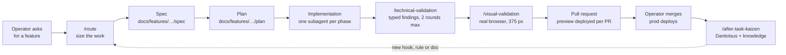

# How it is built

One person runs this repository. Claude Code agents write almost all of the code, several at once, each in its own cloud sandbox. This page explains the system that lets them ship without hand-holding, and where each piece lives.

## The loop

1. **Size first.** `/route` sizes a request on five axes (blast radius, open decisions, precedent, reversibility, proof) and picks one of four tiers, from "just edit it" to a fanned-out workflow.
2. **Name the shape, then write.** A non-trivial feature gets a spec and a plan under `docs/features/<app>/<slug>/` before any code. A decision that matches a trigger becomes an [ADR](./adr/README.md).
3. **Fresh eyes at every phase.** The main session orchestrates. It hands each phase and each fix round to a new subagent with one brief, so no reviewer is anchored on the author's reasoning.
4. **Validate twice.** A technical validator reads only the spec, the plan and the diff. A visual validator drives the running app in a real browser and checks each visible claim of the spec.
5. **The preview is the review.** Each pull request deploys its own copy of the changed apps at `<app>-pr-<n>.preview.borso.fr`, with its own database schema. The operator validates there, then merges.
6. **Learn from every merge.** After a merge, a kaizen session reads the friction log the agents kept and writes one root-cause analysis per real defect and one knowledge entry per surprise.

## Lessons become structure

A lesson written as a sentence gets forgotten. A lesson written as a gate does not. So the repository turns each lesson into the cheapest thing that enforces it.

| Layer | What it holds | Where |
| --- | --- | --- |
| Lint rules | 50 project rules, each with its own tests, such as no `useEffect`, no type assertion, no SQL outside a repository, no French identifiers | `eslint-rules/`, run by oxlint |
| Shell gates | 24 repository checks, such as "every ADR number resolves" and "a dated record is append-only" | `scripts/check-*.sh`, run by the git hooks and CI |
| Agent hooks | 25 Claude Code hooks that stop a known mistake before it happens, such as a merge that would deploy prod or a push that swallows its error | `.claude/hooks/` |
| Knowledge triggers | A hook prints the knowledge entry that applies when a command matches it, before the agent repeats an old mistake | `docs/knowledge/`, `scripts/knowledge-triggers.py` |
| Blueprints | Canonical code examples, marked in the code, indexed, and cited by new files with `@FollowsBlueprint` | `.claude/skills/blueprint/` |
| Standards | Fifteen documents, each naming what enforces it | `docs/standards/` |

The written record is large because it is the memory of agents that start each session with none.

| Record | Count (measured on 2026-11-12) |
| --- | --- |
| Architecture decisions | 61 |
| Root-cause analyses (Dantotsus) | 296 |
| Knowledge entries | 146 |
| Feature folders (spec, plan, validation, friction) | 144 |

## Quality bar

- **Pure code is held at 100% coverage per file**, and the changed pure files go through mutation testing (Stryker) before a push.
- **Every page works at 375 px wide.** The visual validator checks it on a phone-sized viewport.
- **No visible string is hard-coded.** Text goes through i18next, in English and French.
- **Every app reports to Sentry**, with traces at full sample rate and source maps.

## The skills

The agents follow skills, plain markdown files in `.claude/skills/`:

| Skill | What it does |
| --- | --- |
| `/route` | Sizes a task and picks how much process it deserves |
| `/specification` | Drafts a spec that surfaces disagreements before code exists |
| `/technical-conception` | Turns a spec into a plan, with risks and pre-flight gates |
| `/implementation` | Writes the plan's code under the standards and blueprints |
| `/technical-validation` | One review agent, typed blocking and non-blocking findings |
| `/visual-validation` | One browser agent, one check per visible claim of the spec |
| `/open-pr` | Writes a pull request that fits a fixed budget |
| `/adr` | Records a decision with its options and criteria |
| `/dantotsu` | Writes a root-cause analysis of a defect |
| `/after-task-kaizen` | Sweeps a merged task into Dantotsus and knowledge |
| `/tech-lead-orchestrator` | Chains the above from "I want X" to a pull request |

The operator's instructions to every agent are in [`CLAUDE.md`](../CLAUDE.md).
